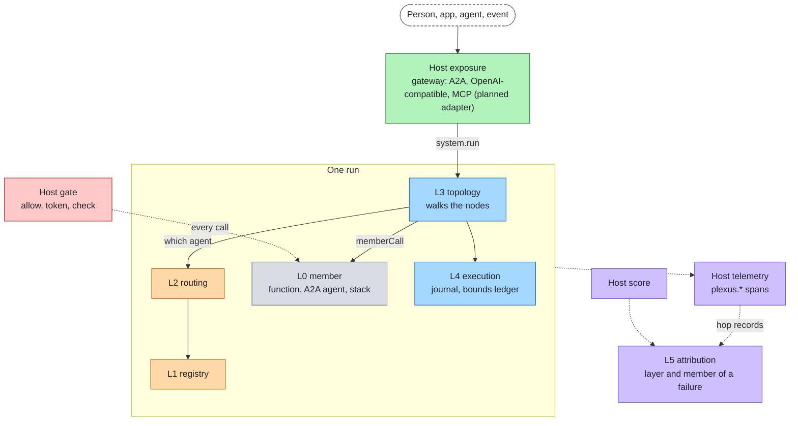

# agent-plexus

agent-plexus composes agents into a multi-agent system. It owns the six layers that lie between agents: how an agent
is called, which agents exist, which one handles a request, how work flows, how a long run survives, and which agent
caused a failure.

It does not implement what an agent stack already has. Identity, policy, content checks, telemetry, scoring and
network exposure come from a host through four hooks; [agent-layers](https://github.com/aantenore/agent-layers) is the
reference host, through one adapter (planned). The core defines a port for each layer; adapters map a framework, a
protocol or a technology onto a port; a system config picks one adapter per port, per profile. The core depends on
nothing and runs offline with prototype defaults for the hooks.

Status: slice 1 is implemented (core, CLI, six reference adapters, an offline example). Everything else is marked
planned where it appears.

- **Why it exists and how it compares:** [docs/product.md](docs/product.md)
- **How it works:** [docs/architecture.md](docs/architecture.md)
- **The layers on one page:** [docs/stack.md](docs/stack.md)
- **Every diagram, and the colour conventions:** [docs/diagrams.md](docs/diagrams.md)
- **Start a system, write a member, write an adapter, go to production:** [docs/guide.md](docs/guide.md)
- **Adapters, status and maturity:** [docs/adapters.md](docs/adapters.md)
- **Every limit, its default and safe range:** [docs/limits.md](docs/limits.md)
- **Threat model between agents:** [docs/cross-cutting/security.md](docs/cross-cutting/security.md)
- **Decisions and open decisions:** [docs/decisions/](docs/decisions/README.md)
- **The language-neutral spec:** [spec/](spec/README.md)
- **The language (shapes, vocabularies, `ext`, stop codes, topology):** [spec/language.md](spec/language.md)
- **The host hooks:** [spec/hooks.md](spec/hooks.md)

## Principle

**Between agents only; the host owns control and insight.** Ports are designed from what a developer composing agents
needs to call. The data that crosses a port is written in one small language ([spec/language.md](spec/language.md)),
whose values equal agent-layers' where the concept is the same. Frameworks and protocols appear only as adapters,
which translate at the edges. Every member call goes through one core pipeline, `memberCall`; a topology cannot reach
a member any other way. A new technology is an adapter plus its tests, never a core change.

## The six layers

| Plane | L | Layer (id) | The question it answers |
|---|---|---|---|
| Member | L0 | Members (`member`) | Who does the work, and how is it called? |
| Discovery | L1 | Registry (`registry`) | Which agents exist, what can they do, can their cards be trusted? |
| Discovery | L2 | Routing (`routing`) | Which agent should handle this request? |
| Flow | L3 | Topology (`topology`) | In what order and shape does work flow between agents? |
| Flow | L4 | Execution (`execution`) | Does a long run survive a restart, and wait for a person? |
| Insight | L5 | Attribution (`attribution`) | When the system fails, which agent and which layer caused it? |

Host hooks, not layers: `gate` (allow, token, check), `telemetry`, `score`, `state`. See
[spec/hooks.md](spec/hooks.md). Ports per layer, reference adapters and the request flow are in
[docs/stack.md](docs/stack.md).

## Request through the system

A host starts a run and passes the verified caller. The topology walks its nodes; every member call is gated by the
host, journaled, bounded and recorded. A failed run is attributed to a layer and a member from its hop records.



## Quickstart

Requirements: Node >= 22.18. No network, no model and no agent runtime are needed.

```bash
git clone https://github.com/aantenore/agent-plexus && cd agent-plexus
npm install

node --conditions=@agent-plexus/source packages/cli/src/cli.ts check --config examples/offline/plexus.json
node --conditions=@agent-plexus/source packages/cli/src/cli.ts run --config examples/offline/plexus.json "I need a refund for my last invoice"
node --conditions=@agent-plexus/source packages/cli/src/cli.ts check --config examples/offline/plexus.json --profile production
node --conditions=@agent-plexus/source packages/cli/src/cli.ts eval --config examples/offline/plexus.json examples/offline/cases.json
```

| Command | Result |
|---|---|
| `check` | The prototype config passes (exit 0). |
| `run` | The billing answer on stdout, one line per hop on stderr (`triage completed`, `billing completed`). |
| `check --profile production` | Exit 1: two FAIL, the prototype host and the prototype-only `memory-execution`. |
| `eval` | Two cases pass; the crash case fails and is attributed to layer `member`, member `billing` (exit 1). |

`dev` runs each typed line as one run. The commands, options and exit codes are in [docs/guide.md](docs/guide.md#cli).
The example is described in [examples/offline](examples/offline/README.md).

## Layout

```
spec/            language-neutral contracts: language.md, hooks.md, ports/ (JSON schemas are planned)
packages/core    @agent-plexus/core: ports, host hooks, memberCall, assemble, system config, limits (zero dependencies)
packages/cli     @agent-plexus/cli: check, run, dev, eval
adapters/<name>  @agent-plexus/adapter-<name>: one package per framework, protocol or technology
examples/        sample systems (offline)
docs/            product, architecture, stack, guide, adapters, limits, layers/<id>.md, cross-cutting/, decisions/, research/, proposals/
```

## Development

```bash
npm install                                          # workspaces, dev dependencies only
npm run typecheck -w @agent-plexus/core              # typecheck one package
npm test -w @agent-plexus/core                       # tests of one package
npm test -w @agent-plexus/adapter-skill-router       # tests of one adapter
```

Contributions: [CONTRIBUTING.md](CONTRIBUTING.md). Core paths need a spec change first. Vulnerabilities: report them
privately, see [SECURITY.md](SECURITY.md).

## Licenses of the reference technologies

This repository is MIT. Reference technologies are used through adapters, never vendored. Nothing below is a
dependency yet: slice 1 has none.

| Component | License | Layer (id) |
|---|---|---|
| A2A SDK (JavaScript) | Apache-2.0 | member (planned) |
| agent-layers | MIT | host, member, runtime (planned adapter) |
| DBOS | MIT | execution (planned) |
| Temporal | MIT | execution (planned) |
| AGNTCY Agent Directory | Apache-2.0 | registry (planned) |

All of the above are OSI-approved licenses. Technologies with licenses that are not OSI-approved are not used as
references; see [docs/research/landscape.md](docs/research/landscape.md).

## License

MIT. See [LICENSE](LICENSE).
