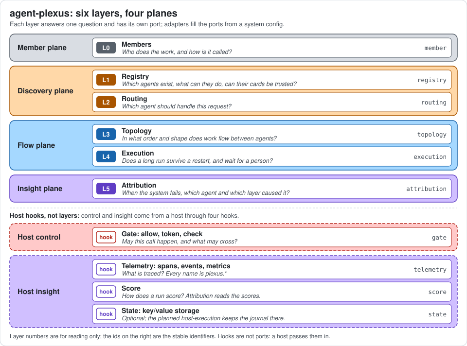
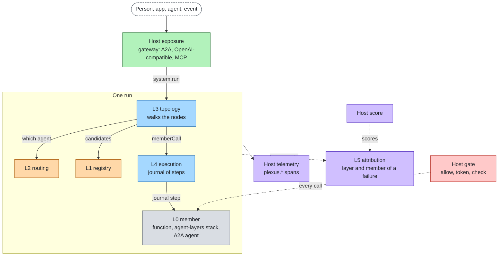

# agent-plexus

**Compose agents from any framework into one bounded, debuggable multi-agent system.**

[](https://www.npmjs.com/package/@agent-plexus/core)
[](LICENSE)
[](package.json)

- **Any agent is a member, and the limits travel with every call.** A function, an agent-layers stack or any agent
  reachable over A2A joins one system through `plexus.json`; the deadline, the budget and the hop limit go along with
  each member call, across frameworks and over the wire.
- **`eval` names the culprit.** A failed case is attributed to a member and a layer from the hop record of the run,
  not left to a reading of logs.
- **The host keeps control.** Identity, policy, telemetry and scoring come from the host through four hooks; the core
  has zero dependencies and runs offline with prototype defaults.

## Use from npm

Requirements: Node >= 22.18. No network, no model and no agent runtime are needed.

```bash
npm install --save-dev @agent-plexus/cli @agent-plexus/core @agent-plexus/adapters
npx agent-plexus init                                          # starter: plexus.json, members/, cases.json
npx agent-plexus check
npx agent-plexus run "I need a refund for my last invoice"
npx agent-plexus eval cases.json
```

`init` writes the offline example into the folder and sets `"type": "module"` in `package.json`: the members are `.ts`
ES modules that Node runs as they are. `check` passes; `run` prints the billing answer, with one line per hop on
stderr; `eval` passes two cases and attributes the crash case to member `billing` (exit 1). Error messages and their
fixes: [docs/guide.md#troubleshooting](docs/guide.md#troubleshooting).

**Why not LangGraph, Mastra or Microsoft Agent Framework?** They orchestrate agents of their own kind and own the
loop; across frameworks they meet over A2A without a shared deadline, budget or hop limit. agent-plexus sits between
agents: an agent built with any of them is a member, every call is bounded the same way, and a failure is attributed
to a member and a layer. Pick one of them when every agent is written in it; the named comparison is in
[docs/product.md](docs/product.md#how-it-compares).

## What it is

agent-plexus composes agents into a multi-agent system. It owns the six layers that lie between agents: how an agent
is called, which agents exist, which one handles a request, how work flows, how a long run survives, and which agent
caused a failure.

It does not implement what an agent stack already has. Identity, policy, content checks, telemetry, scoring and
network exposure come from a host through four hooks; [agent-layers](https://github.com/aantenore/agent-layers) is the
reference host, through one adapter. The core defines a port for each layer; adapters map a framework, a
protocol or a technology onto a port; a system config picks one adapter per port, per profile. The core depends on
nothing and runs offline with prototype defaults for the hooks.

Status: implemented are the core, the CLI, the reference adapters in one package (`@agent-plexus/adapters`: eight
adapters such as `a2a-member` and `sqlite-execution`, one subpath each, and the `agent-layers` host and member under one
more) and two examples (`offline`, `swap`). Planned work is listed in [docs/adapters.md](docs/adapters.md#planned);
technologies without scheduled work are marked candidate.

- **Why it exists and how it compares:** [docs/product.md](docs/product.md)
- **How it works:** [docs/architecture.md](docs/architecture.md)
- **The layers on one page:** [docs/stack.md](docs/stack.md)
- **Every diagram, and the colour conventions:** [docs/diagrams.md](docs/diagrams.md)
- **Start a system, write a member, write an adapter, go to production:** [docs/guide.md](docs/guide.md)
- **Adapters, status and maturity:** [docs/adapters.md](docs/adapters.md)
- **Every limit, its default and safe range:** [docs/limits.md](docs/limits.md)
- **Threat model between agents:** [docs/cross-cutting/security.md](docs/cross-cutting/security.md)
- **Decisions and open decisions:** [docs/decisions/](docs/decisions/README.md)
- **The language-neutral spec:** [spec/](spec/README.md)
- **The language (shapes, vocabularies, `ext`, stop codes, topology):** [spec/language.md](spec/language.md)
- **The host hooks:** [spec/hooks.md](spec/hooks.md)



## Principle

**Between agents only; the host owns control and insight.** Ports are designed from what a developer composing agents
needs to call. The data that crosses a port is written in one small language ([spec/language.md](spec/language.md)),
whose values equal agent-layers' where the concept is the same. Frameworks and protocols appear only as adapters,
which translate at the edges. Every member call goes through one core pipeline, `memberCall`; a topology cannot reach
a member any other way. A new technology is an adapter plus its tests, never a core change.

## The six layers

| Plane | L | Layer (id) | The question it answers |
|---|---|---|---|
| Member | L0 | Members (`member`) | Who does the work, and how is it called? |
| Discovery | L1 | Registry (`registry`) | Which agents exist, what can they do, can their cards be trusted? |
| Discovery | L2 | Routing (`routing`) | Which agent should handle this request? |
| Flow | L3 | Topology (`topology`) | In what order and shape does work flow between agents? |
| Flow | L4 | Execution (`execution`) | Does a long run survive a restart, and wait for a person? |
| Insight | L5 | Attribution (`attribution`) | When the system fails, which agent and which layer caused it? |

Host hooks, not layers: `gate` (allow, token, check), `telemetry`, `score`, `state`. See
[spec/hooks.md](spec/hooks.md). Ports per layer, reference adapters and the request flow are in
[docs/stack.md](docs/stack.md).

## Request through the system

A host starts a run and passes the verified caller. The topology walks its nodes; every member call is gated by the
host, journaled, bounded and recorded. A failed run is attributed to a layer and a member from its hop records.



## Quickstart from a clone

The same example, run against the sources of the repository:

```bash
git clone https://github.com/aantenore/agent-plexus && cd agent-plexus
npm install

node --conditions=@agent-plexus/source packages/cli/src/cli.ts check --config examples/offline/plexus.json
node --conditions=@agent-plexus/source packages/cli/src/cli.ts run --config examples/offline/plexus.json "I need a refund for my last invoice"
node --conditions=@agent-plexus/source packages/cli/src/cli.ts check --config examples/offline/plexus.json --profile production
node --conditions=@agent-plexus/source packages/cli/src/cli.ts eval --config examples/offline/plexus.json examples/offline/cases.json
```

| Command | Result |
|---|---|
| `check` | The prototype config passes (exit 0). |
| `run` | The billing answer on stdout, one line per hop on stderr (`triage completed`, `billing completed`). |
| `check --profile production` | Exit 1: two FAIL, the prototype host and the prototype-only `memory-execution`. |
| `eval` | Two cases pass; the crash case fails and is attributed to layer `member`, member `billing` (exit 1). |

`dev` runs each typed line as one run. The commands, options and exit codes are in [docs/guide.md](docs/guide.md#cli).
The example is described in [examples/offline](examples/offline/README.md).

[examples/swap](examples/swap/README.md) runs the same system with each layer replaced in config only: one profile per
alternative, an adapter of the example loaded by path or another published adapter, with the same routes, the same answers
and the same member for the crash case. Its README has the table of profiles; `npm run swap:matrix` runs them all. One
profile, with registry, routing, topology, execution, attribution, the `billing` member and the host swapped together
(two cases pass; the crash case fails and is attributed to member `billing`, exit 1):

```bash
node --conditions=@agent-plexus/source packages/cli/src/cli.ts eval --config examples/swap/plexus.json --profile swap-all examples/swap/cases.json
```

## Layout

```
spec/            language-neutral contracts: language.md, hooks.md, ports/ (JSON schemas are planned)
packages/core    @agent-plexus/core: ports, host hooks, memberCall, assemble, system config, limits (zero dependencies)
packages/cli     @agent-plexus/cli: init, check, run, resume, cancel, dev, eval
packages/conformance  @agent-plexus/conformance: contract tests a port adapter runs in its own tests
packages/adapters  @agent-plexus/adapters: the reference adapters, one subpath export each (@agent-plexus/adapters/<name>)
examples/        sample systems: offline (reference adapters), swap (each layer replaced by one config value)
docs/            product, architecture, stack, guide, adapters, limits, layers/<id>.md, cross-cutting/, decisions/, research/, proposals/
```

## Development

```bash
npm install                                          # workspaces, dev dependencies only
npm run typecheck -w @agent-plexus/core              # typecheck one package
npm test -w @agent-plexus/core                       # tests of one package
npm test -w @agent-plexus/adapters                   # tests of every adapter
npm run test:packages                                # tests of every workspace against the sources
node --conditions=@agent-plexus/source --test "packages/adapters/test/skill-router/*.test.ts"   # one adapter
```

Contributions: [CONTRIBUTING.md](CONTRIBUTING.md). Core paths need a spec change first. Releases:
[RELEASING.md](RELEASING.md). Vulnerabilities: report them privately, see [SECURITY.md](SECURITY.md).

## Ecosystem

The family: [reinloop](https://github.com/aantenore/reinloop) is the runtime of one agent (agents as files, budgets,
approvals, durable resume, OpenTelemetry, zero dependencies); [agent-layers](https://github.com/aantenore/agent-layers)
is the eleven-layer SDK around an agent, where reinloop is one runtime adapter; agent-plexus composes agents into a
multi-agent system, with an agent-layers stack as the host; [Lorebase](https://github.com/aantenore/lorebase) is the
governed, versioned knowledge graph agents read over MCP. Each one is used on its own; together they cover one agent,
its controls, the system around it and what it knows.

## Licenses of the reference technologies

This repository is MIT. Reference technologies are used through adapters, never vendored. A technology is a dependency
only of the adapter that maps it: the core and the other adapters have none.

| Component | License | Layer (id) |
|---|---|---|
| A2A SDK for JavaScript (`@a2a-js/sdk`) | Apache-2.0 | member (adapter `a2a-member`, client side) |
| jose | MIT | member (`a2a-member`, through the SDK: card signature check) |
| A2A protocol 1.0 and 0.3 | Apache-2.0 | member (`a2a-member`, JSON-RPC binding) |
| agent-layers | MIT | host, member, runtime plugin (adapter `agent-layers`, depends on `@agent-layers/core`) |
| DBOS | MIT | execution (candidate) |
| Temporal | MIT | execution (candidate) |
| AGNTCY Agent Directory | Apache-2.0 | registry (candidate) |

All of the above are OSI-approved licenses. Technologies with licenses that are not OSI-approved are not used as
references; see [docs/research/landscape.md](docs/research/landscape.md).

## License

MIT. See [LICENSE](LICENSE).
