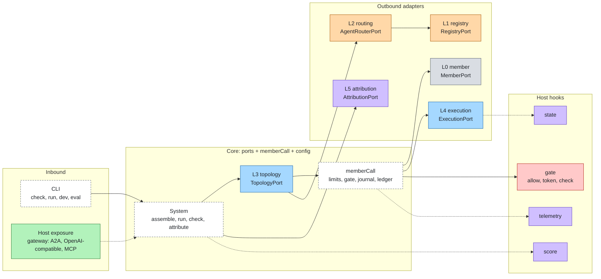
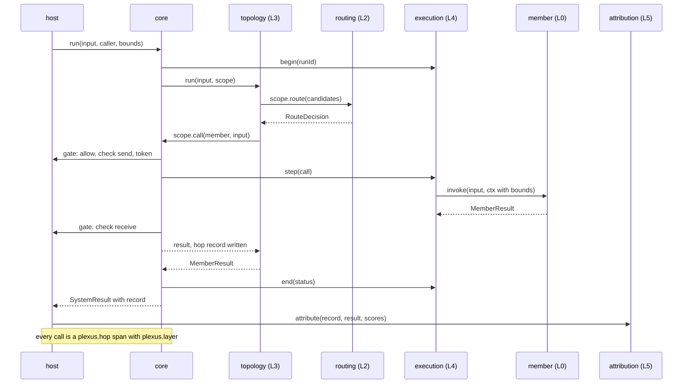

# Architecture

agent-plexus composes agents into a multi-agent system. It owns the six layers between agents and nothing else. The
core defines **ports**, one per layer; **adapters** map a framework, a protocol or a technology onto a port; a
**system config** says which adapter fills each port, per **profile**; the **`memberCall` pipeline** is the single way
to reach a member. Control and insight come from a **host** through four hooks.

> The core never implements a control or insight layer. It calls the host's hooks; adapters map frameworks and protocols onto ports.

## The six layers

Each layer answers one question. Layers have stable ids; the numbers are presentation only. All six live between
agents; none of them exists inside a single agent stack.

| Plane | L | Layer (id) | The question it answers | Port |
|---|---|---|---|---|
| Member | L0 | Members (`member`) | Who does the work, and how is it called? | MemberPort |
| Discovery | L1 | Registry (`registry`) | Which agents exist, what can they do, can their cards be trusted? | RegistryPort |
| Discovery | L2 | Routing (`routing`) | Which agent should handle this request? | AgentRouterPort |
| Flow | L3 | Topology (`topology`) | In what order and shape does work flow between agents? | TopologyPort |
| Flow | L4 | Execution (`execution`) | Does a long run survive a restart, and wait for a person? | ExecutionPort |
| Insight | L5 | Attribution (`attribution`) | When the system fails, which agent and which layer caused it? | AttributionPort |

Boundary rules:

- How one agent is reached is `member`; choosing it is `routing`; the order of calls is `topology`; surviving restarts
  is `execution`.
- Whether a call may happen, what may cross, what is traced and how a run scores belong to the host.
- AgentRouterPort picks an agent. It is not agent-layers' RouterPort, which picks a model.

## Hexagonal model



- **Ports** are owner-defined, thin and versioned (`PORT_VERSIONS`, one version per port, all `0.1.0`). They are
  designed from what a developer composing agents calls, not from a protocol.
- **One language.** The data that crosses a port is written in a small language owned by this project (`RunContext`,
  `MemberResult`, `TopologySpec`, `AgentEntry`, `HopRecord`, `Attribution`). Values that mean the same as in
  agent-layers (run status, stop codes) are equal by choice. See [spec/language.md](../spec/language.md).
- **Escape hatches.** Data a shape does not cover goes in `ext`, namespaced keys that the core copies and never reads.
  Operations a port does not cover stay reachable through `native()` where a port offers it (MemberPort).
- **Outbound adapters** consume something as a port: a function as a MemberPort, a rule list as an AgentRouterPort.
  An agent-layers stack is also a MemberPort (adapter `agent-layers`), and so is an agent served over A2A (adapter
  `a2a-member`). Planned: a database as an ExecutionPort.
- **Inbound** is the CLI. Network exposure is the host's: the agent-layers gateway serves a system over A2A,
  OpenAI-compatible and MCP when the runtime plugin `agent-plexus` of the agent-layers adapter is loaded through the
  `plugins` of the agent-layers config (`@agent-plexus/adapter-agent-layers/runtime`).
- An adapter package is named after what it maps (`@agent-plexus/adapter-function-member`) and exports an `adapters`
  array of descriptors; one package may fill several ports.

## The memberCall pipeline

The core's own logic, and the only way to reach a member. A topology receives it as `scope.call`.

| # | Step | Who decides | On failure |
|---|---|---|---|
| 1 | System limits and received bounds: abort, less than `limits.system.minRemainingMs` left, hops, steps, back-and-forth; reserve budget | core | `stopped`: `aborted`, `timeout`, `hop_limit`, `limit` |
| 2 | May this caller invoke this member | host `gate.allow` | `stopped`, `denied`; `ask` gives `waiting`, `needs_input`; a throwing hook is a `denied` |
| 3 | Check what is sent (text only; `parts` are dropped and `plexus.parts.dropped` is emitted) | host `gate.check`, `send` | `stopped`, `guard_block`, layer `host`, stage `send`; `redact` replaces the text |
| 4 | Credential for the member's audience, on behalf of the caller | host `gate.token` | `stopped`, `needs_auth`; asked only for a member with an `audience`, and a production host that returns none is `needs_auth`; the caller's own credential is never forwarded |
| 5 | Call, as a journal step, with outbound bounds (time left minus `limits.system.marginMs`) and lineage, capped by `stepTimeoutMs` and the time left | MemberPort `invoke` inside ExecutionPort `step` | The member's result, or `failed` / `timeout` / `aborted` from the call |
| 6 | Check what comes back, on completed results only: data for the next member, never instructions | host `gate.check`, `receive` | `stopped`, `guard_block`, layer `host`, stage `receive` |
| 7 | Settle the reservation; write the hop record; span `plexus.hop`, metric `plexus.hops` | core, host `telemetry` | |

Refusals and failures are results, never exceptions, and every call writes a hop record. An unknown member, a member
that throws and a result with an unknown status are `failed` with code `error`. An unreadable host verdict is a block.

## Host hooks

A host is passed to `assemble(config, { host })`, or built by a configured `host` adapter. Four hooks, each small,
each with a prototype default that the readiness gate refuses on a production tier.

| Hook | Operations | Prototype default | Production |
|---|---|---|---|
| `gate` | `allow`, `token`, `check` | Allow every call, no token, no check | Required; errors are a deny |
| `telemetry` | `span`, `event`, `metric` | One line per hop on stderr | Required |
| `score` | `score(case, result)` | `expected` checks only | Optional |
| `state` | `get`, `set`, `delete` | None | Optional; for the planned `host-execution` adapter. The `agent-layers` host provides none |

The reference is [spec/hooks.md](../spec/hooks.md). The `agent-layers` adapter builds a host from a stack: `gate` from
its AuthorizationPort, ApprovalPort, CredentialPort and GuardPorts, `telemetry` from its TelemetryPort, `score` from its
EvaluatorPorts. It provides no `state`: agent-layers' StatePort is an append-only event log per session, not a key/value
store. Another host is another adapter of the same four hooks.

## Prototype defaults and readiness

`"host": null` (or no `host`) uses the prototype host. `check` applies the readiness gate; the findings are `FAIL`
(exit 1) or `WARN`.

| Where | Finding | Severity |
|---|---|---|
| Any tier | A topology that names an unknown member or router, a kind the topology adapter does not run, a graph node that does not exist, a graph end that no edge reaches | FAIL |
| Any tier | A topology that cannot be bound, a member that cannot describe itself | FAIL |
| Any tier | `registry.requireSigned` and a member with neither a signed card nor a pinned endpoint | FAIL |
| Production | The host is a prototype host | FAIL |
| Production | An adapter that is not tiered for production | FAIL |
| Production | A system or adapter limit set to `"unbounded"` where the limit says so | FAIL or WARN per limit; see [limits.md](limits.md) |
| Production | A limit outside its safe range | WARN |

Findings are described by path (`$.host`, `$.ports.execution`, `$.topology`). Load errors (invalid config, an adapter
that is not installed) are FAIL findings too.

## Profiles: same system from prototype to production

A config defines `profiles` that overlay the base config; `--profile <name>` applies one. The overlay merges objects,
replaces arrays and removes a key set to `null`. An object that names a different `adapter` or `kind` replaces the base
one, because options belong to the adapter. The tier is `prototype` unless the config or profile sets `tier`.

```json
{
  "profiles": {
    "prototype": { "host": null },
    "production": { "tier": "production", "registry": { "requireSigned": true } }
  }
}
```

Members, topology and tests do not change between profiles; the host and the adapters do.

## Data flow of one run



## Extension rules

1. A new technology is an adapter plus its tests, never a core change.
2. A core change starts with a spec change: the port page in `spec/ports/` and the version in `PORT_VERSIONS`.
3. Adapters depend only on `@agent-plexus/core` (peer). Conformance suites per port are planned.
4. Framework and protocol names appear only in adapter packages. The core speaks one language and names no framework or
   protocol, not even in comments.
5. Extra data goes in `ext`, never in a new field: keys are `<adapter>.<name>`; the core never reads an adapter key.
6. Limits are declared once with `defineLimits` and set by configuration, never a literal in the code.

## Naming

| Thing | Convention | Example |
|---|---|---|
| Layer id | stable lowercase word | `topology` |
| Port | `<Name>Port` | `TopologyPort`, `AgentRouterPort` |
| Adapter package | `@agent-plexus/adapter-<framework, protocol or technology>` | `@agent-plexus/adapter-skill-router` |
| Adapter name in config | the package suffix, or a module path starting with `.` or `/` (`#<name>` picks a descriptor) | `"adapter": "skill-router"` |
| Member id | key under `members` in the config | `billing` |
| Port slot | key under `ports` | `registry`, `router`, `topology`, `execution`, `attribution` |
| Node path | `root`, then `.steps[i]`, `.branches[i]`, `.merge`, `.fallback`, `.body#<n>` | `root.steps[1]` |
| Telemetry name | `plexus.*` | `plexus.hop` |
