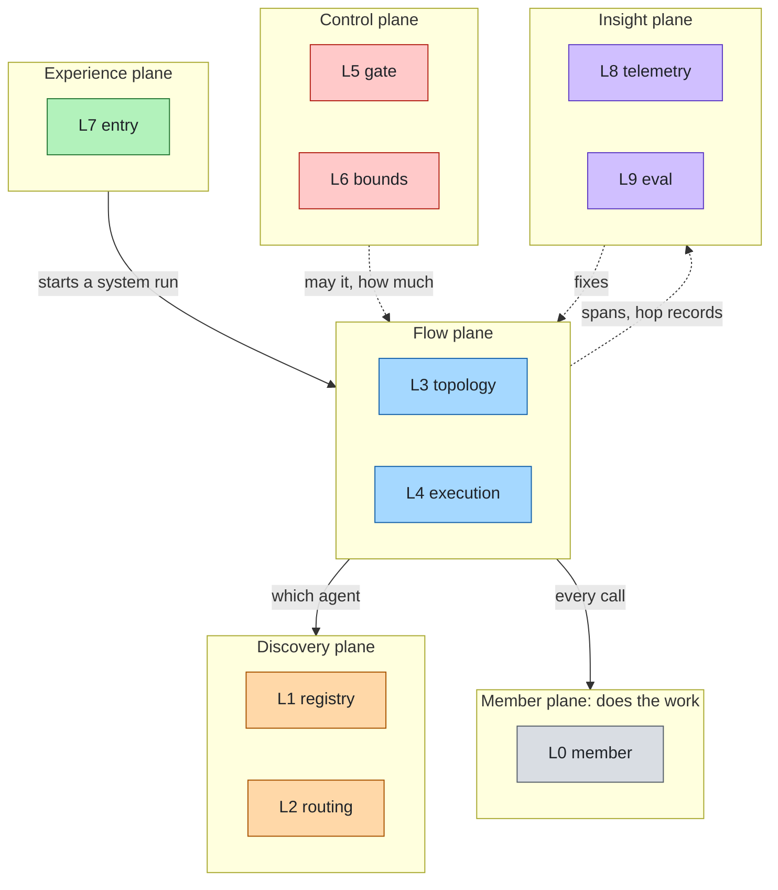
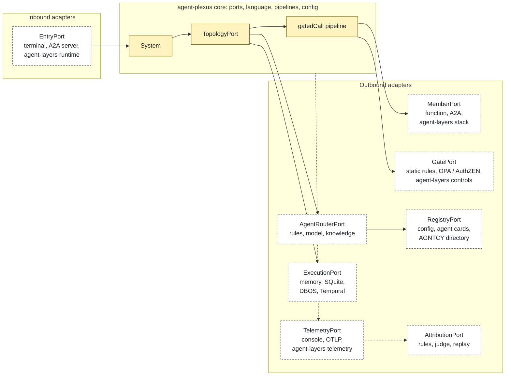
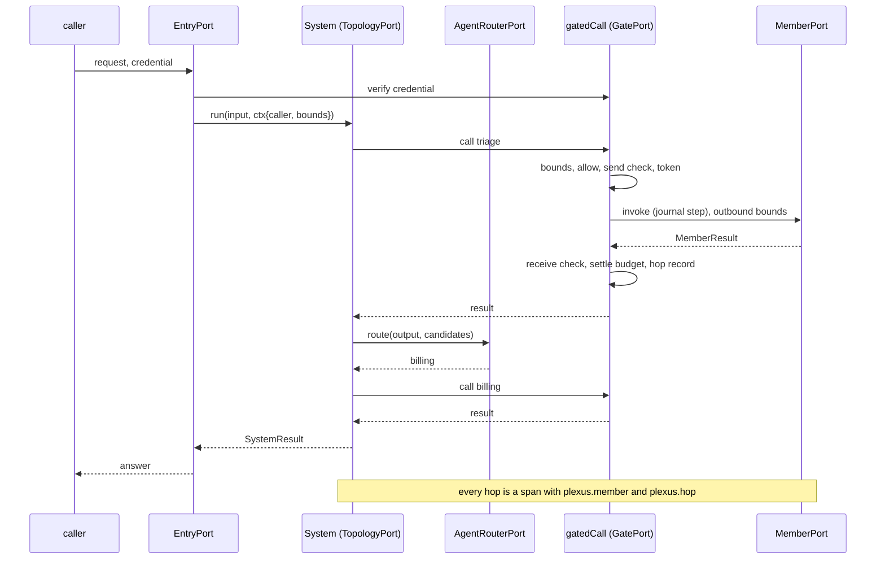

# Design

Status: Draft · Date: 2026-11-01 · Decided by: project owner (open decisions at the end)

agent-plexus composes agents into a multi-agent system. It owns its ports, its language and its pipelines, and
implements none of the agents or the controls around them: adapters do. agent-layers is one of those adapters, the
way reinloop is an adapter of agent-layers: the agent-plexus core never names it, and a system can run without it
([research/landscape.md](research/landscape.md) lists what else exists).

## Purpose

A team that runs several agents needs answers no framework gives across stacks, languages and vendors. agent-plexus
names them as ten layers, the way agent-layers names the eleven layers of one agent: each layer answers one question
and has its ports; layers have stable ids, the numbers are for reading only.

| Plane | L | Layer (id) | The question it answers | Ports |
|---|---|---|---|---|
| Member | L0 | Members (`member`) | Who does the work, and how is it called? | MemberPort |
| Discovery | L1 | Registry (`registry`) | Which agents exist, what can they do, can their cards be trusted? | RegistryPort |
| Discovery | L2 | Routing (`routing`) | Which agent should handle this request? | AgentRouterPort |
| Flow | L3 | Topology (`topology`) | In what order and shape does work flow between agents? | TopologyPort |
| Flow | L4 | Execution (`execution`) | Does a long run survive a restart, and wait for a person? | ExecutionPort |
| Control | L5 | Gate (`gate`) | May this call happen, with which credential, is what crosses acceptable? | GatePort |
| Control | L6 | Bounds (`bounds`) | How long, how much and how deep may the work go? | LedgerPort |
| Experience | L7 | Entries (`entry`) | Who reaches the system, and how? | EntryPort |
| Insight | L8 | Telemetry (`telemetry`) | What happened? | TelemetryPort |
| Insight | L9 | Evaluation & attribution (`eval`) | Was it good, and if not, which agent and which layer failed? | EvaluatorPort, AttributionPort |

Boundary rules: how one agent is reached is `member`; who may reach it and what may cross is `gate`; how much may be
spent is `bounds`. Choosing an agent is `routing`; the order of calls is `topology`; surviving restarts is `execution`.



Plane colours reuse the agent-layers palette: control red, experience green, insight purple; the member plane takes
the foundation grey, discovery the model orange, flow the agent blue.

Promises:

- **Independent.** The core depends on nothing. agent-layers, A2A SDKs, durable engines and telemetry backends are
  adapters; each one can be replaced by changing one line of config.
- **Any agent is a member.** An agent served over A2A (LangGraph, CrewAI, ADK, Microsoft Agent Framework, Strands,
  Pydantic AI), an agent-layers stack, a function in process, another agent-plexus system.
- **One enforcement path.** Every member call goes through one core pipeline, `gatedCall`: bounds, authorization,
  approval, content checks, a credential for the member's audience, telemetry, hop record. Adapters give decisions;
  they cannot skip the pipeline.
- **Bounded by construction.** Deadline, budget and hop count shrink at every hop, and the system adds step, fan-out,
  loop and handoff limits. Every limit is configurable and checked by the readiness gate.
- **Failures land on an agent.** Each system run keeps a hop record; attribution names the member, then the layer or
  step inside it when the member reports one, with a confidence.
- **A system is an agent.** EntryPort adapters expose it like any agent, so systems nest.
- **Same system from prototype to production.** Profiles, tiers, a readiness gate.

## Non-goals

- Not an agent runtime or framework: the loop of each agent belongs to the agent.
- Not a protocol: A2A is the wire; agent-plexus defines only an A2A extension for bounds and lineage.
- Not an identity provider, a policy engine, a registry service, a workflow engine or an observability backend: it
  composes them through adapters.
- Not part of agent-layers, and not dependent on it.
- No visual builder, no hosted control plane.

## Hexagonal model



Yellow is the agent-plexus core; dashed boxes are adapters, each with a zero-dependency reference and candidates.

## The same pattern as agent-layers, one level up

The two projects share a pattern, not code: own ports, one owned language, standards and technologies only in
adapters, profiles and a readiness gate.

| agent-layers | agent-plexus |
|---|---|
| A layer of one agent | A member: one whole agent |
| reinloop is an adapter of RuntimePort; the core never names it | agent-layers is an adapter of MemberPort, GatePort, TelemetryPort, ExecutionPort and EntryPort; the core never names it |
| `governedTools`: policy → approval → authorization → guards → credentials → call | `gatedCall`: bounds → authorization → approval → send check → credential → call → receive check → hop record |
| `AgentSpec` bound by `RuntimePort.bind` | `TopologySpec` bound by `TopologyPort.bind` |
| `compose(config)` → `Stack` | `assemble(config)` → `System` |
| Eleven layers in six planes, one question each | Ten layers in six planes, one question each |
| `agent.layer` on every span | `plexus.layer` on every span; `plexus.member` and `plexus.hop` on every hop |
| Eval attributes a failure to a layer | Attribution names a plexus layer, a member when one is at fault, and the member's own layer when it reports one |

## Language

agent-plexus owns its shapes, written under the same rules as the agent-layers language by choice: fixed and minimal,
a field enters only when the core reads it or two adapters of different standards need it, camelCase, times as ISO
8601 `at` / `<x>At`, extra data in `ext` with keys `<adapter>.<name>` that the core never reads, vocabularies
extensible by config with `like`. Standards appear only in adapters. Where the concepts match agent-layers (caller,
run status, stop codes), the values are chosen so the agent-layers adapter maps them one to one, but they are defined
here.

### Caller, bounds, lineage

| Shape | Field | Type | Req | Notes |
|---|---|---|---|---|
| `Caller` | `id`, `kind` | S, `"user"` \| `"agent"` | yes | The principal. |
| | `roles`, `scopes` | [S], [S] | yes | Empty list, never absent. |
| | `actors` | [`{id, kind, name?}`] | | Agents that acted for the caller, first delegate first, verified by the GatePort adapter. |
| | `credential` | S | | In memory only; never serialised, logged or traced. |
| `Bounds` | `deadlineAt` | S | yes | Local clock. |
| | `hops`, `maxHops` | N, N | yes | Agent-to-agent calls before this run, and the most allowed. |
| | `tokens`, `costUsd` | N, N | | What may still be spent, delegated calls included. |
| `Lineage` | `rootRunId`, `parentRunId` | S, S | | Correlation across systems without a trace backend. |
| `CallContext` | `runId`, `system` | S, S | yes | |
| | `caller`, `bounds`, `lineage`, `sessionId`, `signal`, `trace` | | | `bounds` is a read view of the run's ledger; `trace` is opaque, owned by the telemetry adapter. |

Bounds rules (the same rules proposed to agent-layers for its own runs, see
[proposal](proposals/agent-layers-delegation-bounds.md)): inbound values only tighten the system's own limits; time
crosses the wire as remaining milliseconds; `hops = max(inbound, actors.length + (caller.kind == "agent" ? 1 : 0))`;
a call that would exceed `maxHops`, or start with less than `minRemainingMs`, is refused locally; budget is reserved
per outbound call and settled when it returns, so concurrent calls cannot overspend; retries consume the same
deadline and budget. They stop bugs everywhere and adversaries only as far as `actors` is verified.

### Member results

`RunInput` is `S` or `{text: S, parts?: [Part]}` (`Part` as text or media; adapters that cannot carry media drop it
and say so in their README).

| Shape | Field | Type | Req | Notes |
|---|---|---|---|---|
| `MemberResult` | `status` | `"completed"` \| `"failed"` \| `"stopped"` \| `"waiting"` | yes | Closed vocabulary. |
| | `output` | S | yes | Empty when there is none. |
| | `reason` | `{code: StopCode, layer?: S, by?: S, detail?: S}` | | Required when not `completed`. `code` is the only field consumers branch on; `layer` is the member's own name for where it stopped (an agent-layers layer id, a framework step). |
| | `runId`, `taskRef` | S, S | | The member's run id; an opaque handle to resume or cancel (an A2A task id and context). |
| | `usage`, `costUsd` | `{inputTokens, outputTokens}`, N | | As reported by the member. |
| `StopCode` | | `guard_block`, `denied`, `aborted`, `timeout`, `limit`, `hop_limit`, `needs_input`, `needs_auth`, `rejected`, `error` | | Extensible with `like`. |

### TopologySpec

A node is a member id or a nested `TopologySpec`. Every kind is bounded.

| `kind` | Fields | Meaning |
|---|---|---|
| `sequence` | `steps: [Node]` | Each step gets the previous step's output as input. |
| `parallel` | `branches: [Node]`, `join: "all" \| "first"`, `merge?: Node` | Fan out, then join; `merge` turns the branch outputs into one answer, else they are concatenated with their member ids. With `first`, the other branches are cancelled. |
| `route` | `candidates: [S] \| {skills?, tags?, attrs?}`, `router?: S`, `fallback?: Node` | The AgentRouterPort picks one candidate; none chosen runs `fallback` or stops with `rejected`. |
| `loop` | `body: Node`, `until: Condition`, `maxIterations?: N` | Repeat until the condition holds or the bound (`limits.system.maxIterations` by default) is reached (`limit`). |
| `handoff` | `start: S`, `members: [S]`, `router?: S`, `maxHandoffs?: N` | After each member answers, the router picks the next member among `members`, or ends. The next member receives the original input followed by the outputs so far, each labelled with its member. Nothing runs inside the members, so remote members work. |
| `supervise` | `supervisor: S`, `members: [S]` | The supervisor member chooses which members to call. It reaches them through the system: a MemberPort adapter that can offer tools to its agent (the agent-layers adapter adds a tool source with one tool per member) or the system's own MCP entry. Every such call goes through `gatedCall`. |
| `graph` | `nodes: {S: Node}`, `start: S`, `edges: [{from, to, when?: Condition}]`, `end: [S]` | Explicit state machine; edges are tried in order. |

Every kind also takes `name?`, `input?` (`"output"` default, or `"original"`) and `ext?`. `Condition` is declarative,
so a topology is data that can be validated, diffed and drawn:
`{status?: S | [S], code?: StopCode | [StopCode], ext?: {key: value}, matches?: S}` (`matches` is a regular
expression on the output); otherwise `fn: "<module>#<export>"`, a synchronous pure function.

### AgentEntry, routing, hop record, attribution

| Shape | Fields |
|---|---|
| `AgentEntry` | `id`, `name`, `description`, `skills: [{id, name, description, tags}]`, `endpoint: {protocol, url?, ref?}` (`protocol` is a vocabulary: `a2a`, `function`, extensible, the agent-layers adapter adds `agent-layers`), `audience?` (from config, never from a card), `attrs?` (owner, domain, data classes, cost and latency hints), `trust: {signed, keyId?, pinned}`, `version?` |
| `RouteQuestion` → `RouteDecision` | `{input, candidates: [AgentEntry], caller, bounds?}` → `{member?, ranked?: [{member, score}], reason?}`; no `member` means none fits; `reason` is internal |
| `HopRecord` | `hopId`, `parentHopId?`, `member`, `node` (topology path), `runId?`, `rootRunId`, `hops`, `startedAt`, `durationMs`, `status`, `reason?` (`code`, `layer?`, `by?`), `usage?`, `costUsd?`, `route?`, `inputRef?`, `outputRef?` (keys of texts in the execution journal, so telemetry never carries them) |
| `Attribution` | `layer` (a plexus layer id), `member?`, `memberLayer?` (the member's own name for where it failed, an agent-layers layer id for instance), `hopId?`, `confidence` in [0, 1], `evidence: [S]`, `by` |

`SystemResult` is a `MemberResult` for the whole system plus `record: [HopRecord]`, so a system is a member.

## The gatedCall pipeline

The core's own logic, the counterpart of agent-layers' `governedTools`. Every member call, whether the topology makes
it or a supervisor asks for it, runs these steps in order:

| # | Step | Port | On failure |
|---|---|---|---|
| 1 | Bounds: deadline left, hops + 1 within `maxHops`, steps within `maxSteps`; reserve budget | LedgerPort `reserve` | `stopped`: `timeout`, `hop_limit`, `limit` |
| 2 | Authorization: may this caller (with its actors) invoke this member | GatePort `allow` | `stopped`, `denied`; an error is a deny |
| 3 | Approval when the decision is `ask` | GatePort `allow` → ExecutionPort `wait` | `waiting`, `needs_input` |
| 4 | Send check on the input | GatePort `check`, stage `send` | `stopped`, `guard_block`; `redact` replaces the text |
| 5 | Credential for the member's audience, on behalf of the caller | GatePort `token` | `stopped`, `needs_auth`; never forwards the caller's own credential |
| 6 | Call with the outbound bounds, as a journal step | MemberPort `invoke` inside ExecutionPort `step` | The member's result, or `failed` / `timeout` from the transport |
| 7 | Receive check on the output, which is data for the next member, never instructions | GatePort `check`, stage `receive` | `stopped`, `guard_block` |
| 8 | Settle the budget reservation; write the hop record and the `plexus.hop` span | LedgerPort `settle`, TelemetryPort | |

Authorization and checks fail closed. A production-tier profile refuses a prototype-only GatePort adapter.

## Layers and ports

Ports are owner-defined, thin, versioned per port, one conformance suite each, `native()` for what a port does not
cover. Each has a reference implementation with no dependency, and candidates.

### L0 Members (`member`) · MemberPort

Who does the work, and how is it called?

`invoke(entry: AgentEntry, input: RunInput, ctx: MemberContext) → MemberResult`; optional `resume(entry, taskRef,
input, ctx)` and `cancel(entry, taskRef, ctx)`. `MemberContext` is the `CallContext` plus the credential from step 5
and the outbound bounds and lineage. A remote call is two journal steps: the first stores `taskRef` as soon as the
member returns it, the second waits for the end, so a restart resumes instead of sending again; on deadline or cancel
the adapter cancels the remote task.

| Implementation | License | Notes |
|---|---|---|
| `function-member` (reference) | MIT | An async function in process; for prototypes and tests. |
| `a2a-member` (reference) | MIT | A2A 1.0 JSON-RPC client: card fetched and pinned, endpoint rules (same origin or allowed, https, no private addresses unless configured, no redirects), bounds and lineage as an A2A extension, `GetTask` polling and resume, `CancelTask`. Built on the official A2A JS SDK (Apache-2.0) or on plain `fetch`: open decision 9. |
| `agent-layers` (adapter) | MIT | An agent-layers stack in process (`compose` + `RunnableAgent.run`), with plexus bounds mapped to its context; or a remote agent through its `a2a` runtime. Offers a `members` tool source to the stack's agent for `supervise`. |
| Framework agents in process (OpenAI Agents JS, ADK-TS, Strands TS, LangGraph.js) | MIT / Apache-2.0 | Candidates only when A2A is not an option; over A2A they need no adapter. |

### L1 Registry (`registry`) · RegistryPort

Which agents exist, what can they do, can their cards be trusted?

`list(filter?) → [AgentEntry]`, `get(id)`, optional `watch`. Cards are untrusted input: JWS signatures checked
against configured keys, size and count bounded, cached with a TTL; production requires signed cards or endpoints
pinned in config.

| Implementation | License | Notes |
|---|---|---|
| `static-registry` (reference) | MIT | Entries in config; card URLs fetched and verified. |
| AGNTCY Agent Directory + OASF | Apache-2.0 | Candidate: distributed directory, OASF skills vocabulary. |
| Kubernetes CRDs (kagent shape) | Apache-2.0 | Candidate for clusters. |
| AI Catalog | not versioned yet | Track. |

### L2 Routing (`routing`) · AgentRouterPort

Which agent should handle this request? Distinct from agent-layers' RouterPort, which picks a model.

`route(question) → RouteDecision`.

| Implementation | License | Notes |
|---|---|---|
| `skill-router` (reference) | MIT | Rules on skills, tags, attrs and regular expressions; deterministic. |
| `model-router` | MIT | Asks a model to choose among candidate names and descriptions, as a structured answer; an invalid answer is no choice. The model comes from an OpenAI-compatible endpoint or from the agent-layers adapter (a stack's governed model). |
| `knowledge-router` | MIT | Ranks entries with a search backend; through the agent-layers adapter any of its knowledge sources. |

### L3 Topology (`topology`) · TopologyPort

In what order and shape does work flow between agents?

`bind(system, spec) → RunnableSystem`; `run(input, ctx) → SystemResult`, optional `stream` of events
(`plexus.hop.start`, `plexus.hop.end`, `text`, `run.end`). The adapter calls members only through `gatedCall`.

| Implementation | License | Notes |
|---|---|---|
| `basic-topology` (reference) | MIT | All kinds in process; each member call is a journal step. |
| LangGraph.js, ADK-TS, Strands TS | MIT / Apache-2.0 | Candidates when a team already runs that engine; the reference stays the default. |

### L4 Execution (`execution`) · ExecutionPort

Does a long run survive a restart, and wait for a person?

`begin(runKey) → Execution`; `step(name, fn)` runs once and replays its stored result on resume; `wait(name, until)`
suspends until a signal or the deadline; `signal(runKey, name, value)`; `end()`. A run waiting for a person returns
`waiting`; the journal keeps which member, `taskRef` and context asked, and a later run with the same session and
caller resumes there.

| Implementation | License | Notes |
|---|---|---|
| `memory-execution` (reference, prototype) | MIT | Lost on restart. |
| `sqlite-execution` (reference) | MIT | Journal in SQLite through the runtime's built-in driver (Node `node:sqlite`), no dependency. |
| `agent-layers` (adapter) | MIT | Journal on a stack's StatePort. |
| DBOS, Temporal, Hatchet | MIT | Production candidates. |

### L5 Gate (`gate`) · GatePort

May this call happen, with which credential, is what crosses acceptable?

`verify(credential) → Caller` (for entries that authenticate themselves), `allow(question) → {effect: "allow" |
"deny" | "ask", reason?}` where `question` is `{caller, action: "invoke", member: AgentEntry}`, `token(caller,
audience) → credential?`, `check({stage: "send" | "receive", text, member, caller}) → {action: "allow" | "block" |
"redact", text?}`. One port with four operations, because plexus needs one decision per call, not a policy system.

| Implementation | License | Notes |
|---|---|---|
| `static-gate` (reference, prototype tier) | MIT | Tokens and rules in config, allow lists per member, regular expressions for checks. |
| `agent-layers` (adapter) | MIT | Maps the four operations to a stack's IdentityPort, AuthorizationPort and ApprovalPort, CredentialPort and GuardPort: OIDC with RFC 8693 exchange and `act`, OPA, AuthZEN, Presidio, LLM Guard come with it. |
| OPA, AuthZEN, OIDC directly | Apache-2.0 / standards | Candidates for deployments without agent-layers. |

### L6 Bounds (`bounds`) · LedgerPort

How long, how much and how deep may the work go? The rules are the core's (see the language section); the ledger is
a port because a durable run may resume in another process and its budget must follow it.
`open(runKey, bounds) → Ledger`; `reserve(amount) → reservation`, `settle(reservation, spent)`, `read() → Bounds`.
Reservations never exceed what is left; a reservation not settled before the deadline counts as spent.

| Implementation | License | Notes |
|---|---|---|
| `memory-ledger` (reference) | MIT | In process, one ledger per run. |
| `journal-ledger` (reference) | MIT | Kept in the ExecutionPort journal, so it resumes with the run. |
| Valkey, Postgres | BSD-3-Clause / PostgreSQL | Candidates for a ledger shared by several processes. |

### L7 Entries (`entry`) · EntryPort

Who reaches the system, and how?

Exposes a system as an agent. `serve(system, options)` for entries that run by themselves, `mount(system) → routes`
for a host server. Entries that authenticate callers use GatePort `verify`; inbound bounds and lineage are parsed and
tightened.

| Implementation | License | Notes |
|---|---|---|
| `terminal-entry` (reference) | MIT | Talk to the system in a terminal; one line per hop. |
| `a2a-entry` (reference) | MIT | Agent card and A2A 1.0 JSON-RPC server for the system, with the bounds extension. |
| `agent-layers` (adapter) | MIT | The system as an agent-layers runtime, so its gateway serves it over A2A, OpenAI-compatible and MCP with its own controls. |

### L8 Telemetry (`telemetry`) · TelemetryPort

What happened?

`span(name, attrs, fn)`, `event(name, attrs)`, `metric(name, value, attrs)`; secret-looking attribute keys masked;
credentials never written.

| Implementation | License | Notes |
|---|---|---|
| `console-telemetry` (reference) | MIT | One line per hop. |
| `jsonl-telemetry` (reference) | MIT | A file per run, readable by attribution. |
| OTLP | Apache-2.0 (OpenTelemetry JS) | Candidate; maps `plexus.*` to the GenAI conventions (`invoke_workflow`, `invoke_agent`) where they exist. |
| `agent-layers` (adapter) | MIT | Writes through a stack's TelemetryPort, so system and member spans share one trace. |

### L9 Evaluation & attribution (`eval`) · EvaluatorPort, AttributionPort

Was it good, and if not, which agent and which layer failed?

EvaluatorPort scores a system run against a case: `evaluate(case, result) → [Score]`, `Score {metric, value in [0,
1], layer?, reason?}`; a case may set expectations per member. AttributionPort explains a failure:
`attribute(record, result, scores, ctx) → [Attribution]`.

| EvaluatorPort implementation | License | Notes |
|---|---|---|
| `expected-eval` (reference) | MIT | Exact, contains and regular-expression checks on the output and per member. |
| `agent-layers` (adapter) | MIT | Any agent-layers EvaluatorPort adapter (`expected-eval`, `judge-eval`). |
| promptfoo, Inspect AI, DeepEval | MIT / MIT / Apache-2.0 | Candidates. |

| AttributionPort implementation | License | Notes |
|---|---|---|
| `rule-attribution` (reference) | MIT | Deterministic, from the record; rules below. |
| `judge-attribution` | MIT | A model reads the record (all at once, or by binary search over hops, as in Who&When); agent level only. |
| `replay-attribution` | MIT | Offline: reruns a case with one member's output replaced by a reference answer, or one member swapped, and blames the member whose replacement fixes the run (counterfactual replay, as in AgenTracer). |

Rules of `rule-attribution`, branching on `code` only. The MAST failure groups (specification, inter-agent
misalignment, verification) inform the judge prompt; the result is always a layer, as in agent-layers.

1. The earliest hop in causal order that did not complete, or failed a per-member expectation of the case, is the
   candidate. Branches the topology abandoned (`join: "first"`) are skipped.
2. A route node whose decision has no member is blamed first: layer `routing`, high confidence.
3. Otherwise:

   | Stop code | Layer | Member | Confidence |
   |---|---|---|---|
   | `hop_limit` | `topology` (or `routing` when a router chose the call) | none | high |
   | `timeout`, `limit` | `bounds` | The hop that spent the most of its share; none when the hop started with less than `minRemainingMs` (then the allotment was wrong) | medium |
   | `denied`, `needs_auth` refused by the gate, `guard_block` from the gate | `gate` | The upstream member whose output was blocked, when the block was on receive | high |
   | `guard_block` inside a member whose input was another member's output | `member` | That upstream member, `memberLayer` from the reason | medium |
   | `guard_block` otherwise, `failed`, `error` | `member` | The hop, `memberLayer` from `reason.layer` when reported | high with a layer, else medium |
   | `rejected` | `member` | The hop | low |
   | `needs_input`, `needs_auth` from the member | none: waiting is not a failure | | |

   Remote members report what their protocol carries: over A2A today every stop except a cancellation arrives as
   `rejected`, until the stop-code extension carries the code.
4. Every hop completed but the system's score fails: layer `member`, the member that produced the final output, low
   confidence; the report suggests `judge-attribution` or `replay-attribution`.

## The agent-layers adapter

One package, `@agent-plexus/adapter-agent-layers`, several descriptors, like agent-layers' own `a2a` package. It
depends on `@agent-layers/core` and has `@agent-plexus/core` as a peer; nothing else in agent-plexus does. It
translates plexus shapes to agent-layers shapes and back at the edge (`Caller`, `Bounds`, `MemberResult` ↔
`RunResult`, stop codes one to one).

| Descriptor | Port | What it maps |
|---|---|---|
| `agent-layers` member | MemberPort | A stack composed in process, or a remote agent through the stack's `a2a` runtime; offers the `members` tool source for `supervise` |
| `agent-layers` gate | GatePort | Identity, authorization, approval, credentials, guards of a stack |
| `agent-layers` telemetry | TelemetryPort | A stack's TelemetryPort |
| `agent-layers` eval | EvaluatorPort | A stack's EvaluatorPort adapters |
| `agent-layers` execution | ExecutionPort | A stack's StatePort |
| `agent-layers` entry | EntryPort | The system as a stack's runtime, served by its gateway |

A deployment can use any subset: agent-layers members with `static-gate`, or `a2a-member` members with the
agent-layers gate. When the agent-layers primitives (bounds, actors, `hop_limit`) land there, the adapter maps them;
before that, an agent-layers member does not see the system's remaining bounds.

## System config

```json
{
  "system": { "name": "support" },
  "members": {
    "triage":  { "adapter": "agent-layers", "options": { "config": "./members/triage/agent-layers.json", "agent": "triage" } },
    "billing": { "adapter": "a2a-member", "options": { "url": "https://billing.example.com/.well-known/agent-card.json", "audience": "billing" } },
    "manuals": { "adapter": "function-member", "options": { "module": "./members/manuals.js#answer" } }
  },
  "ports": {
    "gate":        { "adapter": "static-gate", "options": { "tokens": { "dev-token": { "id": "dev", "kind": "user" } } } },
    "registry":    { "adapter": "static-registry" },
    "router":      { "adapter": "skill-router", "options": { "rules": [
      { "member": "billing", "matches": "(?i)invoice|refund|charge" },
      { "member": "manuals", "tags": ["product"] } ] } },
    "topology":    { "adapter": "basic-topology" },
    "execution":   { "adapter": "memory-execution" },
    "telemetry":   { "adapter": "console-telemetry" },
    "ledger":      { "adapter": "memory-ledger" },
    "evaluators":  [{ "adapter": "expected-eval" }],
    "attribution": { "adapter": "rule-attribution" },
    "entries":     [{ "adapter": "terminal-entry" }]
  },
  "topology": {
    "kind": "sequence",
    "steps": ["triage", { "kind": "route", "candidates": ["billing", "manuals"], "fallback": "triage" }]
  },
  "limits": { "run": { "timeoutMs": 300000 }, "delegation": { "maxHops": 4 }, "system": { "maxSteps": 20 } },
  "profiles": {
    "pilot": { "ports": { "execution": { "adapter": "sqlite-execution" }, "ledger": { "adapter": "journal-ledger" }, "router": { "adapter": "model-router" } } },
    "production": { "tier": "production", "registry": { "requireSigned": true },
      "ports": {
        "gate": { "adapter": "agent-layers", "options": { "config": "./agent-layers.json", "profile": "production" } },
        "execution": { "adapter": "dbos" },
        "telemetry": { "adapter": "otlp" },
        "entries": [{ "adapter": "a2a-entry" }] } }
  }
}
```

`agent-plexus check --profile production`: no prototype-only adapter on a production tier; gate, registry trust,
durable execution and telemetry present; every member reachable (card fetched and verified, stack composed, function
loaded) and every adapter conformant; every limit bounded; topology valid (members exist, graph edges reach an end,
every loop and handoff bounded). An adapter may add its own checks (the agent-layers adapter runs that stack's
readiness gate).

## A system run



## Limits

Declared once per component in a `LIMITS` list, so validation, the readiness gate and the docs check read the same
values.

| Setting | Default | Accepted | Safe range | On production | Why |
|---|---|---|---|---|---|
| `limits.run.timeoutMs` | `300000` ms | 1–∞ or unbounded | 1–3600000 | fail if unbounded | Deadline of a system run when the caller sends none. |
| `limits.run.maxTokens` | unbounded | 1–∞ or unbounded | — | warn if unbounded | Tokens one system run may spend, members included. |
| `limits.run.maxCostUsd` | unbounded | 0–∞ or unbounded | — | warn if unbounded | Spend one system run may incur. |
| `limits.delegation.maxHops` | `4` | 0–∞ or unbounded | 0–10 | fail if unbounded | Agent-to-agent calls a chain may make. |
| `limits.delegation.marginMs` | `1000` ms | 0–60000 | — | — | Time kept back on each call for the answer to travel back. |
| `limits.delegation.minRemainingMs` | `1000` ms | 0–60000 | — | — | A call does not start with less time than this. |
| `limits.system.maxSteps` | `20` | 1–∞ or unbounded | 1–100 | fail if unbounded | Member calls in one system run. |
| `limits.system.maxParallel` | `4` | 1–64 | 1–16 | warn outside safe range | Branches of one `parallel` node at once. |
| `limits.system.maxIterations` | `5` | 1–100 | 1–20 | warn outside safe range | Default bound of a `loop`. |
| `limits.system.maxHandoffs` | `10` | 1–100 | 1–20 | warn outside safe range | Default bound of a `handoff`. |
| `limits.system.maxRepeats` | `3` | 1–100 | 1–10 | warn outside safe range | Times in a row the same pair of members may pass work back and forth. |
| `limits.system.stepTimeoutMs` | `300000` ms | 1–∞ or unbounded | 1–3600000 | fail if unbounded | One member call; capped by the run's remaining time. |
| `limits.registry.cardTtlMs` | `300000` ms | 0–86400000 | — | — | How long a fetched card is trusted. |
| `limits.registry.maxCardBytes` | `65536` bytes | 1024–1048576 | — | — | Largest card read. |
| `limits.registry.maxEntries` | `1000` | 1–100000 | — | — | Entries kept. |
| `limits.router.maxCandidates` | `20` | 1–200 | 1–50 | warn outside safe range | Candidates sent to a model or knowledge router. |
| `limits.attribution.maxRecords` | `500` | 1–100000 | — | — | Hop records read by one attribution. |

`limits.delegation.inbound` (`"tighten"` default, `"ignore"`) and `limits.delegation.trustedCallers` are settings next
to these. Budget across `parallel` branches: each branch reserves an even share of what is left and releases what it
does not spend (open decision 5).

## Security

| Threat | Mitigation |
|---|---|
| A member's output instructs the next member | Receive check; output passed as data, never as instructions; the next member's own input controls |
| A forged or swapped agent card | Signatures, endpoints pinned by config, audience from config only, endpoint rules of `a2a-member` |
| A member used beyond the caller's rights | `allow` per call with the caller and its actors; a token per member audience on behalf of the caller, never the caller's own credential forwarded |
| Loops and runaway fan-out | Hop limit, `maxSteps`, `maxParallel`, `maxRepeats`, loop and handoff bounds |
| Denial of wallet across agents | Budget reserved per call and settled with what members report; nothing reported means the reservation is spent |
| One caller's data in another caller's run | Journal keyed by caller and session |
| Telemetry leaking content | Hop records reference texts in the journal; credentials never written |

## Telemetry

The core names its spans, events and metrics `plexus.*` only; telemetry adapters translate (the OTLP adapter to the
GenAI conventions, the agent-layers adapter to its `agent.*` names with `agent.layer: harness`). Every span carries the
mandatory `plexus.layer` attribute, so each layer can be traced and evaluated on its own.

| Kind | Name |
|---|---|
| span | `plexus.run`, `plexus.node`, `plexus.hop`, `plexus.route`, `plexus.gate` |
| attribute | `plexus.layer` (mandatory), `plexus.system`, `plexus.member`, `plexus.hop`, `plexus.node.path`, `plexus.node.kind`, `plexus.route.choice`, `plexus.gate.effect`, `plexus.run.status`, `plexus.run.reason` |
| event | `plexus.limit` |
| metric | `plexus.hops`, `plexus.gate.decisions`, `plexus.attributions` (by layer and member) |

## Packages

| Path | Package | Content |
|---|---|---|
| `spec/` | | Language-neutral source of truth: schemas and one page per port |
| `packages/core` | `@agent-plexus/core` | Ports, `assemble`, `gatedCall`, topology validation, limits; zero dependencies |
| `packages/conformance` | `@agent-plexus/conformance` | One suite per port |
| `packages/cli` | `@agent-plexus/cli` | `check`, `dev`, `eval`, `diff`, `draw` |
| `adapters/<name>` | `@agent-plexus/adapter-<name>` | References: `function-member`, `a2a-member`, `static-gate`, `static-registry`, `skill-router`, `basic-topology`, `memory-execution`, `sqlite-execution`, `memory-ledger`, `journal-ledger`, `console-telemetry`, `jsonl-telemetry`, `expected-eval`, `rule-attribution`, `terminal-entry`, `a2a-entry`; and `agent-layers` |
| `examples/` | | A system of in-process members, runnable offline |

## Order of work

| Slice | Content | Depends on |
|---|---|---|
| 1 | `spec/`, core with `gatedCall`, `function-member`, `static-gate`, `static-registry`, `skill-router`, `basic-topology` (`sequence`, `route`), `memory-execution`, `memory-ledger`, `console-telemetry`, `expected-eval`, `rule-attribution`, `terminal-entry`, `check`; offline example | nothing |
| 2 | `a2a-member`, `a2a-entry` (a system as a member of another), `parallel`, `loop`; the `agent-layers` adapter (member, gate, telemetry) | open decision 9 |
| 3 | `sqlite-execution`, `waiting` and resume, card signatures, `handoff`, `graph`, `supervise` | |
| 4 | `model-router`, `knowledge-router`, `judge-attribution`, `replay-attribution`, a production ExecutionPort and OTLP adapter | decision 4 |

## Open decisions

| # | Decision | Recommendation |
|---|---|---|
| 1 | Name: `agent-plexus` (working name), scope `@agent-plexus`; the npm scope is confirmed only when the org is created. Free alternatives checked: `agent-ensemble`, `agent-concert`. | Keep `agent-plexus` |
| 2 | Visibility of `aantenore/agent-plexus` (private now). | Private until slice 1 runs |
| 3 | One control port (GatePort, four operations) instead of separate identity, authorization, credential and guard ports. | One port; split only if a second adapter needs one operation alone |
| 4 | Production ExecutionPort reference: DBOS (library on Postgres or SQLite) or Temporal (server). | DBOS first |
| 5 | Budget across `parallel` branches: even reserved shares, or a first-come pool (no overspend either way, but branches may starve). | Even reserved shares |
| 6 | Own topology language; Oracle Agent Spec or a framework format only as an import adapter later. | Own |
| 7 | The agent-layers proposal: agent-layers needs bounds, actors and `hop_limit` for its own runs, whoever calls them; the agent-layers adapter of plexus maps to them once they exist. Hand it over with its open questions. | Hand it over |
| 8 | Production registry candidate: AGNTCY directory or Kubernetes CRDs. | When the first production deployment is known |
| 9 | `a2a-member` and `a2a-entry` on the official A2A JS SDK (Apache-2.0, maintained, a dependency) or on plain `fetch` (no dependency, as agent-layers did). | The official SDK: never reinvent a maintained client |
| 10 | The ten layers, their ids and planes, and whether `bounds` keeps its own port (LedgerPort) or folds into `gate`. | Keep ten, with LedgerPort |
