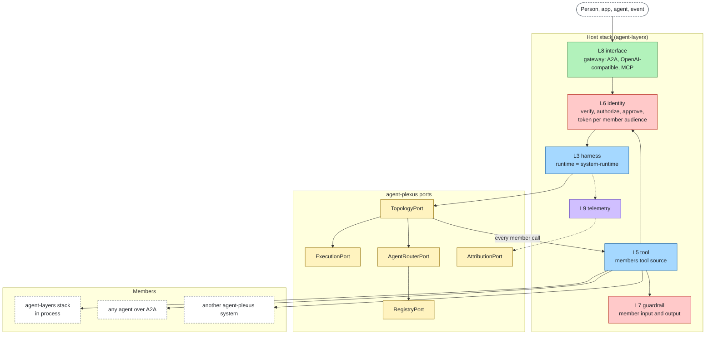
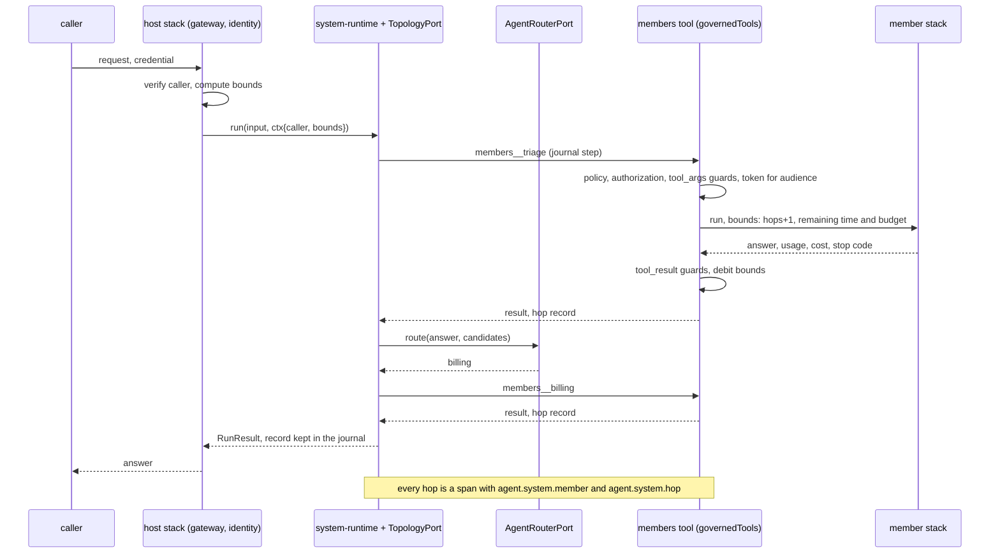

# Design

Status: Draft · Date: 2026-11-01 · Decided by: project owner (open decisions at the end)

agent-plexus composes whole agent stacks into a multi-agent system. agent-layers composes the eleven layers of one
agent through ports, adapters, a config and profiles; agent-plexus does the same one level up, with agents as the
parts. It owns five small ports and the language they speak; everything else is an agent-layers stack, an existing
agent-layers adapter, or an adapter for a framework or standard that already exists
([research/landscape.md](research/landscape.md)).

## Purpose

A team that runs several agents needs to answer five questions, and no framework answers them across stacks,
languages and vendors:

| Question | Port |
|---|---|
| In what order and shape does work flow between agents? | TopologyPort |
| Does a long system run survive a restart, and wait for a person? | ExecutionPort |
| Which agents exist, what can they do, and can their cards be trusted? | RegistryPort |
| Which agent should handle this request? | AgentRouterPort |
| When the system fails, which agent caused it, and in which of its layers? | AttributionPort |

Promises, in the same spirit as agent-layers:

- **Any agent is a member.** An agent-layers stack in process, or any agent that serves A2A (LangGraph, CrewAI, ADK,
  Microsoft Agent Framework, Strands, Pydantic AI, another agent-plexus system). No adapter per framework.
- **One enforcement path.** Every call to a member is a governed tool call of the host stack, so identity,
  authorization, approval, guards, credentials for the member's audience and telemetry are agent-layers' own.
- **Bounded by construction.** Deadline, budget and hop limit shrink across hops and every member enforces them at its
  own boundary ([proposal](proposals/agent-layers-delegation-bounds.md)); the system adds its own step, fan-out, loop
  and handoff limits.
- **Failures land on an agent and a layer.** Each system run keeps a hop record; attribution names the member, then
  the layer inside it, with a confidence.
- **A system is an agent.** It is exposed like any stack (A2A, OpenAI-compatible, MCP through the agent-layers
  gateway), so systems nest.
- **Same system from prototype to production.** Profiles, a readiness gate, every limit configurable.

## Non-goals

- Not an agent runtime or a framework: the loop of each agent belongs to its stack.
- Not a protocol: A2A is the wire; agent-plexus defines only an A2A extension for bounds and lineage, through
  agent-layers.
- Not an identity provider, a registry service, a workflow engine or an observability backend: it composes them.
- Not a replacement for agent-layers: a member never needs agent-plexus to be safe alone.
- No visual builder, no hosted control plane.

## agent-layers one level up

| agent-layers | agent-plexus |
|---|---|
| A layer (`knowledge`, `tool`, ...) | A member: one agent, usually a whole stack |
| One port per layer | Five ports for what lies between members |
| `AgentSpec` bound by `RuntimePort.bind` | `TopologySpec` bound by `TopologyPort.bind` |
| `compose(config)` → `Stack` | `assemble(config)` → `System`, hosted in an agent-layers stack |
| Stack config: one adapter per slot, per profile | System config: members, topology and one adapter per port, per profile |
| `agent.layer` on every span | `agent.system.member` and `agent.system.hop` on every hop span |
| Eval attributes a failure to a layer | Attribution names a member, then a layer inside it |
| Readiness gate on a production profile | The same gate, plus system checks |



Colours follow agent-layers' [diagram conventions](https://github.com/aantenore/agent-layers/blob/main/docs/diagrams.md);
yellow is agent-plexus.

## How a system is hosted

A system runs inside an agent-layers stack, the **host stack**. Two adapters of this project plug into agent-layers
ports, and nothing in agent-layers changes for them:

| Adapter | agent-layers port | What it does |
|---|---|---|
| `system-runtime` | RuntimePort (`runtime` slot) | Binds a system as the host stack's runtime. A run of the host's agent is a system run. The gateway then exposes the system over A2A, OpenAI-compatible (`agent:<name>`) and MCP like any agent. |
| `members` | ToolPort (`tools` slot) | One tool per member, `members__<name>`. A call runs the member: in process through its `RunnableAgent`, remote through the A2A client of agent-layers' `a2a` adapter (endpoint pinning, polling). It sends the remaining bounds, and returns the member's answer as `text` and the member's `RunResult` without `output` as `data` (run id, status, reason, usage, cost). |

**Wiring.** `system-runtime` owns the `System` (members, registry, router, execution journal, limits). Both adapters
name the same system file in `options.system`; `assemble` builds one `System` per file and process, and both adapters
get it by that key. A ToolPort call receives only a `CallContext`, so `members` mints the member's token through
`ctx.credentials` and writes spans through `ctx.telemetry`, and reaches remote members through the A2A client that
agent-layers' `a2a` adapter would export as a helper (an export, not a contract change), not through
`RuntimePort.bind`.

So every member call, whether the topology makes it or the host agent's model chooses it, passes through
`governedTools` of the host stack: local policy, approval for `ask`, authorization (an `AccessQuestion` for the tool
`members__<name>`; the member's id, endpoint and audience are in `ToolSpec.attrs`, which the core copies to
`target.attrs`, and `ToolSpec.layer` is `harness`; `target.kind` stays `tool`, which the core sets),
`tool_args` guards on what is sent to the member,
`tool_result` guards on what comes back, a credential minted for the member's audience on behalf of the caller, and an
`agent.tool.call` span. A member's output is untrusted data for the next member, as retrieved text is for a model.
The `tool_args` and `tool_result` stages fit: a member call is a call with side effects whose arguments come from the
system (the caller's input, another member's output) and whose result is read by the next step.

**The host agent.** The host stack's agent file is the system's front: its name and description are what the
gateway's agent card shows. Its instructions and model are used only where the system needs a model of its own: a
`supervise` node (run by an ordinary agent-layers runtime that `system-runtime` wraps, `options.runtime`, with
`tools: ["members__*"]`) and the `model-router`. Members receive the input as text: the `a2a` adapter sends the text
parts of a `RunInput`, so files and media do not reach remote members in the first version.

The host stack's own model, knowledge and state are available to the ports: the model router uses its governed
model, the knowledge router its knowledge sources, the reference execution journal its StatePort.

## Language

Same rules as the agent-layers language ([ADR 0001 there](https://github.com/aantenore/agent-layers/blob/main/docs/decisions/0001-sdk-language.md)):
fixed minimal shapes owned here, camelCase, `ext` with namespaced keys, vocabularies extensible by config with
`like`, standards only in adapters. agent-plexus reuses the agent-layers shapes (`RunInput`, `RunResult`, `Caller`,
`Usage`, `EvalCase`, `EvalScore`) and adds these.

### TopologySpec

A node is a member name or a nested `TopologySpec`. Every kind is bounded.

| `kind` | Fields | Meaning |
|---|---|---|
| `sequence` | `steps: [Node]` | Each step gets the previous step's output as input. |
| `parallel` | `branches: [Node]`, `join: "all" \| "first"`, `merge?: Node` | Fan out, then join; `merge` turns the branch outputs into one answer, else they are concatenated with their member names. With `first`, the other branches are cancelled. |
| `route` | `candidates: [S] \| {skills?, tags?, attrs?}`, `router?: S`, `fallback?: Node` | The AgentRouterPort picks one candidate; none chosen runs `fallback` or stops with `rejected`. |
| `loop` | `body: Node`, `until: Condition`, `maxIterations?: N` | Repeat until the condition holds or the bound is reached (`limit`). Default bound `limits.system.maxIterations`. |
| `handoff` | `start: S`, `members: [S]`, `router?: S`, `maxHandoffs?: N` | After each member answers, the router picks the next member among `members`, or ends. The next member receives the original input followed by the outputs so far, each labelled with its member. Works for remote members because nothing runs inside them. Default bound `limits.system.maxHandoffs`. |
| `supervise` | `members: [S]`, `instructions?: S` | The host agent's model gets `members__*` tools for the listed members: call and return, chosen by the model, governed by the host. |
| `graph` | `nodes: {S: Node}`, `start: S`, `edges: [{from, to, when?: Condition}]`, `end: [S]` | Explicit state machine; edges are tried in order. |

Every kind also takes `name?`, `input?` (`"output"` default, or `"original"`: what the next node receives) and
`ext?`.

`Condition` is declarative, so a topology is data and can be validated, diffed and drawn:
`{status?: RunStatus | [RunStatus], code?: StopCode | [StopCode], ext?: {key: value}, matches?: S}` (`matches` is a
regular expression on the output). For anything else, `fn: "<module>#<export>"`, a synchronous pure function as in
agent-layers mappings.

### AgentEntry (registry)

| Field | Type | Req | Notes |
|---|---|---|---|
| `id` | S | yes | Stable id, used in config and attribution. |
| `name`, `description` | S, S | yes | From the card, or config. |
| `skills` | [`{id, name, description, tags: [S]}`] | yes | A2A skill shape in the language's names; may be empty. |
| `endpoint` | `{protocol: "stack" \| "a2a", url?: S, agent?: S}` | yes | `stack` is in process; `a2a` is a card or JSON-RPC URL. Vocabulary extensible (`like`). |
| `audience` | S | | Credential audience; from config, never from a card. |
| `attrs` | {S: S \| N \| B \| [S]} | | What routing and policy may read: owner, domain, data classes, cost and latency hints. |
| `trust` | `{signed: B, keyId?: S, pinned: B}` | yes | Whether the card's signature verified and whether the endpoint is pinned by config. |
| `version` | S | | |

### Routing

`RouteQuestion {input: RunInput, candidates: [AgentEntry], caller: PublicCaller, bounds?}` →
`RouteDecision {member?: S, ranked?: [{member: S, score: N}], reason?: S}`. No `member` means no candidate fits.
`reason` is internal, never parsed.

### Hop record

The system keeps one record per member call; it is what attribution reads.

| Field | Type | Notes |
|---|---|---|
| `hopId`, `parentHopId?` | S | Tree of calls; a member that delegates further reports its own hops when it is an agent-plexus system or an in-process stack. |
| `member`, `node` | S, S | Member id; topology path of the node (`root.steps[1].branches[0]`). |
| `runId`, `rootRunId` | S, S | The member's run id (absent when the call was refused before the member ran) and the system run's. |
| `hops` | N | Hop count of the member run. |
| `startedAt`, `durationMs` | S, N | |
| `status`, `reason?` | `RunStatus`, `{code, layer?, by?}` | `layer` and `by` only when the member is in process or chose to report them. |
| `usage?`, `costUsd?` | | As reported by the member. |
| `route?` | `RouteDecision` without `reason` | When a router chose this member. |
| `inputRef?`, `outputRef?` | S | Keys of the texts in the execution journal, so attribution and replay can read them without copying them into telemetry. |

From a governed member call to a hop record:

| What happened | `status`, `reason` |
|---|---|
| The host refused the call (policy, authorization, approval): `ext["sdk.outcome"]` | `stopped`, `{code: "denied", layer: "identity"}` |
| A host guard blocked what was sent or what came back | `stopped`, `{code: "guard_block", layer: "guardrail"}`, stage unknown to the record |
| An in-process member ran | Its `RunResult` from `ToolResult.data`, all fields |
| A remote member ran | Its task state as the `a2a` adapter maps it: today every stop except a cancellation is `rejected` with no layer, until the stop code crosses the boundary (open question 1 of the proposal) |
| The call itself failed (network, timeout of the call) | `failed`, `{code: "error"}` or `{code: "timeout"}` |
| A route node chose no member | No member hop; the node's record has `route` without `member` |

`SystemResult` is the agent-layers `RunResult` of the system run plus `record: [HopRecord]`. Through
`system-runtime` the host sees a plain `RunResult` (status, reason, usage and cost summed); the record stays in the
journal and in telemetry.

## Ports

All five follow agent-layers port rules: owner-defined, thin, versioned per port, one conformance suite each,
`native()` for what the port does not cover.

### TopologyPort

`bind(system: System, spec: TopologySpec) → RunnableSystem`; `RunnableSystem.run(input, ctx) → SystemResult`,
optional `stream` with the agent-layers run events plus `agent-plexus.hop.start` and `agent-plexus.hop.end`.
`System` gives the adapter the members tool source, the router, the registry, the execution and the limits; the
adapter never calls a member any other way.

| Implementation | License | Notes |
|---|---|---|
| `basic-topology` (reference) | MIT | All seven kinds, in process, zero dependencies. Every member call is a journal step, so with a durable execution it resumes. |
| LangGraph.js | MIT | Candidate: compiles a TopologySpec to a graph; brings its checkpointer and `interrupt`. |
| ADK TypeScript | Apache-2.0 | Candidate: `sequence`, `parallel`, `loop` map to its workflow agents. |
| Strands TypeScript | Apache-2.0 | Candidate: `handoff` maps to its swarm, `graph` to its graph. |

A candidate is worth writing only when it brings something the reference lacks (an engine a team already runs, its
checkpointing); the reference stays the default on every profile.

### ExecutionPort

Durable steps for long system runs and for waiting on people. `begin(runKey) → Execution`; `Execution.step(name, fn)`
runs `fn` once and replays its stored result on resume; `Execution.wait(name, until)` suspends until a signal or the
deadline; `signal(runKey, name, value)`; `end()`. Member calls are steps, so a finished step is never repeated. A remote
call is two steps: the first journals the A2A task id as soon as the member returns it, the second polls the task
(`GetTask`) to its end; a restart between them resumes polling instead of sending again. Only a crash between
sending and journalling the task id can send twice, so members should still tolerate a repeated request. This needs
the `a2a` adapter to resume a known task, which it does not do today. When the deadline passes or the run is
cancelled, the `members` tool cancels the remote task (`CancelTask`).

| Implementation | License | Notes |
|---|---|---|
| `memory-execution` (reference, prototype) | MIT | In memory; lost on restart. |
| `state-execution` (reference, pilot) | MIT | Journal on the host stack's StatePort (`sqlite-state` and friends). |
| Temporal | MIT | Candidate for production: the system run is a workflow, each step an activity. |
| DBOS | MIT | Candidate for production without a server: Postgres or SQLite. |
| Hatchet | MIT | Alternative candidate. |

A run waiting for a person ends the host run with status `waiting`, as agent-layers runs do. The journal keeps which
member and which A2A task and `contextId` asked; a later run with the same session and caller resumes the execution
and sends the new input to that task.

### RegistryPort

`list(filter?) → [AgentEntry]`, `get(id) → AgentEntry`, optional `watch`. Cards are untrusted input: the reference
applies agent-layers' `a2a` rules (endpoint only on the card's origin or an allowed one, https, no private addresses
unless configured, no redirects), verifies JWS card signatures against configured keys, bounds card size and count,
and caches with a TTL. Production requires signed cards or endpoints pinned in config.

| Implementation | License | Notes |
|---|---|---|
| `static-registry` (reference) | MIT | Entries in config: in-process stacks, or card URLs fetched and verified. |
| AGNTCY Agent Directory + OASF | Apache-2.0 | Candidate: distributed directory; OASF skills as a vocabulary. |
| Kubernetes CRDs (kagent shape) | Apache-2.0 | Candidate for cluster deployments. |
| AI Catalog `/.well-known/ai-catalog.json` | not versioned yet | Track. |

### AgentRouterPort

`route(question: RouteQuestion) → RouteDecision`. Distinct from agent-layers' RouterPort, which picks a model.

| Implementation | License | Notes |
|---|---|---|
| `skill-router` (reference) | MIT | Deterministic: rules on skills, tags, attrs and regular expressions on the input; first match or ranked by rule weight. |
| `model-router` (reference) | MIT | Asks the host stack's governed model to choose among the candidates' names and descriptions, as a structured answer; an invalid answer is no choice. |
| `knowledge-router` (reference) | MIT | Indexes entries as documents of a host knowledge source and searches with the input, so any KnowledgePort adapter (keyword, vector) ranks members. |

### AttributionPort

`attribute(record: [HopRecord], result: RunResult, scores: [EvalScore], ctx) → [Attribution]`.
`Attribution {member: S, hopId: S, layer?: Layer, category: Category, confidence: N in [0, 1], evidence: [S], by: S}`.
`category` is a vocabulary built on the MAST groups: `specification` (topology, routing, instructions),
`coordination` (handoffs, lost context, conflicting outputs), `verification` (accepted a wrong answer, stopped too
early or too late), `execution` (a member's own layer failed: model, tool, knowledge, guard, identity), `bounds`
(deadline, budget, hops).

| Implementation | License | Notes |
|---|---|---|
| `rule-attribution` (reference) | MIT | Deterministic, from the record; below. |
| `judge-attribution` | MIT | The host model reads the record (all at once, or by binary search over hops, as in Who&When) and names a member; agent level only. |
| `replay-attribution` | MIT | Offline: reruns the case with one member's output replaced by a reference answer, or with one member swapped, and blames the member whose replacement fixes the run (counterfactual replay, as in AgenTracer). Costly, so eval only. |

Scores themselves come from agent-layers EvaluatorPort adapters (`expected-eval`, `judge-eval`, promptfoo later)
run on the system as one agent: agent-plexus adds attribution, not another scorer.

Rules of `rule-attribution`, in order:

1. The earliest hop in causal order with a status other than `completed`, or with a failing per-member score when the
   case sets expectations per member, is the candidate. Branches the topology abandoned (`join: "first"`) are skipped.
2. A route node whose decision has no member is blamed first: category `specification`, high confidence.
3. Otherwise the stop code decides. The rule branches on `code` only, as the agent-layers language requires; `layer`
   is used as the reported layer, never to choose a row.

   | Stop code | Blamed | Category | Confidence |
   |---|---|---|---|
   | `hop_limit` | The node that delegated (or its router) | `specification` | high |
   | `timeout`, `limit` | The hop that spent the most of its share; its parent when the hop started with less than `minRemainingMs` | `bounds` | medium |
   | `guard_block` on a hop whose input was another member's output | That upstream member | `coordination` | medium |
   | `guard_block` otherwise, `denied`, `failed`, `error` | The hop, with `reason.layer` as the layer when known | `execution` | high when the layer is known, else medium |
   | `rejected` (a remote member's stop, cause unknown) | The hop | `execution` | low |
   | `needs_input`, `needs_auth` | Nobody: waiting is not a failure | | |

   Until the stop code crosses A2A, the specific rows apply to in-process members; remote members fall in the
   `rejected` row.

4. Every hop completed but the system's score fails: the member that produced the final output, category
   `verification`, low confidence; the report suggests `judge-attribution` or `replay-attribution`.
5. Inside an in-process member, the layer comes from agent-layers' `layer-signals` on the member's run events.

## System config

The host stack is an ordinary agent-layers config; the system config sits next to it. Example (prototype):

```json
{
  "system": { "name": "support", "host": "./agent-layers.json" },
  "members": {
    "triage":  { "stack": "./members/triage/agent-layers.json", "agent": "triage" },
    "billing": { "a2a": "https://billing.example.com/.well-known/agent-card.json", "audience": "billing" },
    "manuals": { "stack": "./members/manuals/agent-layers.json", "agent": "manuals", "risk": "read" }
  },
  "ports": {
    "topology":    { "adapter": "basic-topology" },
    "execution":   { "adapter": "memory-execution" },
    "registry":    { "adapter": "static-registry" },
    "router":      { "adapter": "skill-router", "options": { "rules": [
      { "member": "billing", "matches": "(?i)invoice|refund|charge" },
      { "member": "manuals", "tags": ["product"] } ] } },
    "attribution": { "adapter": "rule-attribution" }
  },
  "topology": {
    "kind": "sequence",
    "steps": [
      "triage",
      { "kind": "route", "candidates": ["billing", "manuals"], "fallback": "triage" }
    ]
  },
  "limits": { "system": { "maxSteps": 20, "maxParallel": 4 } },
  "profiles": {
    "pilot": { "ports": { "execution": { "adapter": "state-execution" }, "router": { "adapter": "model-router" } } },
    "production": { "tier": "production", "registry": { "requireSigned": true },
      "ports": { "execution": { "adapter": "temporal" } } }
  }
}
```

In the host stack: `runtime` is `system-runtime` with `options.system` pointing at this file, and `tools.members` is
the `members` tool source. `agent-plexus check --profile production` runs `agent-layers check` on the host profile and
adds the system checks: no prototype-only port adapter, every member reachable and conformant (card fetched and
verified, or stack composed), production members signed or pinned, host identity, authorization and credentials
present, every system limit bounded, topology valid (members exist, graph edges reach an end, every loop bounded).

## A system run



## Limits

Declared once in a `LIMITS` list per component, as in agent-layers, so validation, the readiness gate and the docs
check read the same values. Run deadline, budget and hop limit are the host stack's (`limits.run.*`,
`limits.delegation.*` in the agent-layers proposal); a system run is one run of the host.

| Setting | Default | Accepted | Safe range | On production | Why |
|---|---|---|---|---|---|
| `limits.system.maxSteps` | `20` | 1–∞ or unbounded | 1–100 | fail if unbounded | Member calls in one system run, all nodes together. |
| `limits.system.maxParallel` | `4` | 1–64 | 1–16 | warn outside safe range | Branches of one `parallel` node running at once. |
| `limits.system.maxIterations` | `5` | 1–100 | 1–20 | warn outside safe range | Default bound of a `loop` node without its own. |
| `limits.system.maxHandoffs` | `10` | 1–100 | 1–20 | warn outside safe range | Default bound of a `handoff` node. |
| `limits.system.maxRepeats` | `3` | 1–100 | 1–10 | warn outside safe range | Times in a row the same pair of members may pass work back and forth before the run stops with `limit`. |
| `limits.system.stepTimeoutMs` | `300000` ms | 1–∞ or unbounded | 1–3600000 | fail if unbounded | One member call; always capped by the run's remaining time. |
| `limits.registry.cardTtlMs` | `300000` ms | 0–86400000 | — | — | How long a fetched card is trusted before it is fetched again. |
| `limits.registry.maxCardBytes` | `65536` bytes | 1024–1048576 | — | — | Largest card read. |
| `limits.registry.maxEntries` | `1000` | 1–100000 | — | — | Entries a registry adapter keeps. |
| `limits.router.maxCandidates` | `20` | 1–200 | 1–50 | warn outside safe range | Candidates sent to a model or knowledge router. |
| `limits.attribution.maxRecords` | `500` | 1–100000 | — | — | Hop records read by one attribution. |

Bounds across `parallel` branches: each branch gets the run's remaining deadline. Budget is reserved, never shared
blindly: a `parallel` node gives each branch an even share of what is left, the call reserves it from the run's
ledger, and what the member does not spend is released when it returns (open decision 5).

## Security

The agent-layers threat model holds for each member. Between members:

| Threat | Mitigation |
|---|---|
| A member's output instructs the next member | Output is data: `tool_result` guards in the host; the next member's own input guards; never placed in instructions |
| A forged or swapped agent card | Signature verification, endpoints pinned by config, audience from config only, the `a2a` adapter's endpoint rules |
| A member used beyond the caller's rights | Authorization per member call with the caller and its actor chain; a token per member audience, exchanged on behalf of the caller, never the caller's own token forwarded |
| Loops and runaway fan-out | Hop limit at every member, `maxSteps`, `maxParallel`, `maxRepeats`, loop and handoff bounds |
| Denial of wallet across agents | Budget that shrinks across hops and is debited with what members report |
| Leaking one caller's data into another caller's system run | Execution journal keyed by caller and session, as agent-layers sessions are |
| Telemetry leaking content | Hop records hold references to texts in the journal, not the texts |

## Telemetry

Spans keep the mandatory `agent.layer` (`harness` for the system run and its nodes; the members tool call is already
an `agent.tool.call` on `tool`). agent-plexus names live under `agent.system.*`:

| Kind | Name |
|---|---|
| span | `agent.system.node` (one per topology node), `agent.system.route` |
| attribute | `agent.system.name`, `agent.system.member`, `agent.system.hop`, `agent.system.node.path`, `agent.system.node.kind`, `agent.system.route.choice` |
| event | `agent.system.limit` (which system limit stopped the run) |
| metric | `agent.system.hops` (per run), `agent.system.attributions` (by member and category) |

The `otlp` adapter of agent-layers maps them to the OpenTelemetry GenAI names where those exist (`invoke_workflow`
for the system run), which are still in development status.

## Packages

| Path | Package | Content |
|---|---|---|
| `spec/` | | Language-neutral source of truth: schemas (`topology-spec`, `agent-entry`, `hop-record`, `attribution`), one page per port |
| `packages/core` | `@agent-plexus/core` | Ports, `assemble`, topology validation, limits; peer dependency on `@agent-layers/core`, nothing else |
| `packages/conformance` | `@agent-plexus/conformance` | One suite per port |
| `packages/cli` | `@agent-plexus/cli` | `check`, `dev`, `eval`, `diff`, `draw` (the topology as a diagram) |
| `adapters/system-runtime`, `adapters/members` | `@agent-plexus/adapter-*` | The two agent-layers adapters |
| `adapters/<reference>` | `@agent-plexus/adapter-*` | `basic-topology`, `memory-execution`, `state-execution`, `static-registry`, `skill-router`, `model-router`, `knowledge-router`, `rule-attribution` |
| `examples/` | | A prototype system of two in-process members, runnable offline |

## Order of work

| Slice | Content | Depends on |
|---|---|---|
| 1 | `spec/`, core, `members`, `system-runtime`, `basic-topology` (`sequence`, `route`), `memory-execution`, `static-registry` (in-process members), `skill-router`, `rule-attribution`, `check`; example runs offline | agent-layers as published; bounds enforced at system level only until the primitives land |
| 2 | Remote members over A2A, system exposed through the gateway, a system as a member of another; `parallel`, `loop`, `supervise` | The agent-layers primitives (bounds, actors, `hop_limit`); the A2A client exported by the `a2a` adapter |
| 3 | `state-execution`, `waiting` and resume; card signatures; `handoff`, `graph` | The `a2a` adapter resuming a known task |
| 4 | `model-router`, `knowledge-router`, `judge-attribution`, `replay-attribution`; first production ExecutionPort adapter | Decision 4 |

Until slice 2, a member reached by the system does not see the system's remaining bounds; the system still enforces
its own deadline, steps and hops before each call.

## Open decisions

| # | Decision | Recommendation |
|---|---|---|
| 1 | Name: `agent-plexus` (working name), scope `@agent-plexus`. Free on npm and GitHub on 2026-11-01; the npm scope is confirmed only when the org is created. Alternatives checked and free: `agent-ensemble`, `agent-concert`. | Keep `agent-plexus` |
| 2 | Create `aantenore/agent-plexus` on GitHub and push; public or private until slice 1. | Private until slice 1 runs |
| 3 | Every member call is a governed tool call of the host stack (one enforcement path), rather than a separate call path with its own checks. | Accept |
| 4 | Production ExecutionPort reference: Temporal (server to run) or DBOS (library on Postgres or SQLite). | DBOS first, Temporal second |
| 5 | Budget across `parallel` branches: even shares reserved per branch and released on return (no overspend), or a first-come pool (some branches may starve). | Even reserved shares |
| 6 | Own topology language, with Oracle Agent Spec or a framework format only as an import adapter later. | Own |
| 7 | The agent-layers changes: hand the [proposal](proposals/agent-layers-delegation-bounds.md) to the agent-layers repository as an ADR, with its open questions (stop code across the boundary, cost source, default `maxHops` and repeated agents, `actor_token` default), plus two smaller requests: export the A2A client of the `a2a` adapter, and let it resume a known task. | Hand it over as written |
| 8 | Production registry candidate after `static-registry`: AGNTCY directory or Kubernetes CRDs. | Decide when the first production deployment is known |
