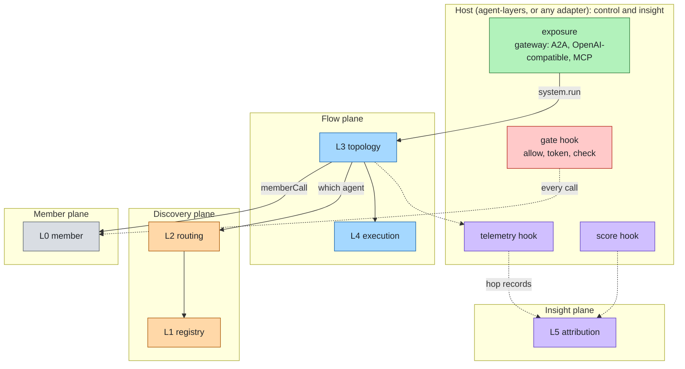

# Design

Status: Draft · Date: 2026-11-01 · Decided by: project owner (open decisions at the end)

agent-plexus composes agents into a multi-agent system. It owns only what lies **between** agents: how an agent is
called, which agents exist, which one handles a request, how work flows, how a long run survives, and which agent
caused a failure. Everything an agent stack already has (identity, policy, content checks, telemetry, scoring,
network exposure) it receives from a **host** through a few hooks, the way reinloop receives governed tools from
agent-layers instead of implementing identity or guardrails itself. agent-layers is the natural host, through one
adapter; the core never names it and runs without it.

## Purpose

| Promise | How |
|---|---|
| Independent | The core depends on nothing and runs offline with its reference implementations and prototype defaults for the hooks. |
| No second control plane | Authorization, approval, credentials, content checks, telemetry and scoring are host hooks. agent-plexus calls them; it does not implement them. In production they must come from a real host. |
| Any agent is a member | An agent served over A2A (LangGraph, CrewAI, ADK, Microsoft Agent Framework, Strands, Pydantic AI), an agent-layers stack, a function, another agent-plexus system. |
| One call path | Every member call goes through one core pipeline, `memberCall`; topologies and supervisors cannot reach a member any other way. |
| Bounded | System limits (steps, fan-out, loops, handoffs, time) are the system's; deadline, budget and hops received from the host are honoured and passed on. |
| Failures land on an agent | Each run keeps a hop record; attribution names a layer, a member, and the member's own layer when it reports one. |
| A system is an agent | It is exposed through its host (the agent-layers gateway serves it over A2A, OpenAI-compatible and MCP), so systems nest. |

## Non-goals

- Not an agent runtime: the loop of each agent belongs to the agent.
- Not a control plane: no identity, policy, guard, telemetry or evaluation implementation beyond prototype defaults.
- Not a server: network exposure is the host's.
- Not a protocol: A2A is the wire; the bounds extension is defined once, in the agent-layers proposal, and reused.
- No visual builder, no hosted control plane.

## The six layers

Each layer answers one question and has one port. Layers have stable ids; the numbers are for reading only. All six
live in the space between agents; none of them exists inside a single agent stack.

| Plane | L | Layer (id) | The question it answers | Port |
|---|---|---|---|---|
| Member | L0 | Members (`member`) | Who does the work, and how is it called? | MemberPort |
| Discovery | L1 | Registry (`registry`) | Which agents exist, what can they do, can their cards be trusted? | RegistryPort |
| Discovery | L2 | Routing (`routing`) | Which agent should handle this request? | AgentRouterPort |
| Flow | L3 | Topology (`topology`) | In what order and shape does work flow between agents? | TopologyPort |
| Flow | L4 | Execution (`execution`) | Does a long run survive a restart, and wait for a person? | ExecutionPort |
| Insight | L5 | Attribution (`attribution`) | When the system fails, which agent and which layer caused it? | AttributionPort |

Boundary rules: how one agent is reached is `member`; choosing it is `routing`; the order of calls is `topology`;
surviving restarts is `execution`. Whether a call may happen, what may cross, what is traced and how a run scores
belong to the host.



Plane colours reuse the agent-layers palette. Red, green and the host's purple are the host's planes; agent-plexus
adds none of them.

## Where agent-plexus stops and agent-layers starts

| Concern | agent-layers layer | agent-plexus |
|---|---|---|
| Verify the caller | L6 `identity` | Receives the caller already verified, in the run context |
| Authorize, approve, mint a token per audience | L6 `identity` | Calls the host's `gate.allow` and `gate.token` for every member call |
| Content checks | L7 `guardrail` | Calls the host's `gate.check` on what is sent to and received from a member |
| Deadline, budget, hops of one agent | the proposed bounds primitives | Honours what the host passes in, reserves per member call, passes the rest on with the same wire extension |
| Spans, events, metrics | L9 `telemetry` | Emits `plexus.*` names through the host's telemetry hook |
| Scoring a run | L10 `eval` | Calls the host's `score` hook; adds attribution across hops |
| Network exposure | L8 `interface`, gateway | None: the host serves the system |
| Durable state of one agent | L3 `harness` StatePort | Its own journal across member calls; may store it in the host's StatePort |
| How an agent is called, discovery, routing between agents, topology, cross-agent attribution | none | The six layers |

## Host hooks

A host is an object passed to `assemble(config, host)`. Every hook is small and every hook has a prototype default,
which the readiness gate refuses on a production-tier profile.

| Hook | Operations | Prototype default | Production |
|---|---|---|---|
| `gate` | `allow({caller, action: "invoke", member}) → {effect: "allow" \| "deny" \| "ask", reason?}`; `token(caller, audience) → credential?`; `check({stage: "send" \| "receive", text, member, caller}) → {action: "allow" \| "block" \| "redact", text?}` | allow every call, no token, no check | required; errors are a deny |
| `telemetry` | `span(name, attrs, fn)`, `event(name, attrs)`, `metric(name, value, attrs)` | one console line per hop | required |
| `score` | `score(case, result) → [Score]` | `expected` checks only: exact, contains, regular expression | optional |
| `state` | `get`, `set`, `delete` by key | none (ExecutionPort keeps its own journal) | optional, used by the `host-execution` adapter |

The agent-layers adapter builds a host from a stack: `gate` from its IdentityPort-verified caller, AuthorizationPort,
ApprovalPort, CredentialPort and GuardPort; `telemetry` from its TelemetryPort; `score` from its EvaluatorPort
adapters; `state` from its StatePort. Another host (a company platform, a plain OPA and OpenTelemetry setup) is
another adapter of the same four hooks.

## The memberCall pipeline

The core's own logic, and the only way to reach a member:

| # | Step | Who decides | On failure |
|---|---|---|---|
| 1 | System limits and received bounds: time left, steps, hops; reserve budget | core | `stopped`: `timeout`, `limit`, `hop_limit` |
| 2 | May this caller invoke this member | host `gate.allow` | `stopped`, `denied`; `ask` → `waiting`, `needs_input`, through ExecutionPort `wait` |
| 3 | Check what is sent | host `gate.check`, `send` | `stopped`, `guard_block`; `redact` replaces the text |
| 4 | Credential for the member's audience, on behalf of the caller | host `gate.token` | `stopped`, `needs_auth`; the caller's own credential is never forwarded |
| 5 | Call, as a journal step, with outbound bounds and lineage | MemberPort `invoke` inside ExecutionPort `step` | the member's result, or `failed` / `timeout` from the transport |
| 6 | Check what comes back: data for the next member, never instructions | host `gate.check`, `receive` | `stopped`, `guard_block` |
| 7 | Settle the reservation; write the hop record; span `plexus.hop` | core, host `telemetry` | |

## Language

Only the shapes the six layers need, under the same rules as the agent-layers language by choice (fixed and
minimal, camelCase, ISO 8601 `at` / `<x>At`, `ext` with `<adapter>.<name>` keys the core never reads, vocabularies
extensible with `like`). Where a concept is the host's, agent-plexus carries it without interpreting it.

| Shape | Fields | Notes |
|---|---|---|
| `RunContext` | `runId`, `system`, `caller?`, `bounds?`, `lineage?`, `sessionId?`, `signal?`, `trace?` | `caller` is the host's verified caller, passed through; the core reads only `id`, `kind` and `actors` for questions to the gate. `trace` is opaque, owned by the telemetry hook. |
| `Bounds` | `deadlineAt`, `hops`, `maxHops`, `tokens?`, `costUsd?` | Same fields and rules as the agent-layers proposal; the agent-layers adapter maps them one to one. |
| `MemberResult` | `status` (`completed`, `failed`, `stopped`, `waiting`), `output`, `reason?` (`code`, `layer?`, `by?`, `detail?`), `runId?`, `taskRef?`, `usage?`, `costUsd?` | Values equal to agent-layers' `RunResult`, by choice; `code` from the agent-layers `stopCode` values; consumers branch on `code` only. `layer` is the member's own name for where it stopped. |
| `TopologySpec` | below | |
| `AgentEntry` | `id`, `name`, `description`, `skills: [{id, name, description, tags}]`, `endpoint: {protocol, url?, ref?}`, `audience?`, `attrs?`, `trust: {signed, keyId?, pinned}`, `version?` | `protocol` vocabulary: `a2a`, `function`; adapters add values (`agent-layers`). `audience` from config, never from a card. |
| `RouteQuestion` → `RouteDecision` | `{input, candidates, caller?, bounds?}` → `{member?, ranked?: [{member, score}], reason?}` | No `member`: none fits. |
| `HopRecord` | `hopId`, `parentHopId?`, `member`, `node`, `runId?`, `rootRunId`, `hops`, `startedAt`, `durationMs`, `status`, `reason?`, `usage?`, `costUsd?`, `route?`, `inputRef?`, `outputRef?` | Texts stay in the journal; records hold their keys. |
| `Attribution` | `layer`, `member?`, `memberLayer?`, `hopId?`, `confidence` in [0, 1], `evidence: [S]`, `by` | `layer` is a plexus layer id, or `host` when the host refused a call. |

`SystemResult` is a `MemberResult` plus `record: [HopRecord]`, so a system is a member of another system.

### TopologySpec

A node is a member id or a nested `TopologySpec`; every kind is bounded.

| `kind` | Fields | Meaning |
|---|---|---|
| `sequence` | `steps: [Node]` | Each step gets the previous step's output. |
| `parallel` | `branches: [Node]`, `join: "all" \| "first"`, `merge?: Node` | Fan out and join; with `first`, the other branches are cancelled. |
| `route` | `candidates: [S] \| {skills?, tags?, attrs?}`, `router?: S`, `fallback?: Node` | The AgentRouterPort picks one; none chosen runs `fallback` or stops with `rejected`. |
| `loop` | `body: Node`, `until: Condition`, `maxIterations?: N` | Bounded by `limits.system.maxIterations` by default. |
| `handoff` | `start: S`, `members: [S]`, `router?: S`, `maxHandoffs?: N` | After each answer the router picks the next member or ends; the next member receives the original input and the labelled outputs so far. Nothing runs inside the members. |
| `supervise` | `supervisor: S`, `members: [S]` | The supervisor chooses whom to call. It reaches them through the system: the agent-layers member adapter offers its agent one tool per member, each call a `memberCall`. |
| `graph` | `nodes`, `start`, `edges: [{from, to, when?}]`, `end` | Explicit state machine. |

Every kind takes `name?`, `input?` (`"output"` or `"original"`) and `ext?`. `Condition` is data:
`{status?, code?, ext?, matches?}`, or `fn: "<module>#<export>"`, a synchronous pure function.

## Layers and ports

Owner-defined, thin, versioned per port, one conformance suite each, `native()` for what a port does not cover, a
zero-dependency reference for each.

### L0 Members (`member`) · MemberPort

Who does the work, and how is it called? `invoke(entry, input, ctx) → MemberResult`; optional `resume(entry,
taskRef, input, ctx)`, `cancel(entry, taskRef, ctx)`. A remote call is two journal steps (store `taskRef`, then wait
for the end), so a restart resumes instead of sending again; on deadline or cancel the adapter cancels the remote
task.

| Implementation | License | Notes |
|---|---|---|
| `function-member` (reference) | MIT | An async function in process. |
| `a2a-member` (reference) | MIT | A2A 1.0 client on the official A2A JS SDK (Apache-2.0): card pinned, endpoint rules (same origin or allowed, https, no private addresses unless configured, no redirects), bounds and lineage through the A2A extension of the agent-layers proposal, `GetTask` polling and resume, `CancelTask`. Calling agents is this layer's own job; the agent-layers `a2a` runtime serves a different purpose (a stack whose runtime is remote). |
| `agent-layers` (adapter) | MIT | An agent-layers stack in process; offers the `supervise` tool source. |

### L1 Registry (`registry`) · RegistryPort

Which agents exist, what can they do, can their cards be trusted? `list(filter?)`, `get(id)`, optional `watch`.
Cards are untrusted: JWS signatures checked against configured keys, size and count bounded, cached with a TTL;
production requires signed cards or endpoints pinned in config.

| Implementation | License | Notes |
|---|---|---|
| `static-registry` (reference) | MIT | Entries in config; card URLs fetched and verified. |
| AGNTCY Agent Directory + OASF | Apache-2.0 | Candidate. |
| Kubernetes CRDs (kagent shape) | Apache-2.0 | Candidate. |

### L2 Routing (`routing`) · AgentRouterPort

Which agent should handle this request? `route(question) → RouteDecision`. Distinct from agent-layers' RouterPort,
which picks a model.

| Implementation | License | Notes |
|---|---|---|
| `skill-router` (reference) | MIT | Rules on skills, tags, attrs, regular expressions. |
| `model-router` | MIT | A model chooses among names and descriptions, as a structured answer; the model is any OpenAI-compatible endpoint, or a stack's governed model through the agent-layers adapter. |
| `knowledge-router` | MIT | A search backend ranks entries; any agent-layers knowledge source through the adapter. |

### L3 Topology (`topology`) · TopologyPort

In what order and shape does work flow between agents? `bind(system, spec) → RunnableSystem`; `run(input, ctx) →
SystemResult`, optional `stream`. The adapter reaches members only through `memberCall`.

| Implementation | License | Notes |
|---|---|---|
| `basic-topology` (reference) | MIT | All kinds, in process; each member call is a journal step. |
| LangGraph.js, ADK-TS, Strands TS | MIT / Apache-2.0 | Candidates when a team already runs that engine. |

### L4 Execution (`execution`) · ExecutionPort

Does a long run survive a restart, and wait for a person? `begin(runKey)`, `step(name, fn)` (runs once, replays on
resume), `wait(name, until)`, `signal(runKey, name, value)`, `end()`. The budget ledger of a run is kept in its
journal, so it resumes with the run. A run waiting for a person returns `waiting`; the journal keeps which member,
`taskRef` and context asked.

| Implementation | License | Notes |
|---|---|---|
| `memory-execution` (reference, prototype) | MIT | Lost on restart. |
| `sqlite-execution` (reference) | MIT | SQLite through Node's built-in `node:sqlite`. |
| `host-execution` | MIT | Journal in the host's `state` hook (an agent-layers StatePort). |
| DBOS, Temporal, Hatchet | MIT | Production candidates. |

### L5 Attribution (`attribution`) · AttributionPort

When the system fails, which agent and which layer caused it? `attribute(record, result, scores, ctx) →
[Attribution]`. Scores come from the host's `score` hook; agent-plexus adds attribution, not another scorer.

| Implementation | License | Notes |
|---|---|---|
| `rule-attribution` (reference) | MIT | Deterministic; rules below. |
| `judge-attribution` | MIT | A model reads the record (all at once, or binary search over hops, as in Who&When); agent level only. |
| `replay-attribution` | MIT | Offline counterfactual replay: one member's output replaced, or one member swapped (as in AgenTracer). |

Rules of `rule-attribution`, branching on `code` only:

1. The earliest hop that did not complete, or failed a per-member expectation, is the candidate; branches the
   topology abandoned are skipped.
2. A route node that chose no member: layer `routing`, high confidence.
3. Otherwise:

   | Stop code | Layer | Member | Confidence |
   |---|---|---|---|
   | `hop_limit` | `topology` (`routing` when a router chose the call) | none | high |
   | `timeout`, `limit` | `topology` when the system's own limit stopped it; else `member` | The hop that spent the most of its share | medium |
   | `denied`, `needs_auth`, `guard_block` from the host's gate | `host` | The upstream member whose output was blocked, when the block was on `receive` | high |
   | `guard_block` inside a member whose input was another member's output | `member` | That upstream member, `memberLayer` from the reason | medium |
   | `guard_block` otherwise, `failed`, `error` | `member` | The hop, `memberLayer` from `reason.layer` when reported | high with a layer, else medium |
   | `rejected` | `member` | The hop | low |
   | `needs_input`, `needs_auth` from the member | none: waiting is not a failure | | |

   Over A2A today every remote stop except a cancellation arrives as `rejected`, until the stop code crosses the
   boundary (open question 1 of the proposal).
4. Every hop completed but the score fails: layer `member`, the member that produced the final output, low
   confidence; the report suggests `judge-attribution` or `replay-attribution`.

## The agent-layers adapter

`@agent-plexus/adapter-agent-layers`: the only package that depends on agent-layers (`@agent-layers/core` as a
dependency, `@agent-plexus/core` as a peer), translating shapes at the edge.

| Descriptor | Fills | What it maps |
|---|---|---|
| `host` | host hooks | `gate`, `telemetry`, `score`, `state` from one stack |
| `member` | MemberPort | A stack in process, with the `supervise` tool source |
| `runtime` | an agent-layers RuntimePort | The system as a stack's runtime: the gateway exposes it over A2A, OpenAI-compatible and MCP; the stack's verified caller and bounds become the `RunContext` |
| `models`, `knowledge` | AgentRouterPort helpers | A stack's governed model for `model-router`, its knowledge sources for `knowledge-router` |

Typical production: an agent-layers stack hosts the system (runtime, host hooks, gateway), members are reached over
A2A, and every member call is gated by that stack's controls.

## System config

```json
{
  "system": { "name": "support" },
  "host": { "adapter": "agent-layers", "options": { "config": "./agent-layers.json" } },
  "members": {
    "triage":  { "adapter": "function-member", "options": { "module": "./members/triage.js#answer" } },
    "billing": { "adapter": "a2a-member", "options": { "url": "https://billing.example.com/.well-known/agent-card.json", "audience": "billing" } }
  },
  "ports": {
    "registry":    { "adapter": "static-registry" },
    "router":      { "adapter": "skill-router", "options": { "rules": [{ "member": "billing", "matches": "(?i)invoice|refund" }] } },
    "topology":    { "adapter": "basic-topology" },
    "execution":   { "adapter": "memory-execution" },
    "attribution": { "adapter": "rule-attribution" }
  },
  "topology": { "kind": "sequence", "steps": ["triage", { "kind": "route", "candidates": ["billing"], "fallback": "triage" }] },
  "limits": { "system": { "maxSteps": 20, "timeoutMs": 300000 } },
  "profiles": {
    "prototype": { "host": null },
    "production": { "tier": "production", "registry": { "requireSigned": true }, "ports": { "execution": { "adapter": "dbos" } } }
  }
}
```

`"host": null` uses the prototype defaults. `agent-plexus check --profile production` fails on a missing or
prototype host, prototype-only adapters, unsigned and unpinned members, unbounded limits and invalid topologies; the
agent-layers host adds its own readiness gate.

## Limits

| Setting | Default | Accepted | Safe range | On production | Why |
|---|---|---|---|---|---|
| `limits.system.timeoutMs` | `300000` ms | 1–∞ or unbounded | 1–3600000 | fail if unbounded | Deadline of a system run when the host passes none. |
| `limits.system.maxSteps` | `20` | 1–∞ or unbounded | 1–100 | fail if unbounded | Member calls in one run. |
| `limits.system.maxDepth` | `3` | 0–∞ or unbounded | 0–10 | fail if unbounded | Hops a system run may add when the host passes no bounds (nested systems, supervisors). |
| `limits.system.maxParallel` | `4` | 1–64 | 1–16 | warn outside safe range | Branches running at once. |
| `limits.system.maxIterations` | `5` | 1–100 | 1–20 | warn outside safe range | Default bound of a `loop`. |
| `limits.system.maxHandoffs` | `10` | 1–100 | 1–20 | warn outside safe range | Default bound of a `handoff`. |
| `limits.system.maxRepeats` | `3` | 1–100 | 1–10 | warn outside safe range | Back-and-forth between the same two members. |
| `limits.system.stepTimeoutMs` | `300000` ms | 1–∞ or unbounded | 1–3600000 | fail if unbounded | One member call, capped by the time left. |
| `limits.registry.cardTtlMs` | `300000` ms | 0–86400000 | — | — | How long a fetched card is trusted. |
| `limits.registry.maxCardBytes` | `65536` bytes | 1024–1048576 | — | — | Largest card read. |
| `limits.router.maxCandidates` | `20` | 1–200 | 1–50 | warn outside safe range | Candidates sent to a model or knowledge router. |
| `limits.attribution.maxRecords` | `500` | 1–100000 | — | — | Hop records read by one attribution. |

Budget across `parallel` branches: each branch reserves an even share of what is left and releases what it does not
spend (open decision 5).

## Security

| Threat | Mitigation |
|---|---|
| A member's output instructs the next member | Host `receive` check; output passed as data |
| A forged or swapped card | Signatures, endpoints pinned, audience from config, `a2a-member` endpoint rules |
| A member used beyond the caller's rights | Host `allow` per call with caller and actors; a token per member audience, never the caller's own credential |
| Loops and runaway fan-out | Depth, steps, parallel, repeats, loop and handoff bounds |
| Denial of wallet | Budget reserved per call, settled with what members report; nothing reported means spent |
| Running unguarded in production | The readiness gate refuses the prototype host defaults |

## Telemetry

Names are `plexus.*`, emitted through the host's telemetry hook, each span with the mandatory `plexus.layer`.

| Kind | Name |
|---|---|
| span | `plexus.run`, `plexus.node`, `plexus.hop`, `plexus.route` |
| attribute | `plexus.layer`, `plexus.system`, `plexus.member`, `plexus.hop`, `plexus.node.path`, `plexus.node.kind`, `plexus.route.choice`, `plexus.run.status`, `plexus.run.reason` |
| event | `plexus.limit` |
| metric | `plexus.hops`, `plexus.attributions` (by layer and member) |

## Packages

| Path | Package | Content |
|---|---|---|
| `spec/` | | Schemas and one page per port and per hook |
| `packages/core` | `@agent-plexus/core` | Ports, host hooks and their prototype defaults, `assemble`, `memberCall`, topology validation, limits; zero dependencies |
| `packages/conformance` | `@agent-plexus/conformance` | One suite per port and for a host |
| `packages/cli` | `@agent-plexus/cli` | `check`, `dev` (terminal), `eval`, `diff`, `draw` |
| `adapters/<name>` | `@agent-plexus/adapter-<name>` | `function-member`, `a2a-member`, `static-registry`, `skill-router`, `model-router`, `knowledge-router`, `basic-topology`, `memory-execution`, `sqlite-execution`, `host-execution`, `rule-attribution`; and `agent-layers` |
| `examples/` | | A system of function members, runnable offline |

## Order of work

| Slice | Content | Depends on |
|---|---|---|
| 1 | `spec/`, core (`memberCall`, prototype host), `function-member`, `static-registry`, `skill-router`, `basic-topology` (`sequence`, `route`), `memory-execution`, `rule-attribution`, CLI `check` and `dev`; offline example | nothing |
| 2 | `agent-layers` adapter (`host`, `member`, `runtime`): a system hosted and exposed by a stack | agent-layers as published |
| 3 | `a2a-member`, `parallel`, `loop`, `supervise`; a system as a member of another | the A2A JS SDK; the bounds extension of the agent-layers proposal |
| 4 | `sqlite-execution`, `host-execution`, `waiting` and resume, signatures, `handoff`, `graph` | |
| 5 | `model-router`, `knowledge-router`, `judge-attribution`, `replay-attribution`, a production ExecutionPort | decision 4 |

## Open decisions

| # | Decision | Recommendation |
|---|---|---|
| 1 | Name `agent-plexus`, scope `@agent-plexus` (confirmed only when the npm org is created). | Keep |
| 2 | Repository visibility (private now). | Private until slice 1 runs |
| 3 | The six layers, and host hooks instead of own control and insight layers. | Accept |
| 4 | Production ExecutionPort: DBOS or Temporal. | DBOS first |
| 5 | Budget across `parallel` branches: even reserved shares or a first-come pool. | Even shares |
| 6 | Own topology language; other formats only as import adapters. | Own |
| 7 | Hand the agent-layers proposal over: it defines the bounds rules and the A2A extension both projects use. | Hand it over |
| 8 | Production registry candidate: AGNTCY directory or Kubernetes CRDs. | When the first production deployment is known |
| 9 | `a2a-member` on the official A2A JS SDK, or on plain `fetch`. | The SDK |
