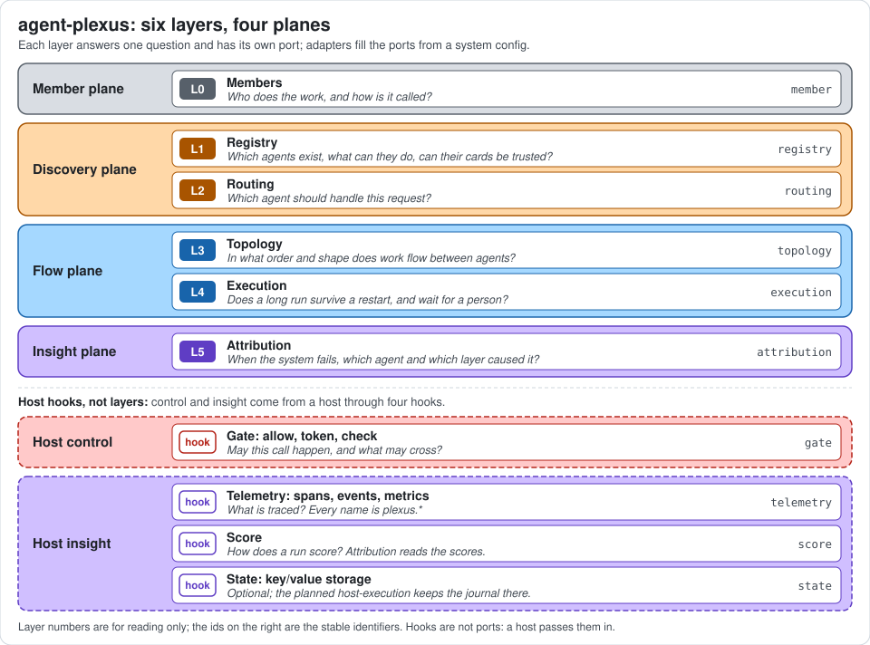

# Diagrams

Conventions for the diagrams in these docs, and an index of all of them. Diagrams are [Mermaid](https://mermaid.js.org)
blocks, which GitHub renders, plus one static figure.



The figure is `docs/assets/system-overview.svg`, a hand-written SVG on a neutral background so it reads in light and
dark themes. It lists the layers from `LAYERS` in `packages/core/src/layers.ts` and the host hooks from
[spec/hooks.md](../spec/hooks.md); keep both in step.

The conventions are those of agent-layers, so a diagram of a system that runs on an agent-layers host reads the same
way. agent-plexus adds no plane colours of its own: it maps its planes onto the existing palette.

## Conventions

- **One colour per plane.** Every layer node takes the class of its plane. Nodes that are not a layer (a caller, a
  backend, an adapter, a step of a process, the core's own functions) use the neutral `external` class, dashed.
- **Labels carry the layer.** A layer node reads `L3 topology` plus a short role. Ports use their exact names from
  [spec/ports](../spec/ports/README.md); adapters use their names from [adapters.md](adapters.md). Planned adapters
  and candidates say so in the label.
- **Small.** About fifteen nodes at most; split a diagram instead of growing it.
- **Arrows.** A solid arrow is a call or a flow of data. A dotted arrow is observation (telemetry, hop records),
  governance or an optional or planned path. A plain line joins an adapter to the port it fills.
- **Sequence diagrams** take no plane colours. Participants are named `layer (Ln)`, `host` for the host and its hooks,
  and `core` for the core's own functions (`assemble`, `memberCall`).
- **Accuracy.** A diagram must match `LAYERS` in `packages/core/src/layers.ts`, the port pages and the adapter
  catalog. Nothing checks inside diagram blocks, so check them by hand when the system changes.

### Palette

Paste only the lines for the classes a diagram uses, unchanged, at the end of the block, and assign a class with
`:::name` on the node.

| agent-plexus plane | Class | Fill | Stroke | Layers |
|---|---|---|---|---|
| Member plane | `foundation` | `#d9dde3` | `#57606a` | `member` |
| Discovery plane | `model` | `#ffd8a8` | `#a85400` | `registry`, `routing` |
| Flow plane | `agent` | `#a5d8ff` | `#1864ab` | `topology`, `execution` |
| Insight plane | `insight` | `#d0bfff` | `#5f3dc4` | `attribution`; the host's `telemetry`, `score` and `state` hooks |
| Host control | `control` | `#ffc9c9` | `#b42318` | the host's `gate` hook |
| Host exposure | `experience` | `#b2f2bb` | `#2a7a38` | the host's gateway |
| Not a layer | `external` | `#ffffff` | `#57606a` | callers, backends, adapters, steps, the core's functions |

Red and green are the host's planes in agent-layers; agent-plexus uses them only for the `gate` hook and the exposure
it receives, never for a layer of its own. Purple is the insight plane in both projects: in agent-plexus it colours the
layer `attribution` (L5), and the host's insight hooks (`telemetry`, `score`, `state`) share it, so a purple node is
either that layer or one of those hooks, and its label says which.

```text
classDef foundation fill:#d9dde3,stroke:#57606a,color:#1f2328
classDef model fill:#ffd8a8,stroke:#a85400,color:#1f2328
classDef agent fill:#a5d8ff,stroke:#1864ab,color:#1f2328
classDef control fill:#ffc9c9,stroke:#b42318,color:#1f2328
classDef experience fill:#b2f2bb,stroke:#2a7a38,color:#1f2328
classDef insight fill:#d0bfff,stroke:#5f3dc4,color:#1f2328
classDef external fill:#ffffff,stroke:#57606a,color:#1f2328,stroke-dasharray:4 3
```

Fills are light and the text is dark in every class, so nodes stay readable in light and dark themes.

### Checking a diagram

```bash
npx -y @mermaid-js/mermaid-cli@11.4.2 -i docs/layers/topology.md -o /tmp/topology-check.md
```

The command renders every Mermaid block of a Markdown file and fails on a syntax error.

## Index

### Overview

| Diagram | Where | Shows |
|---|---|---|
| System figure | [README](../README.md), [stack.md](stack.md), this page | Six layers in four planes, one question per layer, and the four host hooks |
| Request through the system | [README](../README.md#request-through-the-system) | A run across the layers, with the host's gate, telemetry and score around it |
| Planes at a glance | [stack.md](stack.md#planes-at-a-glance) | How the member, discovery, flow and insight planes relate to the host |
| Request flow | [stack.md](stack.md#request-flow) | Which layer calls which, in more detail |
| Ports and adapters | [stack.md](stack.md#ports-and-adapters) | Core ports, implemented adapters, planned adapters, candidates |
| Developer journey | [product.md](product.md#the-developer-journey) | Members, config, `check`, `run`, `eval`, production check |
| Profile ladder | [product.md](product.md#profile-ladder) | What changes from the prototype to the production profile |
| Hexagonal model | [architecture.md](architecture.md#hexagonal-model) | Inbound, core, outbound adapters and host hooks |
| Data flow of one run | [architecture.md](architecture.md#data-flow-of-one-run) | One run end to end, including the gate and the journal |

### Layers

Each layer page has a **Where it sits** diagram: its port, what calls it and what it calls. Some pages add one more.

| Layer | Where it sits | Additional diagram |
|---|---|---|
| `member` (L0) | [member.md](layers/member.md#where-it-sits) | [Remote call and resume](layers/member.md#remote-call-and-resume): sequence of a two-phase call over A2A, checkpoint, then resume after a restart |
| `registry` (L1) | [registry.md](layers/registry.md#where-it-sits) | |
| `routing` (L2) | [routing.md](layers/routing.md#where-it-sits) | [Decision flow](layers/routing.md#decision-flow): candidates, the router's answer checked, no member to fallback or `rejected` |
| `topology` (L3) | [topology.md](layers/topology.md#where-it-sits) | [Reference topology](layers/topology.md#reference-topology): the offline example with the node path of each hop |
| `execution` (L4) | [execution.md](layers/execution.md#where-it-sits) | [Step and replay](layers/execution.md#step-and-replay): replay a stored result, resume a kept task handle, or invoke |
| `attribution` (L5) | [attribution.md](layers/attribution.md#where-it-sits) | [Rules at a glance](layers/attribution.md#rules-at-a-glance): which stop code points to which layer |

### Cross-cutting

| Diagram | Where | Shows |
|---|---|---|
| Threat map | [security.md](cross-cutting/security.md#threat-map) | Which layer or hook mitigates which threat |

### Proposals

| Diagram | Where | Shows |
|---|---|---|
| Delegation bounds | [agent-layers-delegation-bounds.md](proposals/agent-layers-delegation-bounds.md#diagram) | Sequence across four stacks: deadline, hops and actors passed on, the fourth stopped with `hop_limit` |
