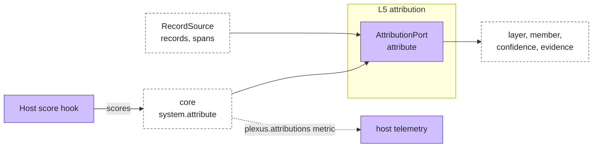

# Attribution

Layer id `attribution` (L5), Insight plane. *When the system fails, which agent and which layer caused it?*

## Responsibility

Name the layer and the member behind a failed run from its hop records and scores. Scores come from the host's `score`
hook; agent-plexus adds attribution across hops, not another scorer.

## Ports

| Port | What it does |
|---|---|
| [AttributionPort](../../spec/ports/AttributionPort.md) | `attribute` an `AttributionInput` (hop record, result, scores, optional record source) into a list of `Attribution` |

Data shapes: `HopRecord`, `Score` and `Attribution` in [spec/language.md](../../spec/language.md).

An `Attribution` is `{ layer, member?, memberLayer?, hopId?, confidence, evidence, by }`. `layer` is a plexus layer id,
or `host` when the host refused a call. `memberLayer` is the member's own name for where it failed (an agent-layers
layer id, for instance). `confidence` is in [0, 1]; `evidence` is a list of short identifiers (codes, hop ids, node
paths), never texts.

A `RecordSource` is an interface inside this layer, not a port: `records(rootRunId)` and, when available,
`spans(hopId)` with the member's own spans (`name`, `layer?`, `status?`, `attrs?`).

### Where it sits



## Standards

None. The method is from research on multi-agent failure: attribute to an agent first, a step second; structured hop
records beat log text. See [research/protocols.md](../research/protocols.md).

## Boundaries

- Rules branch on the stop code only; `detail` is never parsed.
- Hops the topology abandoned are skipped.
- Waiting is not a failure: `needs_input`, a member's `needs_auth` and `aborted` give no attribution.
- The upstream rule is an approximation: the record does not say which hop's output fed which, so the upstream hop is
  the previous completed hop in record order.
- `system.attribute` reads at most `limits.attribution.maxRecords` records and gives the adapter an in-memory record
  source, `memory`, of the last 100 runs. It has records only; member spans need a trace-backed source (planned).

## Rules of `rule-attribution`

| # | Situation | Layer | Member | Confidence |
|---|---|---|---|---|
| 1 | The candidate is the earliest hop that did not complete, or whose member failed an expectation (a score with `member` below 1) | | | |
| 1 | Completed hop of a member that failed an expectation | `member` | The hop | medium |
| 2 | A route node that chose no member | `routing` | none | high |
| 3 | `hop_limit` | `topology`, `routing` when a router chose the call | none | high |
| 3 | `timeout`, `limit` with `reason.layer` `topology` (the system's own limit or deadline) | `topology` | none | high |
| 3 | `timeout`, `limit` otherwise | `member` | `limit`: the hop with the most tokens, else the highest cost, else the longest duration. `timeout`: the longest duration | medium |
| 3 | `denied`, `needs_auth` from the host | `host` | none | high |
| 3 | `guard_block` from the host | `host` | `receive`: the hop's own member; `send`: the previous completed hop's member | high |
| 3 | `guard_block` from a member, with an earlier completed hop | `member` | That upstream hop's member | medium |
| 3 | `guard_block` otherwise, `failed`, `error`, other codes | `member` | The hop | high with a member layer, else medium |
| 3 | `rejected` | `member` | The hop | low |
| 4 | Every hop completed and a score is below 1 | `member` | The last completed hop | low |

Confidence values: high 0.9, medium 0.6, low 0.3. Over A2A today every remote stop except a cancellation arrives as
`rejected`, until the stop code crosses the boundary ([proposal](../proposals/agent-layers-delegation-bounds.md)).

## Configuration

```json
{ "ports": { "attribution": { "adapter": "rule-attribution" } }, "limits": { "attribution": { "maxRecords": 500 } } }
```

## Telemetry

| Kind | Name |
|---|---|
| metric | `plexus.attributions` by `plexus.layer` and `plexus.member` |

Planned: the spans of a remote member joined to its hop through the trace context the telemetry hook propagates.

## Evaluation

`agent-plexus eval` attributes every case that did not pass and prints one line per attribution:
`<layer> <member?> <memberLayer?> <confidence> <evidence>`. `--json` adds `layer`, `member`, `memberLayer`, `hopId`,
`confidence`, `evidence` and `by`. For a research-grade verdict (counterfactual replay, model judging) use the planned
`replay-attribution` and `judge-attribution`.

## How to swap

Change `ports.attribution.adapter`. Records and scores stay the same.

## Reference adapters

| Adapter | Maps | Status |
|---|---|---|
| [`rule-attribution`](../../adapters/rule-attribution) | Deterministic rules on hop records (prototype, production) | implemented |
| `judge-attribution` | A model reads the record, all at once or by binary search over hops; agent level only | planned |
| `replay-attribution` | Offline counterfactual replay: one member's output replaced, or one member swapped | planned |

Record sources: `memory` (implemented, inside the core); `journal`, `jsonl` (planned); Langfuse and Jaeger (candidates).

Full list: [adapters.md](../adapters.md).

## Reference setup

[`examples/offline`](../../examples/offline/README.md): `billing` stops with `error` when the input contains "crash",
and `eval` attributes the failure to layer `member`, member `billing`.
