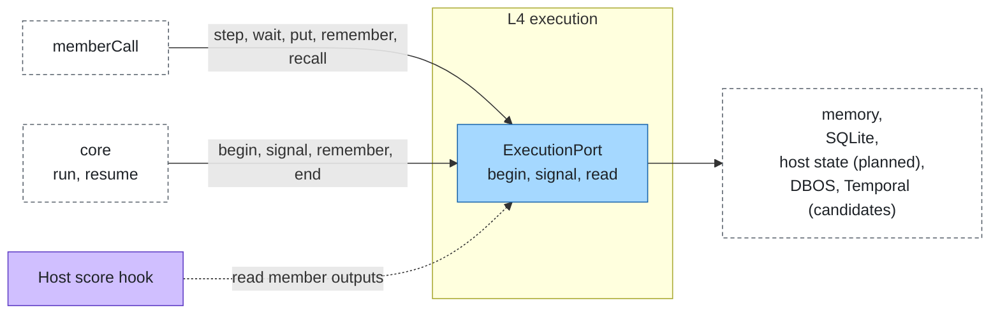
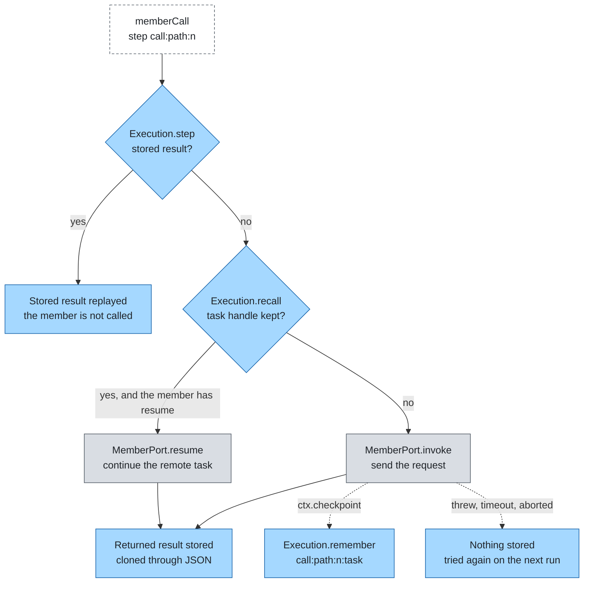
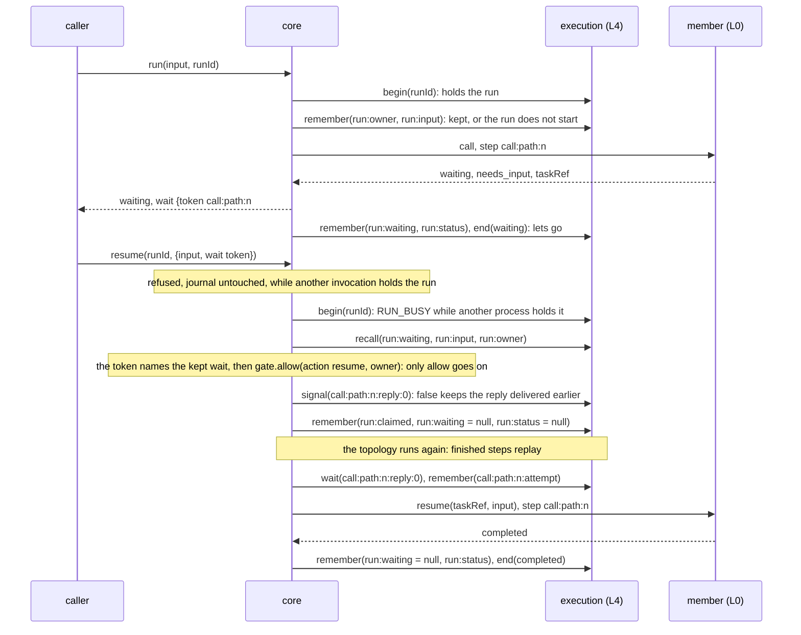

# Execution

Layer id `execution` (L4), Flow plane. *Does a long run survive a restart, and wait for a person?*

## Responsibility

Keep the journal of a run: each member call and each routing decision is a step that runs once and replays its stored
result when the run is begun again. The journal also holds the texts that hop records refer to, so records stay small
and free of content, and the reply that resumes a waiting run.

## Ports

| Port | What it does |
|---|---|
| [ExecutionPort](../../spec/ports/ExecutionPort.md) | `begin` a run by key and get an `Execution`; `signal` a waiting run; `read` a stored text by key |

An `Execution` has `step(name, fn)` (runs once, replays on resume; results must be JSON-serialisable),
`wait(name, untilAt)` (suspends until a `signal` or the deadline), `put(text)` (stores a text and returns its key),
`remember(key, value)` and `recall(key)` (a small JSON value kept for the run, such as a remote task handle) and
`end(status)`.

### Where it sits



## Standards

None. Durable engines (DBOS, Temporal, Hatchet) are candidates for adapters on this port.

## Step and replay

Each member call is one step, named `call:<node path>:<n>`, and each routing decision one step named
`route:<node path>:<n>`, where `<n>` counts the calls (or decisions) of that node path in the run, from 0: parallel
branches get the same keys on replay whatever order they finish in. A finished step replays; an unfinished step with a
kept task handle continues the remote task. Only final outcomes are stored: what the member returned, whatever its
status. A call that threw, timed out or was aborted, and a router or registry that failed, store nothing and are tried
again when the run is begun again.



## Waiting and resume

A run ends `waiting` when the host's gate answers `ask` (kind `gate`) or a member waits for input (kind `member`).
`System.resume(runId, reply)` answers it; `agent-plexus resume` does the same from the command line.



- One invocation runs a run at a time. A `run` or `resume` of a run another invocation holds fails (`failed`, `error`,
  layer `execution`, "run <id> is in progress") and touches nothing: in one process the core refuses it before
  `begin`; across processes `sqlite-execution` holds the run from `begin` to `end` and rejects another `begin` with
  `RUN_BUSY`. A refused invocation never ends or drops the run another one is running; it lets go of its own hold with
  `release`, leaving the run's status as it was (a run it created and kept nothing in ends `failed`). See
  [ExecutionPort](../../spec/ports/ExecutionPort.md#hold).
- The input of a run is kept as `run:input` when it starts, with `run:lineage`, and the identity of its caller as
  `run:owner` (`{id, kind, name?, actors?}`, `null` without a caller; never the credential, roles or scopes). If
  `run:owner` or `run:input` cannot be kept the run does not start ("run <id> could not be kept"), so nobody can take
  its id over later and replay it. A resume does not need the input again and carries its own caller.
- A resume asks the host's gate `allow` with action `resume`, the resumer as `caller`, the run's `owner` and the
  waiting member, before it delivers anything. `deny` stops it `denied` (layer `host`), `ask` returns it `waiting`
  (`needs_input`, layer `host`); the run stays as it was. The prototype host lets only the owner resume. A run with no
  kept owner cannot be resumed.
- `run` with the id of a run the journal knows continues it under the same rule (its owner, or a caller the gate lets
  `resume` it) and only with the same input: a different one fails (`failed`, `error`, layer `execution`, "run <id>
  exists with a different input") and `run:input` is never replaced.
- When a run ends `waiting`, the call it waits on is kept as `run:waiting`: `{key, attempt, kind, member, node}`, where
  `key` is the call's first step name. It is the wait the run's result names: every waiting result of a call carries
  `wait: {token, kind, member}` (`token` = `<key>#<attempt>`, `kind` `input` or `approval`), the topology passes it on,
  and `SystemResult.wait` names the kept wait. A graph that follows a waiting edge to a second wait, or a parallel node
  with a member wait and a gate ask, keeps the one its result reports. A run that ends otherwise keeps `null`.
- `resume` refuses (`failed`, code `error`, layer `execution`) a run that is not waiting, a reply whose `wait` token
  names another wait ("run <id> waits on another step", so a late or repeated reply cannot answer a later wait) and a
  reply of the other kind than the wait: `{approved, reason?}` answers a gate, `{input}` a member. A refused resume
  leaves the run's stored status and kept wait unchanged.
- It signals `<key>:reply:<attempt>`, then runs the topology again under the same run id with the kept input. Finished
  steps and routing decisions replay; the waiting call reads the reply with `wait` and makes a new attempt, kept as
  `<key>:attempt` and journaled as the step `<key>#<attempt>`. A waiting result is therefore never the final step of a
  call, and a replay after the resume uses the attempt's result.
- One reply per wait: `signal` is first wins. Of two concurrent resumes, the second fails as in progress; the member is
  resumed once. A resume whose `signal` returns `false` holds the run alone, so the reply was delivered by an earlier
  resume that stopped before it kept its claim: it goes on with that reply, not its own, and reports
  `plexus.execution.reply_kept`.
- After its signal, a resume keeps the wait as `run:claimed` and sets `run:waiting` and `run:status` to `null`: the run
  is in progress. Should it stop before the waiting call reads the reply (a crash, a deadline already past), `resume`
  finds nothing waiting; `run` with the same id and input continues the run, and the waiting call reads the claimed
  reply. After a crash, `sqlite-execution` keeps the run held until its `leaseMs` runs out.
- Kind `gate`: `gate.allow` is asked again with `answer` (`{approved, reason?, by}`, `by` the id of the caller that
  resumed); the host decides. Kind `member`: the input goes through the send check, then `resume(taskRef, input)` of
  the member; see [members](member.md).
- A run begun again with `run` instead of `resume` replays and still waits; nobody is called again.
- A resume is a new invocation: the deadline comes from its own context and the limits, the budget from its context
  less what the run spent before (`run:spent`). Replayed steps spend nothing from that budget, and their hop records
  are marked `replayed`: their `usage` and `costUsd` stay on the record but are not counted again in the resume's
  result, whose totals the core sums over the records that are not `replayed`.
- A value the core cannot keep (a `run:*` key, a waiting member's handle) and a failed `end` or `release` are reported
  as the telemetry event `plexus.execution.write_failed` (the key, `end` or `release`, and the error, never the value);
  the run goes on but may not be resumable.
- It needs the journal of the run: across processes, a durable adapter such as `sqlite-execution`.
  `memory-execution` resumes only within the process that ran it. `sqlite-execution` has no wake-up across processes: a
  signal sent by another process is seen by a later `wait`.

## Boundaries

- The run key is the run id. A durable adapter resumes an existing run with the same key.
- Each member call is one step named `call:<node path>:<n>` (`#<attempt>` appended for a resumed attempt); the
  member is not called again on replay. Each routing decision is a step `route:<node path>:<n>`, so a router that
  would answer differently cannot change the path of a replay.
- Step results and signal values are cloned through JSON, so a replay returns exactly what a resume would.
- Next to each step the core keeps the remote task handle a member checkpointed, with `remember` under
  `call:<node path>:<n>:task`, and reads it with `recall` before calling. If the step has no stored result but a
  handle exists (the run stopped in between), the member continues that task through `resume` instead of being sent
  the request again. The handle lives and dies with the run's journal, like the steps: `memory-execution`,
  `sqlite-execution` and the example `file-execution` keep it, and it survives a restart only where the journal does.
  A crash before the handle is kept can still send the request twice; see [members](member.md).
- Texts sent to and received from a member are stored with `put`; hop records carry the keys (`inputRef`,
  `outputRef`), never the texts. Any host's `score` hook reads member outputs through the `read` the core passes it
  (`ScoreContext.read`, the execution adapter's `read`).
- A host verdict `ask` ends the call as `waiting` with code `needs_input`; `resume` answers it (see above). The core
  calls `wait` only for a reply it has just signalled, with a deadline already passed.
- The budget is the run's: after every call that settles its budget the core keeps what the run spent as
  `run:spent`, and an invocation starts from its bounds less that. A replayed step spends nothing (the invocation that
  ran it counted it) and needs no budget, so a run whose budget is spent still replays; any other call stops with
  `limit` before the host's gate is asked or a credential minted (the core asks the journal whether the step has a
  stored result first). A call that ends `waiting` spends only what its member reported, so the resume that continues
  it is still funded; the continuation settles what it spends.
- A step's function runs in the caller's process inside `step`; the core keeps the outcome of a call that is not final
  in its own state, so an engine that serialises or wraps the error `step` rejects with works unchanged.
- Prototype adapters lose the journal on restart; the readiness gate refuses them on a production tier.

## Configuration

```json
{
  "ports": { "execution": { "adapter": "memory-execution", "options": { "maxRuns": 1000 } } }
}
```

## Telemetry

The journal emits no span of its own; its steps run inside the `plexus.hop` span of the call. A value the core cannot
keep, or a failed `end` or `release`, emits the event `plexus.execution.write_failed` (layer `execution`) with
`plexus.execution.key` and `plexus.error.message`, never the value. `plexus.execution.reply_kept` (a resume went on
with a reply delivered earlier) and `plexus.execution.wait_inferred` (a waiting result named no wait of the run) carry
`plexus.member`.

## Evaluation

Expectations on a member's output (`contains`, `matches`) read the stored text through `read`, which the core passes
to any host's scorer; a host without `score` gets the built-in `expected` checks. An adapter without `read` leaves only
`status` to check, and a case that asks for more fails with `output unavailable`.

## How to swap

Change `ports.execution.adapter`. Members and topology stay. A production profile needs a durable adapter, such as `sqlite-execution`.

## Reference adapters

| Adapter | Maps | Status |
|---|---|---|
| [`memory-execution`](../../packages/adapters/src/memory-execution) | An in-process journal; lost on restart (prototype only) | implemented |
| [`sqlite-execution`](../../packages/adapters/src/sqlite-execution) | SQLite through `node:sqlite`; a run survives a restart (prototype, production) | implemented |
| `host-execution` | The journal in the host's `state` hook | planned |
| DBOS, Temporal, Hatchet | MIT | candidate |

Full list: [adapters.md](../adapters.md).

## Reference setup

[`examples/offline`](../../examples/offline/README.md) uses `memory-execution`; its `production` profile is refused for
that reason.
