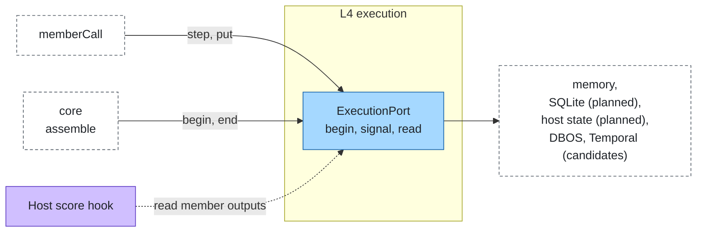

# Execution

Layer id `execution` (L4), Flow plane. *Does a long run survive a restart, and wait for a person?*

## Responsibility

Keep the journal of a run: each member call is a step that runs once and replays its stored result on resume. The
journal also holds the texts that hop records refer to, so records stay small and free of content.

## Ports

| Port | What it does |
|---|---|
| [ExecutionPort](../../spec/ports/ExecutionPort.md) | `begin` a run by key and get an `Execution`; `signal` a waiting run; `read` a stored text by key |

An `Execution` has `step(name, fn)` (runs once, replays on resume; results must be JSON-serialisable),
`wait(name, untilAt)` (suspends until a `signal` or the deadline), `put(text)` (stores a text and returns its key) and
`end(status)`.

### Where it sits



## Standards

None. Durable engines (DBOS, Temporal, Hatchet) are adapters on this port.

## Boundaries

- The run key is the run id. A durable adapter resumes an existing run with the same key.
- Each member call is one step named `call:<node path>:<index>`; the member is not called again on replay.
- Step results and signal values are cloned through JSON, so a replay returns exactly what a resume would.
- Texts sent to and received from a member are stored with `put`; hop records carry the keys (`inputRef`,
  `outputRef`), never the texts. The host's `score` hook reads member outputs through `read`.
- A host verdict `ask` ends the call as `waiting` with code `needs_input`. Resuming a waiting run is planned; today
  `wait` and `signal` are part of the port and implemented by `memory-execution`, but the core does not call them.
- The budget ledger of a run is held in memory by the core; keeping it in the journal so it resumes with the run is
  planned.
- Prototype adapters lose the journal on restart; the readiness gate refuses them on a production tier.

## Configuration

```json
{
  "ports": { "execution": { "adapter": "memory-execution", "options": { "maxRuns": 1000 } } }
}
```

## Telemetry

The journal emits no span of its own; its steps run inside the `plexus.hop` span of the call.

## Evaluation

Expectations on a member's output (`contains`, `matches`) read the stored text through `read`; an adapter without `read`
leaves only `status` to check, and a case that asks for more fails with `output unavailable`.

## How to swap

Change `ports.execution.adapter`. Members and topology stay. A production profile needs a durable adapter.

## Reference adapters

| Adapter | Maps | Status |
|---|---|---|
| [`memory-execution`](../../adapters/memory-execution) | An in-process journal; lost on restart (prototype only) | implemented |
| `sqlite-execution` | SQLite through `node:sqlite` | planned |
| `host-execution` | The journal in the host's `state` hook | planned |
| DBOS, Temporal, Hatchet | MIT | candidates |

Full list: [adapters.md](../adapters.md).

## Reference setup

[`examples/offline`](../../examples/offline/README.md) uses `memory-execution`; its `production` profile is refused for
that reason.
