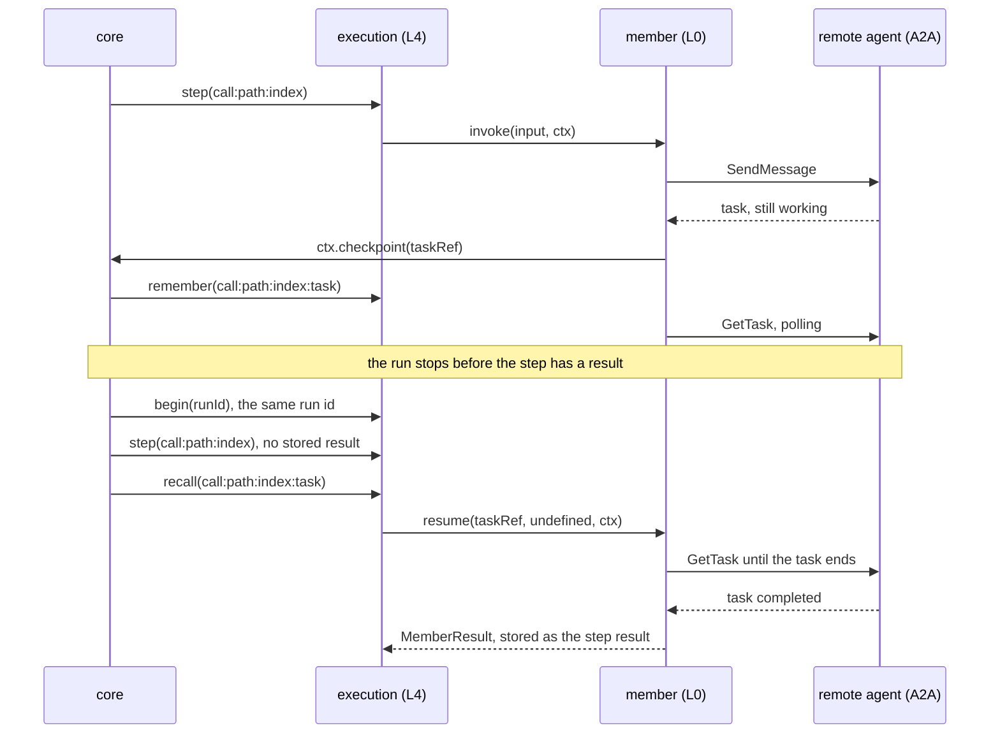

# Members

Layer id `member` (L0), Member plane. *Who does the work, and how is it called?*

## Responsibility

Describe one agent and call it. A member is any agent that can take an input and return a result: a function, an
agent served over a protocol, a whole agent stack, another agent-plexus system. The member owns its loop; this layer
owns only the call.

## Ports

| Port | What it does |
|---|---|
| [MemberPort](../../spec/ports/MemberPort.md) | `describe` the member as an `AgentEntry`; `invoke` it with an input and a call context; optional `resume` (continue remote work), `cancel` and `native` |

Data shapes: `AgentEntry`, `MemberResult`, `RunInput` and `Bounds` in [spec/language.md](../../spec/language.md).

One MemberPort instance exists per configured member. The call context is the run context plus the hop id, the
credential from the host's gate for the member's audience, the outbound bounds (time left, hops, reserved budget,
lineage) and `checkpoint(taskRef)`. A result has a `status` (`completed`, `failed`, `stopped`, `waiting`), an `output`, and a structured `reason`
when it did not complete; consumers branch on `reason.code` only.

### Where it sits


## Standards

Mapped by adapters, not by the port:

- A2A 1.0, and 0.3 through the SDK, for agents in any framework (adapter `a2a-member`, JSON-RPC binding).
- The agent-layers stack, in process (adapter `agent-layers`).

## Remote call and resume

A remote call is two-phase. The member checkpoints the remote task as soon as the other side has the work; a run begun
again with the same run id continues that task instead of sending the request again. Shown with `a2a-member`.



## Boundaries

- Members are reached only through `memberCall`; a topology cannot call a port directly.
- The caller reaches the member without its credential. The member receives a token for its own audience from the
  host's gate, never the caller's.
- The audience comes from config (`audience` option), never from a card.
- Bounds reach the member as `ctx.outbound`: time as remaining milliseconds, never a clock time. A member can only
  tighten them.
- A member that throws, or returns an unknown status, becomes `failed` with code `error`; the core never rejects. What
  the member returned is journaled as the call's result; a throw, a timeout or an abort is not, so a run begun again
  calls the member again.
- A remote call is two-phase. The member calls `ctx.checkpoint(taskRef)` as soon as the remote side has the work; the
  core keeps the handle in the run's journal next to the step (`call:<node path>:<n>:task`). If the run is begun
  again with the same run id before the step finished, a member with `resume` is asked to wait for that task through
  `resume(taskRef, undefined, ctx)` instead of being sent the request again. A finished step replays its stored result
  and calls nobody.
- A crash between sending the request and the checkpoint can still send the request twice, so a member should
  tolerate a repeated request. A member without `resume`, or one that never checkpoints, is invoked again.
- A member that waits for input returns `waiting` (`needs_input`, or `needs_auth`) with its handle, checkpointed or in
  `taskRef`. `System.resume(runId, { input })` answers it: the input goes through the send check like any outbound
  text, then `resume(taskRef, input, ctx)` continues the same remote task as a new attempt of the call (step
  `call:<node path>:<n>#<attempt>`, hop record `attempt`). The receive check, the budget and the hop record work as
  for any call. A member without `resume`, or without a kept handle, stops with code `rejected`, layer `member`. See
  [execution](execution.md#waiting-and-resume).
- On its own deadline the adapter cancels the remote task itself (`a2a-member` sends `CancelTask`). The core calls
  `cancel`, best effort and bounded by `limits.system.cancelTimeoutMs`, for a call whose task it knows whenever it cuts
  the call off (an abort of the run or the call, or its own step or deadline timeout, which aborts the call signal with
  a `TimeoutError` reason), and when the topology abandons a call that ended `waiting`; the adapter then leaves the
  task to it, so the task is cancelled once. A cancelled task's handle is forgotten, so a later invocation of the run
  invokes the member again instead of resuming it. A result the member returned itself is never cancelled. A cancel
  that fails is reported as `plexus.member.cancel_failed`; it changes no result.
- An adapter declares in its descriptor's `capabilities` (`resume`, `cancel`, `checkpoint`, `waits`) what its members
  do. The readiness gate warns about a member that `waits` without `resume`, and about one that `checkpoint`s without
  `cancel` raced by a `parallel` with `join: "first"`.
- A member's own name for where it stopped goes in `reason.memberLayer`, never in `reason.layer`: a member speaks for
  layer `member` only. The core moves a plexus layer or `host` a member names to `memberLayer` and sets `member`.
- A call that ends `waiting` spends from the budget only what it reported; its continuation settles the rest. `usage`
  and `costUsd` that are not finite non-negative numbers are dropped (event `plexus.member.figure_dropped`).
- Bounds travel to a remote agent in the [bounds extension](../../spec/extensions/bounds-v1.md) of A2A (canonical in
  agent-layers): time left, hops, budget and lineage; the report on the task settles the budget and names a stop of the
  remote bounds (`hop_limit`, `timeout`, `limit`). To an agent-layers stack in process they go as the run's
  `delegation`.

## Configuration

```json
{
  "members": {
    "billing": {
      "adapter": "function-member",
      "options": { "module": "./members/billing.ts#answer", "description": "Answers invoice questions", "tags": ["billing"], "audience": "billing" }
    }
  }
}
```

Options per adapter are in each package README. The member id is the key; it is the name used in the topology, in hop
records and in `plexus.member`.

## Telemetry

| Kind | Name |
|---|---|
| span | `plexus.hop`, with `plexus.layer` = `member`, `plexus.system`, `plexus.member`, `plexus.hop`, `plexus.node.path`, then `plexus.run.status` and `plexus.run.reason` |
| event | `plexus.parts.dropped` when an input carried `parts` that did not cross |
| event | `plexus.member.resumed` when the call continued remote work through `resume`: journaled work after a restart, or a reply to a waiting member (no content) |
| event | `plexus.checkpoint.ignored` when a member checkpointed a handle that is not a non-empty string of at most 1024 characters |
| event | `plexus.member.figure_dropped` when a member reported `usage` or `costUsd` that is not a finite non-negative number (dropped) |
| metric | `plexus.hops` by member and status |

## Evaluation

A case can set an expectation per member: `expected.members.<id>` with `status`, `contains` or `matches` on the last
hop of that member. A failed expectation attributes to layer `member`. See [attribution](attribution.md).

## How to swap

Change the member's `adapter` and options. The topology, the router rules and the tests stay. A framework that serves
A2A needs no adapter of its own.

## Reference adapters

| Adapter | Maps | Status |
|---|---|---|
| [`function-member`](../../packages/adapters/src/function-member) | An in-process function (prototype, production) | implemented |
| [`a2a-member`](../../packages/adapters/src/a2a-member) | An agent served over A2A 1.0 and 0.3, on the official JavaScript SDK (prototype, production); card fetched without credential and verified against configured keys, endpoint pinning, https and private-address rules, polling, resume, cancel, bounds extension | implemented |
| [`agent-layers`](../../packages/adapters/src/agent-layers) | An agent of an agent-layers stack, in process (prototype, production); the outbound bounds become the run's `delegation` (deadline, hops, budget, lineage) and the caller's `actors` map both ways; a waiting stack run is reported with its approval under `ext["agent-layers.approval"]`, but not resumed (`waits` without `resume`) | implemented |
| `agent-layers`: tool source of `supervise` | The stack's tools as what a supervisor can call | planned |

Another agent-plexus system as a member works in process through the `fn` option of `function-member` (code only, not
JSON config): a function that runs the other system and returns its `SystemResult`, which extends `MemberResult`. Over
the network it is an agent served over A2A, called through `a2a-member`. `a2a-member` is tested against a real
agent-layers stack served by its gateway. How to call a remote agent: [guide](../guide.md#call-a-remote-agent).

Full list: [adapters.md](../adapters.md).

## Reference setup

[`examples/offline`](../../examples/offline/README.md) has three function members: `triage`, `billing`, `manuals`.
