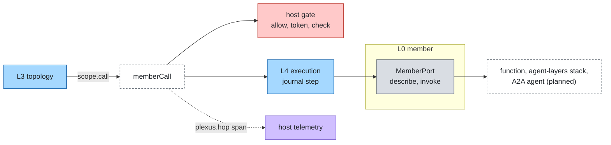

# Members

Layer id `member` (L0), Member plane. *Who does the work, and how is it called?*

## Responsibility

Describe one agent and call it. A member is any agent that can take an input and return a result: a function, an
agent served over a protocol, a whole agent stack, another agent-plexus system. The member owns its loop; this layer
owns only the call.

## Ports

| Port | What it does |
|---|---|
| [MemberPort](../../spec/ports/MemberPort.md) | `describe` the member as an `AgentEntry`; `invoke` it with an input and a call context; optional `resume`, `cancel` and `native` |

Data shapes: `AgentEntry`, `MemberResult`, `RunInput` and `Bounds` in [spec/language.md](../../spec/language.md).

One MemberPort instance exists per configured member. The call context is the run context plus the hop id, the
credential from the host's gate for the member's audience, and the outbound bounds (time left, hops, reserved budget,
lineage). A result has a `status` (`completed`, `failed`, `stopped`, `waiting`), an `output`, and a structured `reason`
when it did not complete; consumers branch on `reason.code` only.

### Where it sits



## Standards

Mapped by adapters, not by the port:

- A2A 1.0 for agents in any framework (planned `a2a-member`).
- The agent-layers stack, in process (adapter `agent-layers`).

## Boundaries

- Members are reached only through `memberCall`; a topology cannot call a port directly.
- The caller reaches the member without its credential. The member receives a token for its own audience from the
  host's gate, never the caller's.
- The audience comes from config (`audience` option), never from a card.
- Bounds reach the member as `ctx.outbound`: time as remaining milliseconds, never a clock time. A member can only
  tighten them.
- A member that throws, or returns an unknown status, becomes `failed` with code `error`; the core never rejects.
- Planned: a remote call is two journal steps (store the `taskRef`, then wait for the end), so a restart resumes
  instead of sending again; on deadline or cancel the adapter cancels the remote task.

## Configuration

```json
{
  "members": {
    "billing": {
      "adapter": "function-member",
      "options": { "module": "./members/billing.ts#answer", "description": "Answers invoice questions", "tags": ["billing"], "audience": "billing" }
    }
  }
}
```

Options per adapter are in each package README. The member id is the key; it is the name used in the topology, in hop
records and in `plexus.member`.

## Telemetry

| Kind | Name |
|---|---|
| span | `plexus.hop`, with `plexus.layer` = `member`, `plexus.system`, `plexus.member`, `plexus.hop`, `plexus.node.path`, then `plexus.run.status` and `plexus.run.reason` |
| event | `plexus.parts.dropped` when an input carried `parts` that did not cross |
| metric | `plexus.hops` by member and status |

## Evaluation

A case can set an expectation per member: `expected.members.<id>` with `status`, `contains` or `matches` on the last
hop of that member. A failed expectation attributes to layer `member`. See [attribution](attribution.md).

## How to swap

Change the member's `adapter` and options. The topology, the router rules and the tests stay. A framework that serves
A2A needs no adapter of its own.

## Reference adapters

| Adapter | Maps | Status |
|---|---|---|
| [`function-member`](../../adapters/function-member) | An in-process function (prototype, production) | implemented |
| `a2a-member` | An agent served over A2A 1.0, on the official JavaScript SDK | planned |
| [`agent-layers`](../../adapters/agent-layers) | An agent of an agent-layers stack, in process (prototype, production); deadline, hops and budget are not passed on yet, because agent-layers has no bounds | implemented |
| `agent-layers`: tool source of `supervise` | The stack's tools as what a supervisor can call | planned |

Another agent-plexus system as a member works today in process: the `fn` option of `function-member` (code only, not JSON
config) takes a function that runs the other system and returns its `SystemResult`, which extends `MemberResult`. Over
the network it is planned, through `a2a-member`.

Full list: [adapters.md](../adapters.md).

## Reference setup

[`examples/offline`](../../examples/offline/README.md) has three function members: `triage`, `billing`, `manuals`.
