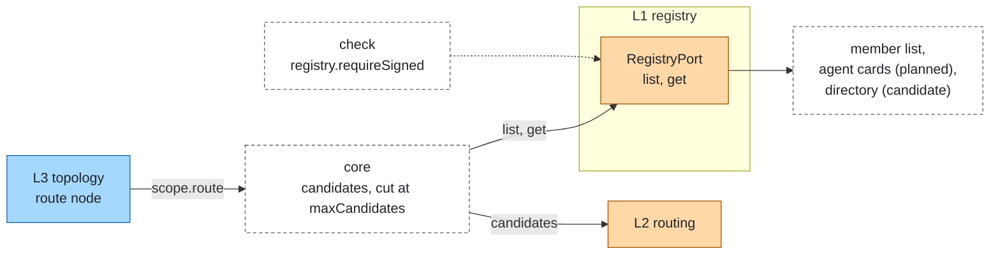

# Registry

Layer id `registry` (L1), Discovery plane. *Which agents exist, what can they do, can their cards be trusted?*

## Responsibility

List the agents of the system with what they can do, and say how far each can be trusted. The registry answers
questions about candidates; it does not choose among them ([routing](routing.md)) and does not call them
([member](member.md)).

## Ports

| Port | What it does |
|---|---|
| [RegistryPort](../../spec/ports/RegistryPort.md) | `list` entries that match a filter; `get` one entry by id |

Data shapes: `AgentEntry` and `CandidateFilter` in [spec/language.md](../../spec/language.md).

An `AgentEntry` has `id`, `name`, `description`, `skills` (`id`, `name`, `description`, `tags`), `endpoint`
(`protocol`, `url?`, `ref?`), `audience?`, `attrs?`, `trust` (`signed`, `keyId?`, `pinned`) and `version?`. A filter has
`skills`, `tags` and `attrs`; an empty list is no constraint.

### Where it sits



## Standards

Mapped by adapters, not by the port:

- A2A agent cards (`/.well-known/agent-card.json`): skills, security schemes, JWS signatures. `a2a-member` reads and
  verifies the card of its own member; a registry source that lists cards is planned.
- AGNTCY Agent Directory with OASF skills, and Kubernetes CRDs: candidates.

## Boundaries

- Cards are untrusted. `a2a-member` checks their JWS signatures against configured keys only, bounds their size
  (its option `maxCardBytes`) and caches them for its option `cardTtlMs`. Production requires signed cards or endpoints
  pinned in config.
- `audience` always comes from config; a card cannot set the audience a token is minted for.
- `registry.requireSigned` makes `check` fail every member with neither a signed card nor a pinned endpoint. A
  function member is pinned.
- `registry.requireListed` makes the registry a gate: a member call needs the registry to return the member, else it is
  `denied` (layer `registry`). Without it the registry only supplies route candidates.
- The core cuts the candidates it hands to a router at `limits.router.maxCandidates`.
- Choosing among candidates is [routing](routing.md); a registry does not rank.

## Signed cards

- **Verifies**: the member that reads the card. `a2a-member` checks the JWS of its remote card against the keys in
  config and reports `trust: { signed, keyId, pinned }` on its entry. A registry takes that as given.
- **Enforces**: the `static-registry` `trust` policy (`requireSigned`, `keyIds`, `exempt`). An entry that fails it is not
  returned by `get`, is left out of `list`, and is reported once as a `plexus.registry.refused` event with the member id
  and the reason (`unsigned` or `key`).
- **Direct calls**: only with the system config flag `registry.requireListed: true` does the core refuse to call a member
  the registry does not return, even when the topology names it directly (`denied`, layer `registry`); `check` fails a
  member the registry does not list. Without the flag a refused member can still be named by the topology. The flag is in
  the [config reference](../guide.md#stack-config-reference).
- **Production**: `requireSigned` with `keyIds`, `exempt` listing the local members (they have no card), and
  `registry.requireListed: true`.

```json
{
  "ports": {
    "registry": {
      "adapter": "static-registry",
      "options": { "trust": { "requireSigned": true, "keyIds": ["partners-2026"], "exempt": ["triage"] } }
    }
  }
}
```

## Configuration

```json
{
  "ports": {
    "registry": { "adapter": "static-registry", "options": { "entries": { "billing": { "tags": ["billing"] } } } }
  },
  "registry": { "requireSigned": false, "requireListed": false }
}
```

The registry slot is optional; a `route` node needs it to find candidates. The registry has no system limits: card size
and lifetime are options of the adapter that fetches cards (`a2a-member`: `maxCardBytes`, `cardTtlMs`). Limits:
[limits.md](../limits.md).

## Telemetry

The registry emits no span of its own. Candidate lookup happens inside the `plexus.route` span of
[routing](routing.md).

## Evaluation

A wrong or missing candidate shows as a route that chose no member, attributed to layer `routing`. Tags and skills in
the registry are what routing rules and evaluation cases rely on.

## How to swap

Change `ports.registry.adapter`. Members, rules and topology stay. An adapter that fetches cards takes its card limits
as its own options.

## Reference adapters

| Adapter | Maps | Status |
|---|---|---|
| [`static-registry`](../../adapters/static-registry) | The members configured in the system, with overrides from config; fetches nothing (prototype, production) | implemented |
| Card-fetching registry | Cards listed in config, fetched, pinned, signatures checked | candidate |
| AGNTCY Agent Directory + OASF | Apache-2.0 | candidate |
| Kubernetes CRDs | Apache-2.0 | candidate |

Full list: [adapters.md](../adapters.md).

## Reference setup

[`examples/offline`](../../examples/offline/README.md) tags `billing` with `billing` and `manuals` with `product`.
