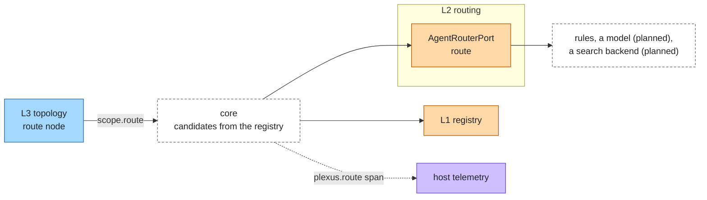
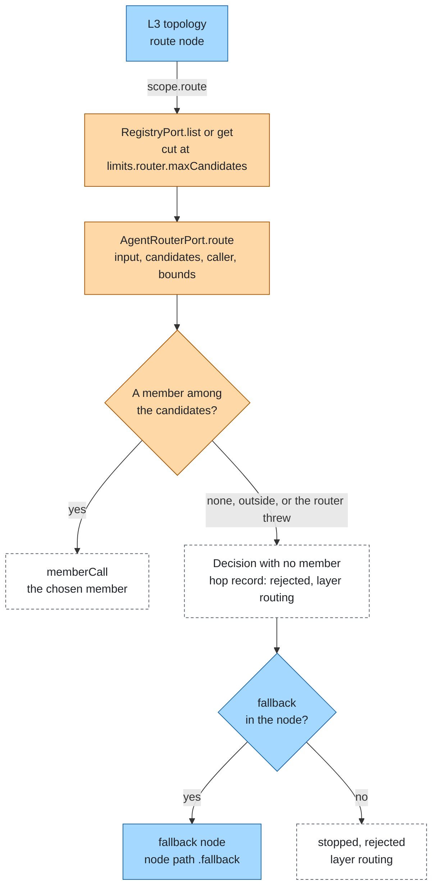

# Routing

Layer id `routing` (L2), Discovery plane. *Which agent should handle this request?*

## Responsibility

Choose one member among candidates for a request. Distinct from agent-layers' RouterPort, which picks a model.

## Ports

| Port | What it does |
|---|---|
| [AgentRouterPort](../../spec/ports/AgentRouterPort.md) | `route` a `RouteQuestion` into a `RouteDecision` |

Data shapes: `RouteQuestion` and `RouteDecision` in [spec/language.md](../../spec/language.md).

A question is `{ input, candidates, caller?, bounds? }`. A decision is `{ member?, ranked?, reason? }`. No `member` means
no candidate fits; `reason` is internal text and never parsed.

### Where it sits



## Standards

None. Routing metadata (skills, tags, attrs) comes from the registry entry. A2A skills are free text without cost,
latency or SLA fields, so richer metadata is agent-plexus' own and rides in the entry's `ext`.

## Decision flow

The core reads the candidates and checks the answer, so a router only picks among what it is given. A route that chose
nobody is a hop record of its own; the topology decides what happens next.



## Boundaries

- Routing picks; [topology](topology.md) decides what a missing choice means (`fallback`, else `rejected`).
- The core validates the answer: a member outside the candidates, or a router that throws, becomes a decision with no
  member.
- The router sees the caller without its credential and the run's bounds.
- A route that chose nobody is written as a hop record of its own (no member, a `route` field), so attribution can see
  it. It does not count as a step.
- The candidates are read from the registry and cut at `limits.router.maxCandidates`.

## Configuration

One router, or named routers; `route` and `handoff` nodes name one with `router` (default `router`).

```json
{
  "ports": {
    "router": { "adapter": "skill-router", "options": { "rules": [{ "member": "billing", "matches": "(?i)invoice|refund" }] } }
  },
  "topology": { "kind": "route", "candidates": ["billing", "manuals"], "router": "router", "fallback": "triage" }
}
```

```json
{
  "ports": {
    "router": { "rules": { "adapter": "skill-router", "options": { "rules": [] } }, "model": { "adapter": "model-router" } }
  }
}
```

The second form is a map of named routers; `model-router` is planned.

## Telemetry

| Kind | Name |
|---|---|
| span | `plexus.route`, with `plexus.layer` = `routing`, `plexus.system`, `plexus.node.path`, then `plexus.route.choice` (the chosen member, empty for none) |

## Evaluation

Expect the right member through `expected.members.<id>`: a hop of that member must exist. A route that chose nobody is
attributed to layer `routing` with high confidence. See [attribution](attribution.md).

## How to swap

Change `ports.router.adapter` or add a named router and point the node at it. Members and registry stay.

## Reference adapters

| Adapter | Maps | Status |
|---|---|---|
| [`skill-router`](../../adapters/skill-router) | Rules on regular expressions, tags and skills; the heaviest applicable rule wins (prototype, production) | implemented |
| `model-router` | A model chooses among names and descriptions, as a structured answer | planned |
| `knowledge-router` | A search backend ranks entries | planned |

Full list: [adapters.md](../adapters.md).

## Reference setup

[`examples/offline`](../../examples/offline/README.md): billing on `(?i)invoice|refund|charge`, manuals on
`(?i)manual|setup|product`; anything else falls back to `triage`.
