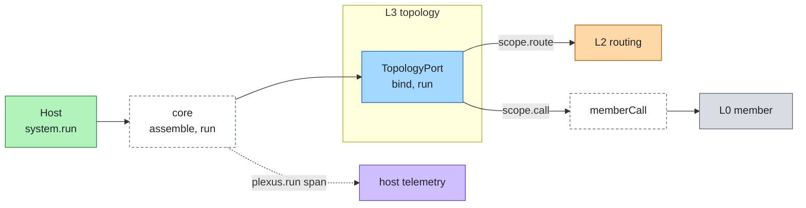
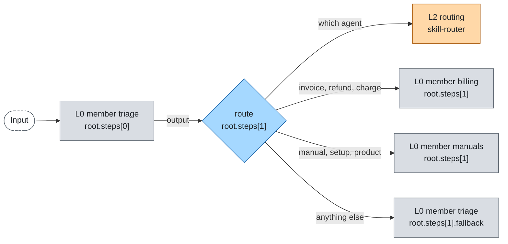

# Topology

Layer id `topology` (L3), Flow plane. *In what order and shape does work flow between agents?*

## Responsibility

Run a topology: a description, as data, of how members are called. The adapter walks the nodes; the core gives it a
scope whose `call` is the `memberCall` pipeline, so a topology cannot reach a member any other way.

## Ports

| Port | What it does |
|---|---|
| [TopologyPort](../../spec/ports/TopologyPort.md) | Declare the `kinds` it runs; `bind` a `TopologySpec` into a `BoundTopology`; `run` it with a `RunScope` |

Data shapes: `TopologySpec`, `Condition`, `MemberResult` and `HopRecord` in [spec/language.md](../../spec/language.md).

The scope of one run has `ctx`, `input`, the topology `limits` (`maxParallel`, `maxIterations`, `maxHandoffs`), and four
functions: `call` (the pipeline), `route` (the AgentRouterPort over registry candidates), `matches` (evaluates a
`Condition`) and `abandon` (marks the hops of a cancelled branch, and has the remote task of a call that ended
waiting cancelled). The core enforces `maxSteps`, time, hops and `maxRepeats` itself, inside `call`, and `maxParallel`
across the run: a call beyond it waits for a slot, first come first served, and is never refused for it. It wraps the
result into a `SystemResult` with the hop record; the result's `usage` and `costUsd` are the core's totals over the
invocation's calls, not what the topology summed.

### Where it sits



## Kinds

A node is a member id or a nested `TopologySpec`. Every kind takes `name?`, `input?` (`"output"`, the previous output, by
default; `"original"`, the system's input) and `ext?`.

| Kind | Meaning | `basic-topology` |
|---|---|---|
| `sequence` | Each step gets the previous step's output; stops at the first step that is not `completed` | implemented |
| `route` | The router picks one candidate; none chosen runs `fallback` or stops with `rejected` (layer `routing`); a routing failure runs `fallback` or ends `failed`, code `error` (layer `routing`) | implemented |
| `loop` | `body` runs until `until` holds; bounded by `maxIterations`, else `limits.system.maxIterations`; never holding stops with `limit` | implemented |
| `parallel` | Fan out and join (`all` or `first`), with an optional `merge` node; branches share the budget evenly | implemented |
| `handoff` | After each answer the member (`ext["plexus.handoff"]`; the bare `ext.handoff` of 0.1.0 is deprecated but still read) or the router picks the next member, or it ends; bounded by `maxHandoffs`, else `limits.system.maxHandoffs`; exceeding stops with `limit`. When the router chooses nobody, the handoff ends with the last member's result and no routing hop is written; when routing fails, it stops `failed`, code `error` (layer `routing`) | implemented |
| `supervise` | The supervisor is called with the node input; while its completed result names `ext["plexus.delegate"] = { member, input? }` (the bare `ext.delegate` of 0.1.0 is deprecated but still read) (member in `members`, else `rejected`, layer `topology`), that member is called with `input` or the supervisor's output, and the supervisor is called again with `[<member>]` then the member's output; it ends with the supervisor's first result without a delegation, or with any result that is not `completed` (`waiting` included); delegations are bounded by `limits.system.maxHandoffs`, exceeding stops with `limit` | implemented |
| `graph` | Explicit state machine: the first edge from a node that applies (`when` holds, or `completed` without `when`) is followed; a `waiting` result follows only an edge whose `when` names `status: "waiting"`, otherwise the graph ends `waiting`; a node visited more than `limits.system.maxIterations` times stops with `limit` | implemented |

`check` refuses a topology that uses a kind the adapter does not run, an unknown member or router, a graph node that
does not exist and a graph end that no edge reaches.

## Standards

None. The topology language is agent-plexus' own; other formats (framework graph definitions) would be import adapters.

## Reference topology

The topology of [`examples/offline`](../../examples/offline/README.md), with the node path each hop record carries. The
edges from the route node are the rules of `skill-router` in that example.



## Boundaries

- Which agent runs is [routing](routing.md); whether a call may happen is the host's `gate`; surviving restarts is
  [execution](execution.md).
- A topology adapter does not read the registry or the host. It receives everything through the scope.
- Node paths identify where a hop was made: `root`, `root.steps[i]`, `root.branches[i]`, `root.merge`, `root.fallback`,
  `root.body#<iteration>`, `root.turns[i]` (handoff), `root.supervisor[i]` and `root.members[i]` (supervise, per
  turn), `root.nodes.<id>` (graph; `#<visit>` from the second visit).
- Every member call site has a node path of its own, the same on every invocation: the journal keys calls by it, so a
  replay finds a call's result only by its path.
- Calls running at the same time pass `share`, and their shares sum to at most 1: a share is a fraction of the budget
  not yet spent, so concurrent branches get even shares whatever order they reserve in.
- Usage and `costUsd` of every call under a node are summed into its result; the system result's totals are the
  core's own, over the calls it made.
- With `join: "first"` the other branches are aborted and their hops marked `abandoned`; attribution skips them.

## Configuration

```json
{
  "topology": {
    "kind": "sequence",
    "steps": [
      "triage",
      { "kind": "route", "candidates": ["billing", "manuals"], "fallback": "triage" }
    ]
  },
  "limits": { "system": { "maxSteps": 20, "maxParallel": 4, "maxIterations": 5 } }
}
```

A `Condition` is data: `{ status?, code?, ext?, matches? }`, or `fn: "<module>#<export>"`, a synchronous pure function
loaded relative to the config file. Limits: [limits.md](../limits.md).

## Telemetry

| Kind | Name |
|---|---|
| span | `plexus.run`, with `plexus.layer` = `topology`, `plexus.system`, then `plexus.run.status` and `plexus.run.reason` |
| event | `plexus.limit` when a system limit or a received bound refuses a call |
| attribute | `plexus.node.path` on hop and route spans |

`plexus.node` and `plexus.node.kind` are declared in the names list but not emitted yet.

## Evaluation

Check the shape of a run through the hop record: `record.map((h) => h.node)` and `record.map((h) => h.member)`. A
system limit that stops a run is attributed to layer `topology` with no member.

## How to swap

Change `ports.topology.adapter`. The topology spec stays as long as the new adapter runs its kinds. LangGraph.js,
ADK-TS and Strands TS are candidates when a team already runs that engine.

## Reference adapters

| Adapter | Maps | Status |
|---|---|---|
| [`basic-topology`](../../adapters/basic-topology) | An in-process executor: `sequence`, `route`, `loop`, `parallel`, `handoff`, `supervise`, `graph` (prototype, production) | implemented |

Full list: [adapters.md](../adapters.md).

## Reference setup

[`examples/offline`](../../examples/offline/README.md): `sequence [triage, route{candidates: [billing, manuals], fallback: triage}]`.
