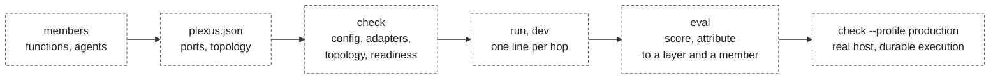
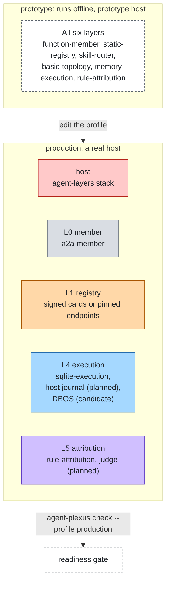

# Product

## Who it is for

Teams that run more than one agent and have to make them work as one system: application developers who want to wire
agents together on a laptop in minutes, and platform teams who have to run that system under the company's identity,
policy and observability.

## The problem

Every orchestration framework owns the loop, the state and the integrations of its agents, and choosing the framework
chooses them too. Agents built with different frameworks cannot join one system without glue, and the glue is where
production breaks:

- nothing carries a deadline, a budget or a hop limit from one agent to the next, so a chain of three agents can run
  three times the limit;
- a failure surfaces as the last agent's error, with no record of which agent or which layer caused it;
- the same control and insight code (identity, policy, content checks, tracing) is rebuilt next to every orchestrator.

## What agent-plexus promises

- **Independent.** The core depends on nothing and runs offline with reference implementations and prototype defaults
  for the hooks.
- **No second control plane.** Authorization, credentials, content checks, telemetry and scoring are host hooks.
  agent-plexus calls them and implements none. In production they must come from a real host.
- **Any agent is a member.** A function, an agent-layers stack in process, and an agent served over A2A (any
  framework or language) through `a2a-member`. Another agent-plexus system works in process through the `fn` option of
  `function-member` (a `SystemResult` extends `MemberResult`), and over the network when it is served over A2A.
- **One call path.** Every member call goes through `memberCall`; topologies cannot reach a member any other way.
- **Bounded.** System limits (steps, depth, parallelism, loops, handoffs, time) are enforced by the core. Deadline,
  budget and hops received from the host are honoured and passed on.
- **Failures land on an agent.** Each run keeps a hop record; attribution names a layer, a member and, when the member
  reports one, the member's own layer.
- **A system is an agent.** A result carries its hop record, so a system can be a member of another one. Exposure over
  the network is the host's: the agent-layers gateway serves a system through the runtime plugin of the `agent-layers`
  adapter.

## The developer journey

1. Write the members: plain functions, or any agent behind an adapter.
2. Write `plexus.json`: members, one adapter per port, a topology.
3. `agent-plexus check` — config, adapters, topology and readiness.
4. `agent-plexus run` and `dev` — one run, or a terminal loop, with one line per hop.
5. `agent-plexus eval` — score a file of cases and attribute each failure.
6. Move to production by editing a profile; `check --profile production` says what still has to change.

## Profile ladder

Profiles are overlays on the base config: objects merge, arrays replace, `null` removes a key. The readiness gate
applies when the profile's `tier` is `production`. Planned adapters and candidates are named but not installed yet.

## Non-goals

- Not an agent runtime: the loop of each agent belongs to the agent.
- Not a control plane: no identity, policy, guard, telemetry or evaluation implementation beyond prototype defaults.
- Not a server: network exposure is the host's.
- Not a protocol: A2A is the wire; the bounds extension is defined once, in the
  [agent-layers proposal](proposals/agent-layers-delegation-bounds.md), and reused.
- No visual builder, no hosted control plane.

## How it compares

| | Scope | Who owns the loop and the controls | Across frameworks |
|---|---|---|---|
| Orchestration frameworks (LangGraph, CrewAI, Microsoft Agent Framework, ADK, Strands, Mastra, ...) | Orchestrate agents of their own kind | The framework | Mostly through A2A, without a shared deadline, budget or hop limit |
| Durable execution engines (Temporal, DBOS, Hatchet) | Survive restarts | The engine | Not agent-aware |
| Agent stacks (agent-layers) | Everything one agent needs: identity, guardrails, telemetry, evaluation | The stack | One agent at a time |
| agent-plexus | The six layers between agents | The host (control and insight); each agent (its loop) | Any agent that can be called, with bounds and attribution |

agent-plexus can use all of these: a framework as a member over A2A, an engine behind ExecutionPort, a stack as the
host. What it adds is the composition between agents. The landscape is in [research/landscape.md](research/landscape.md).
