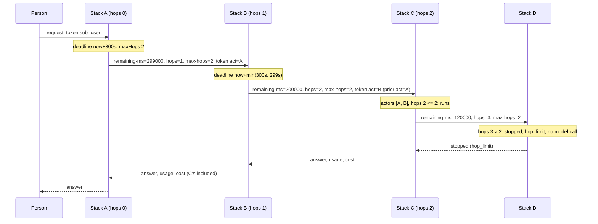

# Proposal for agent-layers: delegation chain, run bounds and hop limit

Target: an architecture decision record in the agent-layers repository (`docs/decisions/NNNN-delegation-bounds.md`,
next free number; 0002 at the time of writing). This file is the proposed text. It is not applied here: the
agent-layers repository changes only through its own review.

---

# NNNN. Every agent bounds its own run and knows who delegated it

Status: Proposed · Date: 2026-11-01 · Decided by: project owner · Supersedes: none · Extends: [0001](0001-sdk-language.md)

Each agent enforces three things at its own boundary, also when it runs alone: a deadline, a budget and a hop limit.
When an agent calls another agent, it passes on what is left of them, and the agent it calls can only make them
tighter. The caller carries the verified chain of agents that acted on its behalf. Multi-agent orchestration stays out
of agent-layers; these are the boundary primitives that make a chain of stacks safe whatever orchestrates it.

## Context

A stack can be called by another agent today (inbound `a2a`, `mcp`, `openai-compatible` with `agent:<name>`) and can
call one (outbound `a2a` runtime, any tool that reaches an agent). What crosses that boundary is the caller, the trace
context, and, on the way back, usage and cost. Four things are missing.

| # | Gap | Where it shows | Effect |
|---|---|---|---|
| 1 | Who acted in between is lost | `oidc` credentials send `subject_token` only (`adapters/oidc/src/credentials.ts`); no `actor_token`; the `act` claim is not read into `Caller` | A tool or a policy sees the user, never the agent chain that reached it. Least privilege per agent cannot be expressed. |
| 2 | No deadline that shrinks across hops | Time limits are per hop: `gateway.requestTimeoutMs` 300000, `a2a` `timeoutMs` 300000 | A chain of three agents can run for three times the limit; a caller that gave up still pays for the work below it. |
| 3 | No budget that crosses a hop | Budgets live in one runtime adapter (`reinloop` `options.budget.*`, `basic-runtime` `maxTurns`); usage and cost come back after the fact (`metadata["agent-layers"]`) | A delegated agent can spend more than the caller had left. Swapping the runtime removes the budget. |
| 4 | No hop count, no stop reason for it | Nothing counts agent-to-agent calls; `stopCode` has no value for it | A loop A → B → A is stopped only by timeouts. An orchestrator cannot tell "too deep" from "out of budget". |

Neither standard fills the gap: A2A 1.0 and MCP 2026-07-28 define no deadline, budget, hop limit or delegation
chain (MCP carries only trace context in `_meta`), and no OAuth working group has adopted an agent delegation draft.
The established practice is outside agent work: gRPC sends the remaining time on each call, SIP decrements
`Max-Forwards` and refuses with a distinct error, Envoy makes retries consume the same deadline.

Constraints from the rest of the design: the core speaks one language and never reads adapter keys (0001); standards
appear only in adapters; every limit is configurable, has a safe range and is checked by the readiness gate
([limits.md](../limits.md)); identity, authorization and guards fail closed.

## Decision

1. **The caller carries its actor chain.** `Caller.actors` lists the agents that acted for the caller, verified from
   the credential by the identity adapter.
2. **Every run has bounds.** `CallContext.bounds` holds the deadline, the remaining budget and the hop count of the
   run. The host computes them when a run starts, from the stack's limits and from what the caller sent.
3. **Tighten only.** Bounds sent by a caller can lower the stack's own limits, never raise them. A caller that lies
   can only stop its own work sooner. (Trust model below.)
4. **The core enforces them, not the runtime.** The host, `guardedModel` and `governedTools` check the bounds, so a
   swapped runtime keeps them.
5. **Delegation passes on what is left.** An adapter that calls another agent sends the remaining bounds through a
   core helper; the wire format belongs to the adapter.
6. **One new stop code.** `hop_limit` joins the core `stopCode` values; deadline and budget reuse `timeout` and
   `limit`.

### Shapes

| Shape | Field | Type | Req | Notes |
|---|---|---|---|---|
| `Caller` | `actors` | [`Actor`] | | Agents that acted for this caller, first delegate first, the agent presenting the credential last. Absent or empty: no delegation known. Part of `PublicCaller`, so guards, events and `AccessQuestion.caller` see it. |
| `Actor` | `id` | S | yes | Identifier of the acting agent at the issuer (an OAuth client id, a workload id). |
| | `kind` | `callerKind` | yes | `agent` in practice; `user` when a person acts for another (support staff). |
| | `name` | S | | Display name. |
| | `issuer` | S | | Who vouches for this entry, when it differs from the credential's issuer. |
| `CallContext` | `bounds` | `Bounds` | | Always present inside a run, filled by the host. A read view of the run's ledger (below); absent in calls made outside a run. |
| | `lineage` | `Lineage` | | Present when the run was started by another agent's run. |
| `Lineage` | `rootRunId`, `parentRunId` | S, S | yes | Correlation across stacks without a trace backend. |
| | `path` | [S] | | Agent names the request went through, as the callers asserted them, oldest first; at most `maxHops` entries. Informational, for loop detection and audit; `Caller.actors` is the verified counterpart. |
| `Bounds` | `deadlineAt` | S | yes | ISO 8601 time, local clock, by which the run must end. |
| | `reserved` | {`tokens`?: N, `costUsd`?: N} | | What calls in flight have reserved and not yet settled. |
| | `hops` | N | yes | Agent-to-agent calls before this run: 0 for a run a person or an event started. |
| | `maxHops` | N | yes | Largest `hops` this chain accepts. |
| | `tokens` | N | | Tokens (input plus output) the run may still spend, delegated runs included. Absent: no token budget. |
| | `costUsd` | N | | Spend the run may still incur, delegated runs included. Absent: no cost budget. |

`Actor` order is chronological on purpose: it reads like the path the request took. Adapters translate: in an RFC 8693
token the outermost `act` claim is the current actor and nested ones are prior actors, so the `oidc` adapter reverses
the nesting. The principal stays `Caller.id` (`sub`); the agent talking to this stack is `actors[actors.length - 1]`.

Vocabulary change: `stopCode` gains the core value `hop_limit`.

| Stop | `RunResult` |
|---|---|
| Deadline reached | `stopped`, `{code: "timeout", layer: "harness", by: "sdk.deadline"}` |
| Token or cost budget spent | `stopped`, `{code: "limit", layer: "harness", by: "sdk.budget"}` |
| Too many hops, refused before the run starts | `stopped`, `{code: "hop_limit", layer: "harness", by: "sdk.hops"}` |
| Too little time left to start | `stopped`, `{code: "timeout", layer: "harness", by: "sdk.deadline"}` |

`sdk.*` names in `by` are the core's own, like `sdk.approval` in `ext`. They are for people and telemetry; consumers
branch on `code` only, as the language requires.

### Computing the bounds of a run

```
now            = local clock when the run starts
deadlineAt     = now + min(limits.run.timeoutMs, inbound.remainingMs)          inbound part only when sent
tokens         = min(limits.run.maxTokens, inbound.tokens)                    absent when both are absent
costUsd        = min(limits.run.maxCostUsd, inbound.costUsd)                  absent when both are absent
verifiedHops   = length(caller.actors) + (caller.kind == "agent" ? 1 : 0)     an agent principal is one hop itself
hops           = max(inbound.hops, verifiedHops)                              0 when neither is known
maxHops        = min(limits.delegation.maxHops, inbound.maxHops)
refuse         when hops > maxHops                                            → hop_limit
refuse         when deadlineAt - now < limits.delegation.minRemainingMs      → timeout
```

The wire carries time as remaining milliseconds, never as a clock time, so clock skew between hosts cannot extend a
deadline. Network latency only shortens it. `hops` takes the larger of the asserted count and the verified actor
chain, so a caller cannot reset it by sending 0 when its credential says otherwise.

### Trust model

Bounds stop bugs everywhere: a loop, a runaway fan-out, a delegate that forgets the caller's deadline. They stop an
adversary only as far as they are verified. Without delegation tokens, `hops`, `remainingMs` and the budget are
asserted by the caller: a hostile intermediate can send `hops=0` and receive this stack's full `limits.run.timeoutMs`,
so a chain of such intermediates is bounded per hop by each stack's own limits, not end to end. With the `oidc`
adapter reading `act`, `hops` comes from the issuer and cannot be reset. On a production-tier profile,
`agent-layers check` warns when the stack accepts agent callers without a verified actor chain and without
`limits.delegation.trustedCallers` (caller ids whose asserted bounds are accepted as they come).

### Enforcement points

| Where | Check | On failure |
|---|---|---|
| Host, when a run starts (`run`, `stream`, channels, triggers) | Computes `bounds`; refuses on `hop_limit` or too little time; arms an abort at `deadlineAt`, merged with `ctx.signal` | `stopped` result, never an exception to the caller |
| `guardedModel`, before each model call | Deadline not passed; `tokens` and `costUsd` above zero | `stopped` with `timeout` or `limit`; the model is not called |
| `guardedModel`, after each reply | Debits `usage` from `tokens`; debits cost when the reply reports one | The next call stops |
| `governedTools`, before each tool call | Deadline not passed; passes `ctx.bounds` to the tool | Error result the model can read (`ok: false`), as for a denial |
| `governedTools`, after each tool call | Debits `ext["sdk.usage"]` and `ext["sdk.costUsd"]` when a tool result reports what a delegated agent spent | |
| Outbound adapters that call an agent | Refuse locally, without a network call, when `hops + 1 > maxHops` or too little time is left; send `outboundBounds(ctx)`; set their own timeout to `min(options.timeoutMs, remaining)`; settle the reservation with the remote run's reported usage and cost | An error result (`ok: false`) or a `stopped` run with the same codes |
| Retries, in any adapter | A retry consumes the same deadline and budget as the first attempt; it never gets a fresh one | |

The runtime still owns its loop and may enforce its own, tighter budgets. What changes is that a runtime without
budgets is no longer unbounded.

### The ledger

Pipelines copy `CallContext` (`{...ctx}`), so a value in it cannot be debited. The host keeps one ledger per run;
`ctx.bounds` reads it, and every copy of the context points to the same ledger. A debit is a single synchronous update
of the ledger, so concurrent calls in one process cannot lose one; a remote agent has its own ledger and reports what
it spent.

Concurrent delegation (parallel branches, a runtime that calls several tools at once) must not let each call see the
whole budget. `outboundBounds(ctx, share?)` therefore **reserves** what it sends: by default everything not yet spent
or reserved, or the `share` (a fraction) the caller asks for, as an orchestrator does for parallel branches. The sum of
reservations never exceeds what is left, so the run cannot overspend. When the call returns, the reservation is
settled: the reported usage and cost are debited and the rest is released. A call whose remote side reports nothing
keeps its whole reservation spent, the safe side.

### Passing bounds on

`outboundBounds(ctx)` is the one core helper adapters use. It returns what to send to the next agent:

| Field | Value |
|---|---|
| `remainingMs` | `deadlineAt - now - limits.delegation.marginMs`; the call is not made when this is below `minRemainingMs` |
| `tokens`, `costUsd` | The reservation: what is left after other reservations, or the requested share of it |
| `hops` | `bounds.hops + 1` |
| `maxHops` | `bounds.maxHops` |
| `rootRunId` | `lineage.rootRunId`, or this run's id when it is the root |
| `parentRunId` | This run's id |
| `path` | `lineage.path` plus this agent's name, cut to the last `maxHops` entries |

The wire format is the adapter's, mapped at the edge like any other field (and overridable through `mappings`):

| Adapter | Outbound | Inbound |
|---|---|---|
| `a2a` | An A2A extension: declared in the card's `capabilities.extensions` with `required: false`, requested with the `A2A-Extensions` header, data in `message.metadata` under the extension URI (A2A keys extension data by its URI) | Read from the same key when the client activated the extension; absent means no inbound bounds |
| `openai-compatible` (inbound `agent:<name>`), `mcp`, `cloudevents`, gateway | One HTTP header, an RFC 9651 structured-field dictionary: `Agent-Bounds: remaining-ms=..., tokens=..., cost-usd=..., hops=..., max-hops=...`, plus `Agent-Lineage: root=..., parent=...` | The gateway parses both into the run's context, bounded in size like `traceparent` |
| `mcp` (outbound tool call to an agent behind MCP) | `params._meta` under a prefixed key (`<prefix>/bounds`), as MCP reserves unprefixed keys | Same |
| `oidc` | Token exchange sends `actor_token` (the stack's own client credential) when `options.actor` is `self`, so the issuer can nest `act` | Reads `act` into `Caller.actors`; `may_act` stays in `ext["oidc.may_act"]` |

W3C Baggage was considered and rejected as the carrier: it is forwarded by telemetry libraries to every downstream
service, including third parties, and every hop can change it without any checking.

### Limits

Declared in `STACK_LIMITS`, documented in [limits.md](../limits.md), checked by the readiness gate.

| Setting | Default | Accepted | Safe range | On production | Why |
|---|---|---|---|---|---|
| `limits.run.timeoutMs` | `300000` ms | 1–∞ or unbounded | 1–3600000 | fail if unbounded | Deadline of a run when the caller sends none; the same default as the `a2a` and gateway time limits. |
| `limits.run.maxTokens` | unbounded | 1–∞ or unbounded | — | warn if unbounded | Tokens one run may spend, delegated runs included. |
| `limits.run.maxCostUsd` | unbounded | 0–∞ or unbounded | — | warn if unbounded | Spend one run may incur, delegated runs included. |
| `limits.delegation.maxHops` | `4` | 0–∞ or unbounded | 0–10 | fail if unbounded | Agent-to-agent calls a chain may make; `0` refuses every delegated run. |
| `limits.delegation.marginMs` | `1000` ms | 0–60000 | — | — | Time kept back on each outbound call for the answer to travel back. |
| `limits.delegation.minRemainingMs` | `1000` ms | 0–60000 | — | — | A run, or an outbound call, does not start with less time than this. |

`limits.delegation.inbound` is a setting next to these, not a number: `"tighten"` (default) applies the caller's
bounds when they are tighter; `"ignore"` drops them, and `hops` then comes from the verified actor chain only.
`limits.delegation.trustedCallers` lists caller ids (services in the same trust domain) whose asserted bounds and hop
count are taken as they come; it silences the production warning of the trust model.

### Telemetry

| Kind | Name |
|---|---|
| attribute on `agent.run` | `agent.run.hops`, `agent.run.max_hops`, `agent.run.root`, `agent.run.parent`, `agent.run.deadline_ms` (remaining when the run started) |
| attribute on `agent.run` | `agent.caller.actors` (actor ids, in order) |
| metric | `agent.bounds.stops`, by `agent.run.reason` (`timeout`, `limit`, `hop_limit`) |

### Authorization

`AccessQuestion.caller` carries `actors`, so a policy can allow a tool only when a given agent is the current actor,
or refuse calls that went through an agent it does not trust. RFC 8693 states that only the current actor counts for
access control and prior actors are informational; `rules-authorization` follows that by default and matches prior
actors only when a rule asks for them explicitly.

## Diagram



## Consequences

- Language 1.0 → 1.1, additive: optional fields on `Caller` and `CallContext`, three shapes (`Actor`, `Bounds`,
  `Lineage`), one core `stopCode` value. Ports whose
  shapes gain fields take a minor version: every port that receives `CallContext` or `Caller` (the common types), so
`ModelPort`, `RouterPort`, `ToolPort`, `KnowledgePort` as well as `IdentityPort`, `RuntimePort`, `ChannelPort`,
`AuthorizationPort`.
- `packages/core`: bounds computation and the run ledger in the host, checks in `guardedModel` and `governedTools`,
  `outboundBounds` with reservations, six limits and two settings in `STACK_LIMITS`.
- Adapters: `a2a` (both directions), `oidc` (`act` in, `actor_token` out), `openai-compatible` inbound, `mcp`,
  `cloudevents`, `rules-authorization` (actor rules), `otlp` (attribute mapping). Runtimes need no change beyond
  honouring `ctx.signal` and passing `ctx` on, which they already do.
- Conformance: `checkChannel` gains inbound cases (bounds parsed, hop limit refused, tighten only); a new
  `checkDelegation` covers outbound adapters (hops + 1, remaining time shrinks, budget debited).
- A stack used alone behaves as before except that every run now has a deadline (`limits.run.timeoutMs`), which the
  production gate requires to be bounded.

## Alternatives considered

| Alternative | Why not |
|---|---|
| Bounds in `ext` | The core must read them to enforce them; 0001 keeps `ext` unread by the core. |
| Absolute deadline on the wire | Clock skew between hosts would extend or cut deadlines silently. |
| Trust the caller's bounds as sent | A caller could raise its own limits; tighten only costs nothing. |
| Enforce only in an orchestrator | An agent reachable over A2A must defend itself whoever calls it. |
| Signed hop limit in the token (an individual draft defines `del_max_depth`) | Not adopted by any working group yet; an identity adapter can map it to `maxHops` when it is. |
| Hop count from the token only | Not every deployment issues delegation tokens; the asserted count still bounds loops, and the token, when present, stops a caller from resetting it. |
| A stop code per bound (`deadline`, `budget`) | `timeout` and `limit` already mean that; `by` tells them apart. Hops are different: they point at the topology, not at the spending. |

## Open questions

1. Does the stop code (the code only, never `layer`, `by` or `detail`) of `timeout`, `limit` and `hop_limit` leave the
   stack in the A2A task metadata, so a calling agent can tell "too deep" from "out of budget"? Today the reason never
   leaves the stack; guard and denial codes would stay inside either way.
2. Where does the cost of a model call come from for `costUsd` enforcement: a price table in the router, the model
   adapter, or only the costs that runtimes and remote agents report?
3. Is `maxHops` 4 the right default, and should a repeated agent in `actors` (A → B → A) be refused by default or only
   counted?
4. Should `options.actor: "self"` become the default of `oidc` credentials once the reference identity provider
   supports actor tokens in token exchange?
