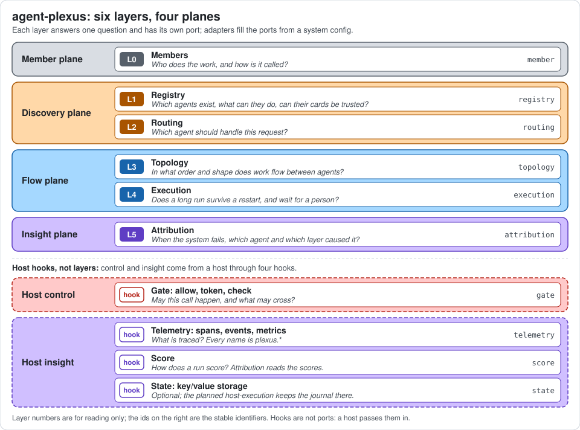
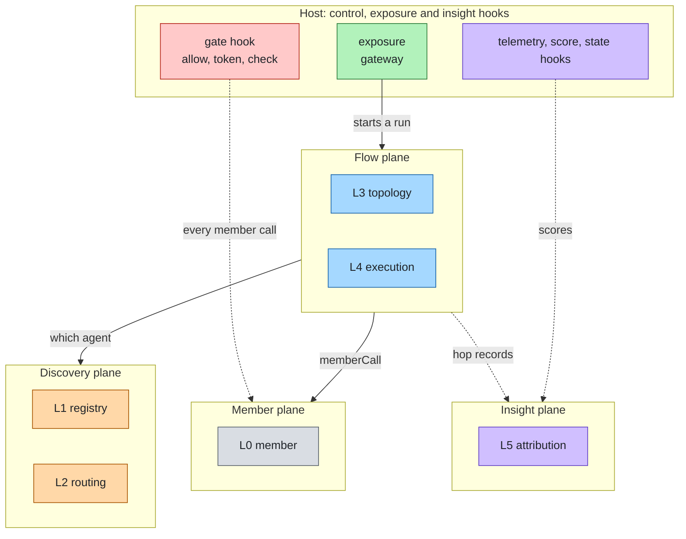
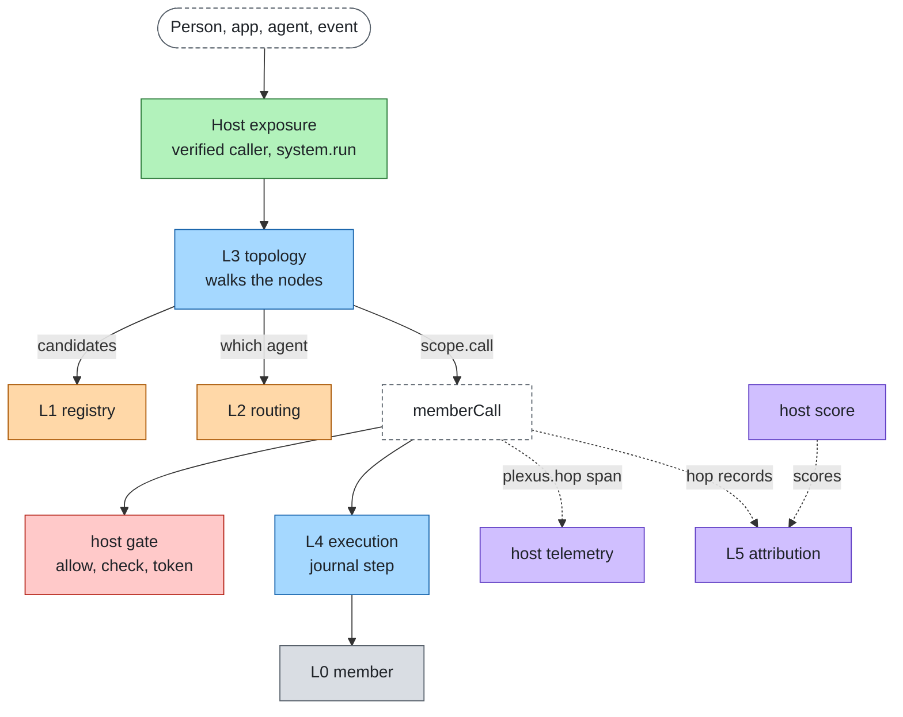
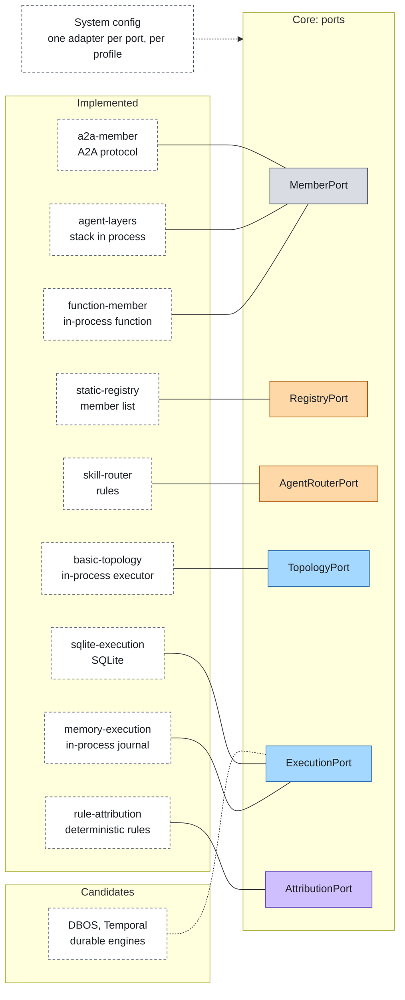

# The system on one page

A multi-agent system needs six layers between its agents. agent-plexus names them, gives each one a port and composes
adapters for them from a config. The core is technology neutral: every framework or protocol below is an adapter, and
each can be swapped by changing one line of config. The design is in [architecture.md](architecture.md).

## Layers by plane

| Plane | L | Layer (id) | The question it answers | Port | Reference adapters |
|---|---|---|---|---|---|
| Member | L0 | [Members](layers/member.md) (`member`) | Who does the work, and how is it called? | MemberPort | `function-member`, `agent-layers`, `a2a-member` |
| Discovery | L1 | [Registry](layers/registry.md) (`registry`) | Which agents exist, what can they do, can their cards be trusted? | RegistryPort | `static-registry`; AGNTCY Agent Directory and Kubernetes CRDs are candidates |
| Discovery | L2 | [Routing](layers/routing.md) (`routing`) | Which agent should handle this request? | AgentRouterPort | `skill-router`; `model-router` and `knowledge-router` planned |
| Flow | L3 | [Topology](layers/topology.md) (`topology`) | In what order and shape does work flow between agents? | TopologyPort | `basic-topology` (`sequence`, `route`, `loop`, `parallel`, `handoff`, `graph`); `supervise` planned |
| Flow | L4 | [Execution](layers/execution.md) (`execution`) | Does a long run survive a restart, and wait for a person? | ExecutionPort | `memory-execution`, `sqlite-execution`; `host-execution` planned; DBOS, Temporal, Hatchet are candidates |
| Insight | L5 | [Attribution](layers/attribution.md) (`attribution`) | When the system fails, which agent and which layer caused it? | AttributionPort | `rule-attribution`; `judge-attribution`, `replay-attribution` planned |

The full catalog with status and maturity is in [adapters.md](adapters.md). Layer ids are stable; the numbers are for
reading only.

Boundary rules: how one agent is reached is `member`; choosing it is `routing`; the order of calls is `topology`;
surviving restarts is `execution`. Whether a call may happen, what may cross, what is traced and how a run scores
belong to the host.

## Planes at a glance

The member plane does the work, the discovery plane finds and chooses, the flow plane orders and keeps, the insight
plane explains failures. The host brings control and exposure.

## Request flow

A host starts a run with the verified caller and the bounds it holds. The topology walks its nodes. A `route` node asks
the core, which reads candidates from the registry and hands them to the router. Every member call goes through `memberCall`: the host's gate
allows, checks what is sent, mints a token for the member's audience; the call runs as a journal step; the gate checks
what comes back; a hop record is written. Telemetry names every span `plexus.*`. Attribution reads the hop records and
the host's scores.

## Ports and adapters

The core defines the ports. An adapter maps a framework, a protocol or one technology onto a port, and the system
config picks one per port.

## Where agent-plexus stops and agent-layers starts

agent-layers composes the eleven layers of one agent. agent-plexus composes agents. Where a concern already has an
agent-layers layer, agent-plexus calls a host hook instead of implementing it.

| Concern | agent-layers layer | agent-plexus |
|---|---|---|
| Verify the caller | L6 `identity` | Receives the caller already verified, in the run context |
| Authorize, approve, mint a token per audience | L6 `identity` | Calls the host's `gate.allow` and `gate.token` for every member call |
| Content checks | L7 `guardrail` | Calls the host's `gate.check` on what is sent to and received from a member |
| Deadline, budget, hops of one agent | the [proposed bounds primitives](proposals/agent-layers-delegation-bounds.md) | Honours what the host passes in, reserves per member call, passes the rest on |
| Spans, events, metrics | L9 `telemetry` | Emits `plexus.*` names through the host's telemetry hook |
| Scoring a run | L10 `eval` | Calls the host's `score` hook; adds attribution across hops |
| Network exposure | L8 `interface`, gateway | None: the host serves the system |
| Durable state of one agent | L3 `harness` StatePort | Its own journal across member calls; may store it in the host's `state` hook (planned `host-execution`) |
| How an agent is called, discovery, routing between agents, topology, cross-agent attribution | none | The six layers |

The `agent-layers` adapter is the only package that depends on agent-layers; the core never names it. It has three
descriptors:

- the `agent-layers` host: `gate` from the stack's authorization, approval, credentials and guards, `telemetry`, and
  `score`. It provides no `state`: agent-layers' StatePort is an append-only event log per session, not a key/value
  store;
- the `agent-layers` member: an agent of a stack, in process. Deadline, hops and budget are not passed on yet, because
  agent-layers has no bounds;
- the runtime plugin `agent-plexus`: an agent-layers RuntimePort that runs a system, loaded through the `plugins` of the
  agent-layers config (`@agent-plexus/adapter-agent-layers/runtime`), so the gateway exposes the system.

The stack's tools as the tool source of a `supervise` topology are planned.

## Cross-cutting concerns

| Concern | Spans | Doc |
|---|---|---|
| Security | member, registry, topology, host gate | [security.md](cross-cutting/security.md) |
| Limits | every layer | [limits.md](limits.md) |
